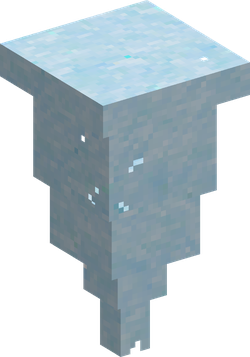

# Kira Kira no Mi

| | |
|---|---|
| **Type** | Paramecia |
| **Abilities** | 3: 2 active, 1 passive |

In 3D: drag to turn, scroll or pinch to zoom.

These abilities unlock once the fruit is **awakened**: see [Awakening](../index.md#getting-started).

!!! note "About the values"
    The values are those of the ability's tooltip in game, with the base mod's default settings. Damage is shown on the base mod's scale, as in the ability screen.

## Glittering Storm { #glittering-storm }

{ .ability-icon } *Active*

{ .form-picture }

Creates a tornado of diamond shards the user can steer, wrecking everything in its path and hurting enemies caught in it every 0.75 seconds.

| Stat | Value |
|---|---|
| Cooldown | 60 s |
| Hold | 8 s |
| Damage | 15 |

## Brilliant Meteor { #brilliant-meteor }

{ .ability-icon } *Active*

The user rips a huge diamond block out of the ground and throws it, it shatters into shards where it lands.

If Diamond Body is active it deals 50% more damage.

| Stat | Value |
|---|---|
| Cooldown | 30 s |
| Charge | 2 s |
| Range | 6 blocks (area) |
| Damage | 70 |

## Unscratchable { #unscratchable }

{ .ability-icon } *Passive*

While Diamond Body is active hits too weak to scratch diamond don't hurt the user at all.

Armament Haki still breaks through.

| Stat | Value |
|---|---|
| Damage | <15 |
