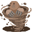

# Mogu Mogu no Mi

| | |
|---|---|
| **Type** | Zoan |
| **Abilities** | 2: 2 active, 0 passive |
| **Effects applied** | { .effect-mini .pixelated }[Ground Dig](../effects.md#effect-ground-dig), { .effect-mini .pixelated }[Ground Dig Break](../effects.md#effect-ground-dig-break) |

These abilities unlock once the fruit is **awakened**: see [Awakening](../index.md#getting-started).

!!! note "About the values"
    The values are those of the ability's tooltip in game, with the base mod's default settings. Damage is shown on the base mod's scale, as in the ability screen.

## Mogu Dig { #mogu-dig }

{ .ability-icon } *Active*

Applies { .effect-mini .pixelated }[Ground Dig](../effects.md#effect-ground-dig), { .effect-mini .pixelated }[Ground Dig Break](../effects.md#effect-ground-dig-break)

**Modes**

- **Normal Mode**: Lets the user swim through blocks after running into the ground
- **Break Mode**: Lets the user swim through blocks, breaking them along the way.

| Stat | Value |
|---|---|
| Hold | ∞ s |
| Cooldown | 1 s |

## Subterranean Dash { #subterranean-dash }

{ .ability-icon } *Active*

Dashes forward really fast while burrowing underground.

| Stat | Value |
|---|---|
| Cooldown | 6 s |
| Range | 1.6 blocks (area) |
| Damage | 25 |
