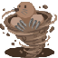

# Mogu Mogu no Mi

| | |
|---|---|
| **Type** | Zoan |
| **Abilities** | 3: 3 active, 0 passive |
| **Transformations** | [Awaken Mogu Heavy Point](#awaken-mogu-heavy-point) |

These abilities unlock once the fruit is **awakened**: see [Awakening](../index.md#getting-started).

!!! note "About the values"
    The values are those of the ability's tooltip in game, with the base mod's default settings. Damage is shown on the base mod's scale, as in the ability screen.

## Awaken Mogu Heavy Point { #awaken-mogu-heavy-point }

{ .ability-icon } *Active · Transformation*

Transforms the user into an awakened mole hybrid, which focuses on strength and digging.

| Stat | Value |
|---|---|
| Cooldown | 1 s |
| Hold | ∞ s |

**Stats while active**

| Stat | Value |
|---|---|
| Armor | +10 |
| Speed | +1.05 |
| Block Reach | -0.5 |
| Step Height | +1 |
| Punch Damage | +12 |
| Regen Rate | +0.25 |
| Toughness | +4 |
| Jump Height | +3.5 |
| Entity Reach | -0.5 |
| Mining Speed | +10 |
| Attack Speed | +0.3 |

## Mogu Dig { #mogu-dig }

{ .ability-icon } *Active*

**Modes**

- **Normal Mode**: Lets the user swim through blocks after running into the ground
- **Break Mode**: Lets the user swim through blocks, breaking them along the way.

| Stat | Value |
|---|---|
| Hold | ∞ s |
| Cooldown | 1 s |

## Subterranean Dash { #subterranean-dash }

{ .ability-icon } *Active*

Dashes forward really fast while burrowing underground.

| Stat | Value |
|---|---|
| Cooldown | 6 s |
| Range | 1.6 blocks (area) |
| Damage | 25 |
