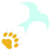

# Neko Neko no Mi, Model: Leopard

| | |
|---|---|
| **Type** | Zoan |
| **Abilities** | 11: 11 active, 0 passive |
| **Transformations** | [Awaken Leopard Heavy Point](#awaken-leopard-heavy-point), [Awaken Leopard Walk Point](#awaken-leopard-walk-point) |

These abilities unlock once the fruit is **awakened**: see [Awakening](../index.md#getting-started).

!!! note "About the values"
    The values are those of the ability's tooltip in game, with the base mod's default settings. Damage is shown on the base mod's scale, as in the ability screen.

## Awaken Leopard Heavy Point { #awaken-leopard-heavy-point }

{ .ability-icon } *Active · Transformation*

Transforms the user into an awakened leopard hybrid, which focuses on strength and speed.

| Stat | Value |
|---|---|
| Cooldown | 1 s |
| Hold | ∞ s |

**Stats while active**

| Stat | Value |
|---|---|
| Armor | +10 |
| Speed | x2.5 |
| Step Height | +1 |
| Punch Damage | +20 |
| Regen Rate | +0.5 |
| Toughness | +4 |
| Fall Resistance | +8 |
| Jump Height | +5 |
| Attack Speed | 0 |

## Awaken Leopard Walk Point { #awaken-leopard-walk-point }

{ .ability-icon } *Active · Transformation*

Transforms the user into an awakened leopard, which focuses on speed.

| Stat | Value |
|---|---|
| Cooldown | 1 s |
| Hold | ∞ s |

**Stats while active**

| Stat | Value |
|---|---|
| Speed | +1.47 |
| Step Height | +1 |
| Punch Damage | +15 |
| Regen Rate | +0.5 |
| Toughness | +2 |
| Fall Resistance | +9.5 |
| Jump Height | +3.5 |
| Attack Speed | +0.75 |

## Shugan { #shugan }

{ .ability-icon } *Active*

The user pulls back a hand with all 5 claws out, jumps at the enemy in front and stabs the whole hand through them. Armour does not stop it.

Requires the awakened Heavy Point. Shares its cooldown with Shigan.

| Stat | Value |
|---|---|
| Cooldown | 25 s |
| Damage | 55 |
| Range (blocks) | 8 |

## Shugan: Madara { #shugan-madara }

{ .ability-icon } *Active*

The user stabs with both clawed hands one after the other, 10 stabs in 1.5 seconds, at every enemy in reach in front. Armour does not stop them and the last stab knocks the enemies back.

Requires the awakened Heavy Point. Shares its cooldown with Shigan.

| Stat | Value |
|---|---|
| Cooldown | 30 s |
| Damage | 9 |
| Stabs | 10 |
| Range (blocks) | 3.5 |

## Tobu Shigan "Bachi" { #tobu-shigan-bachi }

{ .ability-icon } *Active*

The user flicks 3 bullets of compressed air from their claws one after the other, each one goes where the user is looking when it is fired.

Requires the awakened Heavy Point. Shares its cooldown with Shigan.

| Stat | Value |
|---|---|
| Projectile damage | 12 |
| Cooldown | 12 s |
| Shots | 3 |
| Range (blocks) | 32 |

## Rankyaku "Gaicho" { #rankyaku-gaicho }

{ .ability-icon } *Active*

The user kicks a blade of air shaped like a big bird with open wings. It cuts every enemy in its way and breaks on the first wall it hits.

Requires the awakened Heavy Point. Shares its cooldown with Rankyaku.

| Stat | Value |
|---|---|
| Projectile damage | 54 |
| Cooldown | 18 s |
| Range (blocks) | 40 |

## Rankyaku "Hyobi" { #rankyaku-hyobi }

{ .ability-icon } *Active*

The user spins around and their tail throws a curved blade of air all around them, cutting every enemy it reaches and knocking them back.

Requires the awakened Heavy Point. Shares its cooldown with Rankyaku.

| Stat | Value |
|---|---|
| Cooldown | 12 s |
| Damage | 36 |
| Range (blocks) | 6.5 |

## Tekkai "Utsugi" { #tekkai-utsugi }

{ .ability-icon } *Active*

The user hardens their body for a moment. Every hit that lands in that time is blocked and an enemy that hit from up close takes their own hit back and gets knocked away.

Requires the awakened Heavy Point. Shares its cooldown with Tekkai.

| Stat | Value |
|---|---|
| Cooldown | 4–15 s |
| Hold | 1 s |
| Damage | 45 |
| Range (blocks) | 5 |

## Sai Dai Rin: Rokuogan { #sai-dai-rin-rokuogan }

{ .ability-icon } *Active*

The user puts both fists on the enemy in front of them, charges up all their strength and releases it as a shockwave through the enemy's body. Armour does not stop it. The enemy has to be in reach when it is released.

Requires the awakened Heavy Point. Shares its cooldown with Rokuogan.

| Stat | Value |
|---|---|
| Cooldown | 40 s |
| Charge | 2 s |
| Damage | 100 |
| Range (blocks) | 2.5 |

## Mauling { #mauling }

{ .ability-icon } *Active*

The leopard jumps on the enemy in front of it, pins it down and bites it many times, then throws it away with a last bite. Neither of them can move until it is over.

Requires the awakened Walk Point.

| Stat | Value |
|---|---|
| Cooldown | 3–27 s |
| Damage | 10 |
| Bites | 5 |
| Last Bite | 30 |
| Range (blocks) | 8 |

## Tail Hold { #tail-hold }

{ .ability-icon } *Active*

The user's tail wraps around the closest enemy in front and holds them so they can't move. The user still has both hands free and can walk and attack while holding them.

Requires the awakened Heavy Point. Using Sai Dai Rin: Rokuogan lets go of the enemy when it hits.

| Stat | Value |
|---|---|
| Cooldown | 3–20 s |
| Hold | 3 s |
| Range (blocks) | 4 |
