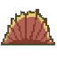
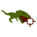

# Ryu Ryu no Mi, Model: Allosaurus

| | |
|---|---|
| **Type** | Ancient Zoan |
| **Abilities** | 2: 2 active, 0 passive |

These abilities unlock once the fruit is **awakened**: see [Awakening](../index.md#getting-started).

!!! note "About the values"
    The values are those of the ability's tooltip in game, with the base mod's default settings. Damage is shown on the base mod's scale, as in the ability screen.

## Ancient Spine Saw { #ancient-spine-saw }

{ .ability-icon } *Active*

The user rolls forward along its spined back, cutting everything in its path.

| Stat | Value |
|---|---|
| Cooldown | 60 s |
| Hold | 10 s |
| Damage | 120 |

## Apex Pursuit { #apex-pursuit }

{ .ability-icon } *Active*

Marks the target the allosaurus is looking at and chases it down way faster than it can run.

When the target is close enough the allosaurus slams its upper jaw down on it and makes it bleed.

| Stat | Value |
|---|---|
| Cooldown | 30 s |
| Hold | 8 s |
| Damage | 60 |
| Range (blocks) | 48 |
