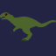
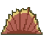
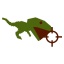

# Ryu Ryu no Mi, Model: Allosaurus

| | |
|---|---|
| **Type** | Ancient Zoan |
| **Abilities** | 4: 4 active, 0 passive |
| **Transformations** | [Awaken Allosaurus Heavy Point](#awaken-allosaurus-heavy-point), [Awaken Allosaurus Walk Point](#awaken-allosaurus-walk-point) |

These abilities unlock once the fruit is **awakened**: see [Awakening](../index.md#getting-started).

!!! note "About the values"
    The values are those of the ability's tooltip in game, with the base mod's default settings. Damage is shown on the base mod's scale, as in the ability screen.

## Awaken Allosaurus Heavy Point { #awaken-allosaurus-heavy-point }

{ .ability-icon } *Active · Transformation*

Transforms the user into an awakened allosaurus hybrid, which focuses on strength

| Stat | Value |
|---|---|
| Cooldown | 1 s |
| Hold | ∞ s |

**Stats while active**

| Stat | Value |
|---|---|
| Armor | +20 |
| Speed | +1.4 |
| Step Height | +1 |
| Punch Damage | +18 |
| Regen Rate | +0.5 |
| Toughness | +5 |
| Fall Resistance | +5 |
| Entity Reach | +0.2 |
| Jump Height | +4 |

## Awaken Allosaurus Walk Point { #awaken-allosaurus-walk-point }

{ .ability-icon } *Active · Transformation*

Transforms the user into an awakened allosaurus, which focuses on speed

| Stat | Value |
|---|---|
| Cooldown | 1 s |
| Hold | ∞ s |

**Stats while active**

| Stat | Value |
|---|---|
| Armor | +30 |
| Speed | +0.21 |
| Block Reach | +0.75 |
| Knockback Resistance | +3 |
| Step Height | +2 |
| Punch Damage | +35 |
| Regen Rate | +0.5 |
| Toughness | +6 |
| Fall Resistance | +4.5 |
| Entity Reach | +0.75 |
| Jump Height | +2.4 |
| Attack Speed | +0.1 |

## Ancient Spine Saw { #ancient-spine-saw }

{ .ability-icon } *Active*

The user rolls forward along its spined back, cutting everything in its path.

| Stat | Value |
|---|---|
| Cooldown | 60 s |
| Hold | 10 s |
| Damage | 45 |

## Apex Pursuit { #apex-pursuit }

{ .ability-icon } *Active*

Marks the target the allosaurus is looking at and chases it down way faster than it can run.

When the target is close enough the allosaurus slams its upper jaw down on it and makes it bleed.

| Stat | Value |
|---|---|
| Cooldown | 30 s |
| Hold | 8 s |
| Damage | 60 |
| Range (blocks) | 48 |
