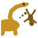

# Ryu Ryu no Mi, Model: Brachiosaurus

| | |
|---|---|
| **Type** | Ancient Zoan |
| **Abilities** | 2: 2 active, 0 passive |

These abilities unlock once the fruit is **awakened**: see [Awakening](../index.md#getting-started).

!!! note "About the values"
    The values are those of the ability's tooltip in game, with the base mod's default settings. Damage is shown on the base mod's scale, as in the ability screen.

## Brachio Stomp { #brachio-stomp }

{ .ability-icon } *Active*

The user stomps the ground a bunch of times, damaging everyone around them with each stomp

| Stat | Value |
|---|---|
| Cooldown | 60 s |
| Damage | 20 |
| Range | 8 blocks (area) |

## Neck Catapult { #neck-catapult }

{ .ability-icon } *Active*

The brachiosaurus lowers its neck, picks up whoever is in front of it and throws them really far.

Enemies take big damage when they land, allies land safely and get a speed boost.

| Stat | Value |
|---|---|
| Cooldown | 20 s |
| Charge | 1 s |
| Damage | 60 |
| Range (blocks) | 20 |
| Throw Distance (blocks) | 40 |
