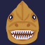
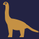
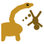

# Ryu Ryu no Mi, Model: Brachiosaurus

| | |
|---|---|
| **Type** | Ancient Zoan |
| **Abilities** | 4: 4 active, 0 passive |
| **Transformations** | [Awaken Brachiosaurus Heavy Point](#awaken-brachiosaurus-heavy-point), [Awaken Brachiosaurus Guard Point](#awaken-brachiosaurus-guard-point) |

These abilities unlock once the fruit is **awakened**: see [Awakening](../index.md#getting-started).

!!! note "About the values"
    The values are those of the ability's tooltip in game, with the base mod's default settings. Damage is shown on the base mod's scale, as in the ability screen.

## Awaken Brachiosaurus Heavy Point { #awaken-brachiosaurus-heavy-point }

{ .ability-icon } *Active · Transformation*

Transforms the user into an awakened brachiosaurus hybrid, which focuses on strength.

| Stat | Value |
|---|---|
| Cooldown | 1 s |
| Hold | ∞ s |

**Stats while active**

| Stat | Value |
|---|---|
| Armor | +25 |
| Speed | +0.7 |
| Knockback Resistance | +2 |
| Step Height | +1.5 |
| Punch Damage | +16 |
| Regen Rate | +0.5 |
| Toughness | +8 |
| Fall Resistance | +5 |
| Entity Reach | +1 |
| Jump Height | +2 |
| Max Health | +100 |
| Attack Speed | 0 |

## Awaken Brachiosaurus Guard Point { #awaken-brachiosaurus-guard-point }

{ .ability-icon } *Active · Transformation*

Transforms the user into an awakened brachiosaurus, which focuses on defense.

| Stat | Value |
|---|---|
| Cooldown | 1 s |
| Hold | ∞ s |

**Stats while active**

| Stat | Value |
|---|---|
| Armor | +30 |
| Block Reach | +8.25 |
| Knockback Resistance | +3 |
| Step Height | +1.5 |
| Regen Rate | +0.5 |
| Fall Resistance | +10 |
| Attack Speed | +0.1 |
| Speed | +0.14 |
| Punch Damage | +10 |
| Toughness | +30 |
| Entity Reach | +8.25 |
| Jump Height | +1.5 |
| Max Health | x1.5 |

## Brachio Stomp { #brachio-stomp }

{ .ability-icon } *Active*

The user stomps the ground a bunch of times, damaging everyone around them with each stomp

| Stat | Value |
|---|---|
| Cooldown | 60 s |
| Damage | 20 |
| Range | 8 blocks (area) |

## Neck Catapult { #neck-catapult }

{ .ability-icon } *Active*

The brachiosaurus lowers its neck, picks up whoever is in front of it and throws them really far.

Enemies take big damage when they land, allies land safely and get a speed boost.

| Stat | Value |
|---|---|
| Cooldown | 20 s |
| Charge | 1 s |
| Damage | 60 |
| Range (blocks) | 20 |
| Throw Distance (blocks) | 40 |
