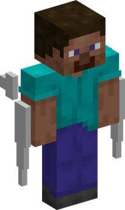

# Supa Supa no Mi

| | |
|---|---|
| **Type** | Paramecia |
| **Abilities** | 3: 3 active, 0 passive |
| **Zones** | [Kenzan World](#kenzan-world) |

In 3D: drag to turn, scroll or pinch to zoom.

These abilities unlock once the fruit is **awakened**: see [Awakening](../index.md#getting-started).

!!! note "About the values"
    The values are those of the ability's tooltip in game, with the base mod's default settings. Damage is shown on the base mod's scale, as in the ability screen.

## Kenzan World { #kenzan-world }

{ .ability-icon } *Active · Zone*

Turns the ground into blades that cut enemies walking on it, and every cut makes them bleed more.

Sprinting doubles the damage, crouching halves it and does not make the bleeding worse, only flying off the ground gets away from it.

| Stat | Value |
|---|---|
| Cooldown | 120 s |
| Charge | 3–12 s |
| Zone Radius (blocks) | 128 |
| Effect Pulse (s) | 2 |
| Damage | 8 |

## Razor Cyclone { #razor-cyclone }

{ .ability-icon } *Active*

{ .form-picture }

The user turns into a whirlwind of blades that moves forward, cutting every enemy it goes through and making them bleed.

Inside the user's Kenzan World the whirlwind is bigger and hits harder.

| Stat | Value |
|---|---|
| Cooldown | 30 s |
| Hold | 6 s |
| Range | 3.5 blocks (area) |
| Damage | 14 |

## Steel Riposte { #steel-riposte }

{ .ability-icon } *Active*

The user hardens their steel body for a moment and the first hit that lands in that time is fully blocked.

Then the user appears behind the attacker and cuts them, making them bleed.

| Stat | Value |
|---|---|
| Cooldown | 4–18 s |
| Hold | 2 s |
| Damage | 60 |
