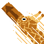

# Ushi Ushi no Mi, Model: Giraffe

| | |
|---|---|
| **Type** | Zoan |
| **Abilities** | 4: 4 active, 0 passive |
| **Transformations** | [Awaken Giraffe Heavy Point](#awaken-giraffe-heavy-point), [Awaken Giraffe Walk Point](#awaken-giraffe-walk-point) |

These abilities unlock once the fruit is **awakened**: see [Awakening](../index.md#getting-started).

!!! note "About the values"
    The values are those of the ability's tooltip in game, with the base mod's default settings. Damage is shown on the base mod's scale, as in the ability screen.

## Awaken Giraffe Heavy Point { #awaken-giraffe-heavy-point }

{ .ability-icon } *Active · Transformation*

Transforms the user into an awakened giraffe hybrid, which focuses on strength and reach.

| Stat | Value |
|---|---|
| Cooldown | 1 s |
| Hold | ∞ s |

**Stats while active**

| Stat | Value |
|---|---|
| Armor | +15 |
| Speed | +0.7 |
| Block Reach | +2.5 |
| Step Height | +1 |
| Punch Damage | +8 |
| Regen Rate | +0.25 |
| Toughness | +7.5 |
| Fall Resistance | +4 |
| Jump Height | +5 |
| Entity Reach | +2.5 |
| Attack Speed | +0.3 |

## Awaken Giraffe Walk Point { #awaken-giraffe-walk-point }

{ .ability-icon } *Active · Transformation*

Transforms the user into an awakened giraffe, which focuses on speed and reach.

| Stat | Value |
|---|---|
| Cooldown | 1 s |
| Hold | ∞ s |

**Stats while active**

| Stat | Value |
|---|---|
| Armor | +14 |
| Speed | +0.84 |
| Block Reach | +1.65 |
| Step Height | +1 |
| Punch Damage | +2.5 |
| Regen Rate | +0.25 |
| Toughness | +4 |
| Fall Resistance | +0.5 |
| Jump Height | +0.75 |
| Entity Reach | +1.65 |
| Attack Speed | +0.25 |

## Longneck Ram { #longneck-ram }

{ .ability-icon } *Active*

**Normal Mode**: Squeezes the neck and shoots the head forward, hitting enemies with a powerful nose strike.

| Stat | Value |
|---|---|
| Cooldown | 8 s |
| Damage | 20 |

**Awaken Mode**: While awakened the head shoots out faster and hits harder.

| Stat | Value |
|---|---|
| Cooldown | 26 s |
| Damage | 80 |

## Neck Hammer { #neck-hammer }

{ .ability-icon } *Active*

Pulls the long neck back and slams the head down on the enemy in front from high above.

If the target is guarding the guard breaks and they can't guard again for a while, shields get knocked aside too.

| Stat | Value |
|---|---|
| Cooldown | 18 s |
| Charge | 1 s |
| Damage | 60 |
| Range (blocks) | 12 |
| Guards Locked (s) | 8 |
