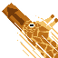

# Ushi Ushi no Mi, Model: Giraffe

| | |
|---|---|
| **Type** | Zoan |
| **Abilities** | 2: 2 active, 0 passive |

These abilities unlock once the fruit is **awakened**: see [Awakening](../index.md#getting-started).

!!! note "About the values"
    The values are those of the ability's tooltip in game, with the base mod's default settings. Damage is shown on the base mod's scale, as in the ability screen.

## Longneck Ram { #longneck-ram }

{ .ability-icon } *Active*

**Normal Mode**: Squeezes the neck and shoots the head forward, hitting enemies with a powerful nose strike.

| Stat | Value |
|---|---|
| Cooldown | 8 s |
| Damage | 20 |

**Awaken Mode**: While awakened the head shoots out faster and hits harder.

| Stat | Value |
|---|---|
| Cooldown | 26 s |
| Damage | 80 |

## Neck Hammer { #neck-hammer }

{ .ability-icon } *Active*

Pulls the long neck back and slams the head down on the enemy in front from high above.

If the target is guarding the guard breaks and they can't guard again for a while, shields get knocked aside too.

| Stat | Value |
|---|---|
| Cooldown | 18 s |
| Charge | 1 s |
| Damage | 60 |
| Range (blocks) | 12 |
| Guards Locked (s) | 8 |
