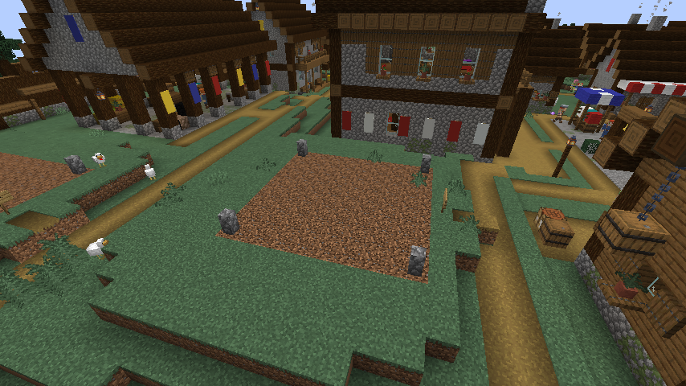
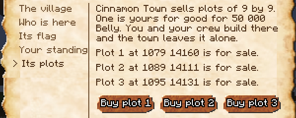

# Towns

One new place in three is a **town** (one in four in a world made before 0.6.0): a [village](villages.md) with quarters round it, a wall, guards, and four buildings no village has. Everything a village does, a town does too; this page tells what it has more.

!!! note "Only in new land"
    Towns came with 0.4.0 and stand in land that has not been explored yet. Villages already made stay as they are, and keep their names.

## What a town is

A town is a village's square, tavern and hall with quarters round them: streets of houses on either side, a craftsmen's street, a row of houses behind the hall or above the port.

| | A village | A town |
|---|---|---|
| Houses | a village's | about twice as many |
| People | a village's | more than twice as many |
| Workshops | four to six trades | one of every trade |
| Wall and guards | none | a wall with gates, guards at the barracks |
| Merchants | they come and go | always there, in the market hall |
| Its own buildings | none | a market hall, a barracks, a warehouse and an inn; since 0.6.0 also a bank, a colosseum, a black market, a bounty office and a quarter of plots |

A town stands where the land has room for it; elsewhere the place is the village it would have been. Towns grow in the five lands, each in its land's look, and the one at its head has his land's title: see [Five lands, five looks](villages.md#five-lands-five-looks).

What follows a village's people follows a town's: the rent it pays the [flag over it](village-flags.md), the bounty on its ruin, the raiders sent against it.

**How to tell a town.** "Town" comes up under its name as you walk in, the one at its head says so, the [Log Book](bestiary-and-logbook.md) lists it as one, and a [Sea Chart](trades/navigator.md) drawn to a town is named for it. A place whose name is a word is called a Town or a Village for what it is.

## The wall and its gates

A town is walled, in what its land builds with.

| Land | The wall |
|---|---|
| Plains | stone |
| Desert | sandstone |
| Snowy plains | a palisade of peeled logs |
| Savanna | fired clay |
| Taiga | a palisade of logs in their bark, on a foot of stone |

- The wall follows the land in steps.
- Its gates, under a little roof, are always open on the town's lanes.
- A walk runs behind its merlons, with a ladder at each gate and a lookout at each corner.
- The windmill and its fields lie outside.
- By the sea the wall stops at the shore, open on the port.

Those who come for a town (raiders, reinforcements, a crew that assaults it) come in by its gates.

## The four buildings

A town has four buildings no village has, each drawn in the five lands' looks and furnished.

| Building | What it is |
|---|---|
| **The market hall** | stalls under a great roof on posts: the five merchants, an Auction House, the clerk who lets stalls |
| **The barracks** | with its yard and its butts: where the guards live |
| **The warehouse** | its wide doors open on the street: the storekeeper buys in bulk |
| **The inn** | with a porch, a balcony and its sign: the innkeeper lets rooms |

Each land has its own names for them; the one at the town's head says them.

| | Plains | Desert | Snowy plains | Savanna | Taiga |
|---|---|---|---|---|---|
| **Market hall** | market hall | bazaar | trading hall | market shade | merchants' hall |
| **Barracks** | barracks | garrison | guardhouse | warriors' lodge | shield hall |
| **Warehouse** | warehouse | granary | storehouse | harvest house | winter stores |
| **Inn** | inn | caravanserai | lodge | rest house | mead hall |

## The noble quarter

**One town in three** has a noble quarter, in place of some of its houses: a **manor** of 33 by 23 blocks, with its wings round a court of honour, and a **garden** with its fountain. Both are drawn in each land's look; in the desert the garden is an oasis. Only towns made since 0.5.0 have one.

| | Plains | Desert | Snowy plains | Savanna | Taiga |
|---|---|---|---|---|---|
| **Manor** | manor | villa | manor house | estate house | lord's hall |
| **Garden** | garden | oasis garden | winter garden | shade garden | walled garden |

- **The nobles** live there: noblemen, noblewomen, old noblemen and young noblewomen, dressed as the floating restaurant's noble guests. A noble who dies is followed by another noble.
- **They have their likes.** A Marine is welcome. A pirate with **any bounty at all** gets only a wary word and they step away from him, where the other townspeople wait for a bounty of 100 000 Belly. Anyone the town fears gets the same.
- **The town hall** says it: the window of the one at the town's head has a line on its nobles and where they live.
- **Their orders** (since 0.6.0). Up to **2 nobles** at a time have the exclamation mark. Each wants **one Superb dish** of the Cook or **one outfit** sewn by a Tailor, and pays **2 to 2.5 times** what it is worth, the best paid errands of all, with the Cook's or the Tailor's XP. See [Errands](villages.md#errands).
- **A noble town is dearer.** Every merchant of a town with a noble quarter buys and sells **25 % dearer**.
- **The Antiquarian**, a merchant found nowhere else, keeps the manor's library. He buys only Fine and Superb dishes and harvests, dearer than anyone, and sells rarities of the trades: see [Merchants and contracts](merchants-and-contracts.md#the-antiquarian).

## The guards

Guards live at the barracks and keep the town. Each is as strong as one of Mine Mine no Mi's brutes, and carries one of Mine Mine no Mi's plain weapons. Like everyone in a town, each has a name. No monster spawns within a town; the guards deal with those that walk in, and go round a wall to one they only hear.

| Land | How its guards dress |
|---|---|
| Plains | a grey coat and a peaked cap |
| Desert | a collar of gold and a corselet of scales |
| Snowy plains | a green coat and a white fur cap |
| Savanna | hide and grass |
| Taiga | a crested helmet and a purple cape |

**Their round.** One of them is always on his round of the gates, by the lanes, by day and by night, while the others stand at their posts. They take it in turns, a quarter of a day each.

**What they go for.**

- The monsters that get within the walls. A guard walks to a monster he hears nearby, even behind a wall.
- Whoever strikes one of the town's people.
- A player the town is closed to, on sight, for as long as it is closed to him.

They follow nobody far out of their town: a dozen blocks past its ground, and they let go.

**A blow on a guard costs double** what a blow on a townsman costs, as a blow on a child does: see [Hands off the villagers](villages.md#hands-off-the-villagers).

**In a raid or an assault.** When a town you hold is raided, or assaulted by other players on a server, what its guards do depends on how you hold it:

| The town... | Its guards... |
|---|---|
| trusts you | fight beside you. In an assault between players, the assailants' blows on them are then no crime |
| fears you | keep to their posts |

When a group takes a town from the Marines, a pirate crew or the Revolutionaries who keep it, the guards stay out of it. See [A village under your flag](village-flags.md).

## The market hall

**The merchants are always there.** The Fishmonger, the Hunting Merchant, the Travelling Cook, the Prospector and the Materials Trader each keep a stall under the hall: no more waiting for one to pass.

| | A merchant passing through a village | A merchant in a town's hall |
|---|---|---|
| Is he there? | he comes and goes | always |
| His purse | his usual one | twice as heavy |
| His orders | three | five |

Their goods, their orders and their purse are new each day. An **Auction House** stands by the hall's way in, open to all: see [Auction House](auction-house.md).

**A Merchant can rent a stall.** The hall has a clerk, the Market Clerk, by the way in. A player of the Merchant trade rents a stall from him and the town's people buy off it every day, whether he is there or not.

| | |
|---|---|
| Rent | 2,000 Belly a week, paid ahead |
| How many | one stall a town, in as many towns as you like |
| Room | 27 squares, for what a merchant buys |
| Sales | 8 pieces a day, and one more every 5 Merchant levels |
| Price | half as much again as its merchant gives, your own Merchant's bonus on top |

A town that is closed to you closes your stall for as long. The detail is on [the Merchant](trades/merchant.md)'s page.

## The inn

The Innkeeper stands behind the counter, dressed as his land dresses. Speak to him and take a room for the night.

| | |
|---|---|
| Price | 500 Belly a night |
| What it gives | **Rested**: 10 % more XP in every trade until the next dusk, on top of what a dish gives |
| How | once it is dark, lie down in one of the inn's beds |
| How long the room is yours | until noon the next day |

- **A few seconds in bed are enough**, even when others on the server stay up and the night does not pass.
- **If the night goes by before you have had them**, the room stays yours one night more.
- **The inn's beds are for its guests only**: without a room, nobody lies in them. The inn lets as many rooms as it has beds.
- **Sleeping there does not move your respawn point**: you still come back where you did before after a death.
- **A town that is closed to you has no room for you.**

## The warehouse

The Storekeeper stands by his table, dressed as his land dresses. Speak to him to see the town's **orders in bulk**.

| | The notice board | The warehouse |
|---|---|---|
| Orders | five every morning | five at a time |
| For whom | one each for the Fisher, the Hunter, the Miner, the Farmer and the Cook | the same |
| How much | one to three of an everyday good | 16 to 32 of an everyday good |
| Price | 1.3 to 1.5 times what the goods are worth to their merchant | a wholesale price, a little under the board's by the piece: 1.1 to 1.3 times |
| XP in the trade | half of what making the goods gave | a quarter |
| Who fills it | the first player to deliver | anyone, in as many goes as it takes |

- **Plain goods only.** Your Fine and Superb pieces and your biggest fish stay with you.
- **Bring what you have.** An order is filled in as many goes as it takes, and several players can fill one together, each paid for what he brings.
- A Merchant's sales bonus comes on top, as on the board's orders.
- **A filled order is replaced the next day**; one nobody fills is replaced after a week.
- **Whoever fills an order has done the town a good turn**: it counts toward the town's [trust](village-flags.md#by-trust).
- A town that is closed to you takes nothing from you.

## The bank

Since 0.6.0 every new town has a **bank** beside its town hall, kept by the **Banker**.

| | |
|---|---|
| Account | no fees; safe from death and from raids |
| Interest | **1 % a week**, on up to 1,000,000 Belly, paid on the least the account held during the week |
| Crew account | every crewmate pays in; the captain and the crewmates he names take out. If the crew breaks up, the money goes to its last captain |
| Loans | one at a time: **10,000** Belly for a town that likes you, **50,000** for a friend, **200,000** for a hero (see [Your name in a village](villages.md#your-name-in-a-village)) |
| Paying back | the loan and 10 % more, within **two weeks** (14 in-game days). Late, what is owed is taken from your account as far as it goes, and your name in that town falls **two steps** |
| Deposit box | 9, 18 or 27 squares, **1,000 Belly per 9 squares a week**, taken from the account. Unpaid, the box locks and nothing in it is lost; it opens again once the weeks owed are paid |

## The colosseum

Since 0.6.0 every new town has a **colosseum**, with its **Arena Master**.

**The ladder.** Ten tiers, each won to sign up for the next, in that town. No entry fee. A fighter who loses waits an in-game hour before trying again.

| Tier | Prize (Belly) | Who you fight |
|---|---|---|
| 1 | 1,000 | bandits and pirate grunts |
| 2 | 1,800 | grunts, snipers, a bandit leader |
| 3 | 3,200 | grunts, snipers, a bandit leader |
| 4 | 5,800 | brutes and beasts |
| 5 | 10,500 | brutes and beasts |
| 6 | 19,000 | captains and dugongs |
| 7 | 34,000 | captains and dugongs |
| 8 | 61,000 | captains, notorious captains and vice admirals, with Devil Fruits; 10 % chance of a Devil Fruit box |
| 9 | 110,000 | the same; 25 % chance of a Devil Fruit box |
| 10 | 200,000 | the same; 75 % chance of a Devil Fruit box, and the title **Arena Champion** |

- A tier pays **half as much again** to one who fights without their Devil Fruit.
- The top three tiers pay a rare prize when no box comes. The box, or the prize, comes once per town per week.
- **The ladders start over every Monday** at midnight, the server's real time. The arena window tells how many days are left.

**Bets.** Bet on a fight, up to 50,000 Belly. The odds come from each side's Doriki; the house keeps 10 %.

**Exhibitions.** Every evening, two fighters of tiers 3 to 7 are announced in the late afternoon and fight at sunset. A fight not over in 5 minutes is no fight, and the bets are paid back.

**Neutral ground.** Beating a Marine in a bout costs no loyalty, adds no bounty, is no strike for a civilian and does not end a pirate's truce. A bout gives no Hunter XP, no Bestiary page and no quest kill. The same holds for the men of the other side when a crew [assaults a village](village-flags.md#assaults-between-players): no loyalty, bounty or strike. You keep your Doriki and the Belly.

## The black market

Since 0.6.0 every new town hides a **smuggler's cellar** under its tavern, open **at night**.

- **The goods**: sea-stone goods, the base mod's weapons, torn maps of the higher grades and the recipes of lost tunes, all at **three times** their worth. The smuggler buys nothing.
- **A Devil Fruit box**, now and then (about one night in 30, at one smuggler in the world), for **5,000,000 Belly**, sold once.
- **Being seen.** Each purchase has a **1 in 10** chance to be seen: your name in that town falls by 30, and your bounty rises by 5 %. One with no bounty, such as a Marine, loses only the name.
- **Finding it.** The barkeeper tells a pirate or a Revolutionary at once, anyone else once the town counts them as a **Friend**, and a Marine never.
- The black market's cache hides the Revolutionary Army's contact: see [Joining the Revolutionary Army](villages.md#joining-the-revolutionary-army).

## The bounty office

Since 0.6.0 every new town has a **Bounty Clerk** by its notice board, where a civilian becomes a Bounty Hunter: see [Becoming a Bounty Hunter](villages.md#becoming-a-bounty-hunter).

## Plots for sale

Every **new town** has a **quarter of plots** (since 0.6.0): **6 plots**, 3 small, 2 medium and 1 large, each bare ground marked by a low post at each corner and a sign on the street side that says "For sale". A town made with 0.4.2 or 0.5 has 3 plots of 9 by 9 among its houses instead.

| Plot | Side (blocks, square) | Price (Belly) |
|---|---|---|
| Small | 9, 11 or 13 | 50,000 to about 104,000 |
| Medium | 15, 17 or 19 | about 139,000 to 223,000 |
| Large | 21, 23 or 25 | about 272,000 to 386,000 |

The price is 50,000 Belly for 9 by 9, and grows with the ground: each plot's side is drawn from its size's three.

- **Buy one from the head of the town**: his window has a part named "Its plots", with each plot, where it lies and whether it is still for sale. A plot is paid once. One plot a player in a town, and none while the town is closed to you.
- **Moving to a larger one.** You may buy a larger plot in the same town by paying the difference. You then have **7 days** to empty the old one; after that the town clears it and sells it again.
- **It is yours for good**, from the bedrock to the sky, whatever becomes of the town. Its sign then bears your name.
- **You and your crew build there**: break, place, open chests. Nobody else can, no explosion takes a block of it and no ability changes one.
- **The town leaves it alone**: nothing you do there is a crime, and the [mending](villages.md#villages-mend-themselves) neither clears what you built nor puts anything back.
- A bed there is a bed: you can set your spawn in your town.

### House plans

The [Carpenter](trades/carpenter.md) draws **house plans** (since 0.6.0), in the look of each land:

| Plan | Carpenter level | For a plot | The site costs |
|---|---|---|---|
| { .item-icon }Small House Plan | 15 | small | 30,000 Belly |
| { .item-icon }Medium House Plan | 30 | medium | 80,000 Belly |
| { .item-icon }Large House Plan | 45 | large | 200,000 Belly |

Lay the plan on your own bare plot of its size and pay for the site; the town brings the materials. The house rises **block by block over an in-game day**, while the land is loaded. It clears and levels the natural ground first, and never covers or breaks what you placed.

Towns made before 0.4.2 keep their houses and have no plot to sell; their head says so. A village has none.
