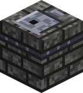

# Blacksmith

At the **Forge**, the Blacksmith makes Mine Mine no Mi weapons and gear that the base mod ships but never lets players craft, from the Blue Sword to the Soul Solid. The trade also takes over a few that the base mod did let players craft, such as bullets, cannons and handcuffs.

| | |
|---|---|
| Workstation | { .block-mini }**Forge** |
| How it is made | 3 Iron Ingots on top; Stone Bricks, Anvil, Stone Bricks in the middle; 3 Stone Bricks at the bottom |
| Materials | iron, and the [Miner](miner.md)'s Kairoseki, Dense Kairoseki, Pure Iron Ore and Marble |
| Levels | 1 to 100; new recipes up to level 50 |

The Forge glows (light level 10) and needs a pickaxe to be picked back up. Every recipe asks for a Blacksmith level and pays Blacksmith XP.

**Forged by.** A weapon made at the Forge carries the name of the Blacksmith who forged it ("Forged by ..."). It is what the [swordsmith from Wano](../village-events.md#a-swordsmith-from-wano) asks for: he turns a forged Katana, Broadsword or Warabide Sword into one of the base mod's named blades, and what your skill had put on the blade passes to the new one.

## What the Forge makes

- **From level 1**, the plain weapons and ammunition: Axe, Broadsword, Katana, Spear and Bullets, then the Pipe (5), the Mace and Scissors (10) and Handcuffs (14).
- **Levels 17 to 28**: the Kabuto (with Iron Scrap and Mysterious Parts), Pop Greens (with Gunpowder), Cannon Balls, the Kairoseki Net and the Cannon.
- **Levels 29 to 41**, sea-stone and fine blades: the Blue Sword, Kairoseki Bullets and the Warabide Sword, then Dense Kairoseki for the Jitte, the 5t Hammer and Kairoseki Handcuffs.
- **The top of the trade**: the Kuro Kabuto (45), forged from a Kabuto and Adam Planks, and the **Soul Solid** (50).

The item names are Mine Mine no Mi's own, and so are their combat stats.

These are all the Forge's recipes ("planks" means any planks):

| Makes | Level | XP | Ingredients |
|---|---|---|---|
| Axe | 1 | 12 | 3 × Iron Ingot, 2 × Stick |
| Broadsword | 1 | 12 | 5 × Iron Ingot, Stick, Leather |
| Bullet ×8 | 1 | 12 | 2 × Iron Ingot, 2 × Cobblestone |
| Katana | 1 | 12 | 4 × Iron Ingot, Stick, Leather |
| Spear | 1 | 12 | 2 × Iron Ingot, 3 × Stick |
| Pipe | 5 | 20 | 3 × Iron Ingot |
| Mace | 10 | 30 | Block of Iron, Iron Ingot, Stick |
| Scissors | 10 | 30 | 3 × Iron Ingot, 3 × Cobblestone |
| Handcuffs | 14 | 38 | Iron Ingot, 2 × Chain |
| Kabuto | 17 | 44 | 4 × any planks, 3 × String, 2 × { .item-icon }Iron Scrap, { .item-icon }Mysterious Parts |
| Pop Green ×8 | 21 | 52 | 2 × any small flowers, 3 × Wheat Seeds, 2 × Bone Meal, Gunpowder |
| Cannon Ball ×4 | 24 | 58 | 4 × Cobblestone |
| Kairoseki Net | 25 | 60 | 4 × Kairoseki, 5 × String |
| Cannon | 28 | 66 | 3 × Block of Iron, 3 × Cobblestone, String |
| Blue Sword | 29 | 68 | 4 × Iron Ingot, 2 × Kairoseki, 3 × Lapis Lazuli, Diamond |
| Kairoseki Bullet ×8 | 32 | 74 | 2 × Kairoseki, 2 × Cobblestone |
| Warabide Sword | 33 | 76 | 4 × Iron Ingot, 2 × { .item-icon }Pure Iron Ore, 2 × { .item-icon }Marble, Diamond |
| Jitte | 36 | 82 | Dense Kairoseki, 2 × Iron Ingot |
| 5t Hammer | 37 | 84 | 5 × Block of Iron, 2 × Dense Kairoseki, 2 × Stick |
| Kairoseki Handcuffs | 41 | 92 | 2 × Dense Kairoseki, Chain |
| Kuro Kabuto | 45 | 100 | Kabuto, 4 × { .block-mini }Adam Planks, 2 × { .item-icon }Mysterious Parts, 3 × String |
| Soul Solid | 50 | 110 | 4 × Iron Ingot, 3 × Dense Kairoseki, 6 × { .item-icon }Diamond Fragment, Bone, Note Block, Diamond |

## Taking over the base mod's recipes

By default, Cruise removes some of Mine Mine no Mi's crafting-table recipes, so those items are made only by the trade that owns them:

- **Blacksmith** (Forge): Jitte, Mace, Pipe, Scissors, Cannon, Cannon Ball, Bullet, Kairoseki Bullet, Handcuffs, Kairoseki Handcuffs.
- **[Tailor](tailor.md)** (Sewing Table): Umbrella, Medic Bag, Flag.
- **[Inventor](inventor.md)** (Workshop): Clima Tact, Perfect Clima Tact, Sorcery Clima Tact.

Turning the **takeOverBaseRecipes** setting off gives all sixteen recipes back to the crafting table, exactly as the base mod shipped them; the trades still make these items too. A second setting keeps chosen items on the crafting table while the takeover stays on. The recipe-book unlocks follow the same settings. Changes apply at the next `/reload` or world load, and on a server, the server's settings decide. See [Configuration](../configuration.md).

## Talents

Every 5 Blacksmith levels give you a **talent point** (10 at level 50, 20 at level 100). Spend them in the Blacksmith's web of talents, opened by the **Talents** button on the trade's page of the trades book or with the **Talents** key (**J** by default). Each talent costs one point. You can take a talent that starts the web, or one linked to a talent you already have. Small talents of one kind add up. A point stays spent until a [Potion of Second Thoughts](chemist.md#the-potion-of-second-thoughts) gives them back. See [Talents](../trades-and-levels.md#talents).

| Talent | Kind | What it gives | Linked to |
|---|---|---|---|
| Bellows boy 1 | small, start | You earn 5% more Blacksmith XP | Tempering |
| { .item-icon }Tempering | **major** | What you forge comes with Unbreaking I | Bellows boy 1, Bellows boy 2 |
| Bellows boy 2 | small | You earn 5% more Blacksmith XP | Tempering, Keen Edge |
| Keen Edge | **major** | A weapon you forge comes with Sharpness I and an armour with Protection I | Bellows boy 2, Scrap heap 1, Bellows boy 3, Wide mould 1, Scrap heap 2, Scrap heap 3 |
| Scrap heap 1 | small | 2% more of your forgings give an ingredient back | Keen Edge, Scrap |
| Bellows boy 3 | small | You earn 5% more Blacksmith XP | Keen Edge, Smith's Notes |
| Wide mould 1 | small | 3% more chance that a forging of bullets or balls gives twice as many | Keen Edge, Fine Temper |
| Scrap heap 2 | small | 2% more of your forgings give an ingredient back | Keen Edge, Full Mould |
| Scrap heap 3 | small | 2% more of your forgings give an ingredient back | Keen Edge, Honed Edge |
| { .item-icon }Scrap | **major** | 25% of your forgings give an ingredient back | Scrap heap 1, Scrap heap 4 |
| { .item-icon }Smith's Notes | **major** | You earn 15% more Blacksmith XP | Bellows boy 3, Bellows boy 4 |
| { .item-icon }Fine Temper | **major** | What you forge comes with Unbreaking II | Wide mould 1, Wide mould 2, Full Mould |
| Full Mould | **major** | 20% chance that a forging of bullets or balls gives twice as many | Scrap heap 2, Wide mould 3, Fine Temper, Honed Edge |
| Honed Edge | **major** | A weapon you forge comes with Sharpness II and an armour with Protection II | Scrap heap 3, Wide mould 4, Full Mould |
| Scrap heap 4 | small | 2% more of your forgings give an ingredient back | Scrap, Scrap heap 5 |
| Bellows boy 4 | small | You earn 5% more Blacksmith XP | Smith's Notes, Bellows boy 5 |
| Wide mould 2 | small | 3% more chance that a forging of bullets or balls gives twice as many | Fine Temper, Hammer Blow |
| Wide mould 3 | small | 3% more chance that a forging of bullets or balls gives twice as many | Full Mould, Hot Iron |
| Wide mould 4 | small | 3% more chance that a forging of bullets or balls gives twice as many | Honed Edge, Sunder |
| Scrap heap 5 | small | 2% more of your forgings give an ingredient back | Scrap heap 4 |
| Bellows boy 5 | small | You earn 5% more Blacksmith XP | Bellows boy 4 |
| Hammer Blow | **ability** | Needs a forged weapon. A great blow that throws a foe back. Gives the ability **Hammer Blow** | Wide mould 2, Fighting Blacksmith 1, Hot Iron |
| { .item-icon }Hot Iron | **major** | A weapon you forge comes with Fire Aspect I | Wide mould 3, Fighting Blacksmith 2, Hammer Blow, Sunder |
| Sunder | **ability** | Needs a forged weapon. A blow that takes 30% of a foe's armour for 6 seconds. Gives the ability **Sunder** | Wide mould 4, Fighting Blacksmith 3, Hot Iron |
| Fighting Blacksmith 1 | small | Your Blacksmith abilities hit 5% harder | Hammer Blow, Fighting Blacksmith 4 |
| Fighting Blacksmith 2 | small | Your Blacksmith abilities hit 5% harder | Hot Iron, Tempered Guard |
| Fighting Blacksmith 3 | small | Your Blacksmith abilities hit 5% harder | Sunder, Fighting Blacksmith 5 |
| Fighting Blacksmith 4 | small | Your Blacksmith abilities hit 5% harder | Fighting Blacksmith 1, Tempered Guard |
| { .item-icon }Tempered Guard | **ability** | Needs a forged weapon. For 6 seconds you take 30% less damage. Gives the ability **Tempered Guard** | Fighting Blacksmith 4, Fighting Blacksmith 5, Fighting Blacksmith 2 |
| Fighting Blacksmith 5 | small | Your Blacksmith abilities hit 5% harder | Fighting Blacksmith 3, Tempered Guard |

The numbers after the names of small talents only tell them apart on this page: in game, small talents of one kind have the same name.

### Combat abilities

Taking an ability talent puts its ability in the **Profession** tab of the abilities screen, and you place it on your bar yourself. It costs nothing from your bag. Its small "Fighting Blacksmith" talents make the Blacksmith's abilities hit harder. Damage is on the base mod's scale, as in the ability screen.

| Ability | What it does | Needs | Cooldown | Damage | Range |
|---|---|---|---|---|---|
| **Hammer Blow** | With a forged weapon in hand strike the enemy you look at with all your weight. It hurts them a lot and throws them back | a weapon forged by a Blacksmith in hand | 10 s | 60 | 4 blocks |
| **Sunder** | With a forged weapon in hand strike the enemy you look at where his armour is weak. He is hurt and loses 30% of his armour for 6 seconds. A player or a boss half as long | a weapon forged by a Blacksmith in hand | 14 s | 35 | 4 blocks |
| **Tempered Guard** | With a forged weapon in hand brace yourself. For 6 seconds you take 30% less damage | a weapon forged by a Blacksmith in hand | 20 s | — | — |

### If you had the trade before 0.5.0

The perks by level are gone. The first time you play 0.5.0, your points are put for you on the talents that took their place, level by level, as long as you have points:

| Level | Points first put on |
|---|---|
| 10 | Bellows boy 1, Tempering |
| 25 | Bellows boy 2, Keen Edge |
| 40 | Scrap heap 1, Scrap |

## Advancements

The **Smithing** tab opens when you become a Blacksmith: Apprentice Blacksmith (level 5), Forged Steel (forge a Katana), Sea-Stone Shot (forge Kairoseki Bullets) and the challenge **Yohohoho!** (forge the Soul Solid).
