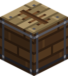
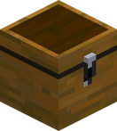
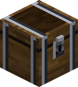
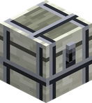
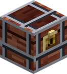
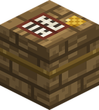
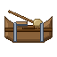
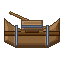
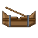
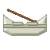

# Carpenter

The Carpenter builds **boats** and heavy **storage** at the Shipyard: sixteen boats whose hulls take several blows before they give, four lockers bigger than a chest, and the Auction House. Out on the water, only a Carpenter can mend a damaged hull.

| | |
|---|---|
| Workstation | { .block-mini }**Shipyard** |
| How it is made | 3 planks on top; log, Crafting Table, log in the middle; 3 logs at the bottom (any planks, any logs) |
| Materials | Kuuigosu, Burning Tree and Adam Planks from the [Lumberjack](lumberjack.md)'s trees |
| Levels | 1 to 100; new recipes up to level 50 |

Every Shipyard recipe asks for a Carpenter level and pays Carpenter XP. The first hull, the **Reinforced Boat**, is a level 1 recipe. **Mending** pays too: 2 XP for each timber you put back on a damaged hull afloat (see [Boats](../boats.md)).

## Boats

There are **16 boats**: four hulls (Reinforced, Kuuigosu, Burning Tree, Adam) in four shapes (Boat, Longboat, Cargo Boat, Fishing Boat).

- **Reinforced** hulls (Carpenter 1 to 13) are built from any planks and iron: the Boat at level 1, the Fishing Boat at 4, the Cargo Boat at 7 and the Longboat at 13.
- **Kuuigosu** hulls (Carpenter 20 to 30) are the quick ones.
- **Burning Tree** hulls (Carpenter 36 to 40) are fireproof.
- **Adam** hulls (Carpenter 50) take the most blows.

How the hulls and shapes behave, and how to ride, mend and salvage the boats: see [Boats](../boats.md).

**In a storm at sea** a Carpenter's boat is slower, and a weak hull takes a blow from the waves now and then. The Burning Tree and the Adam hulls take none, and **Iron Plating** shields the others; a plain boat ends up breaking. See [Events at sea](../events-at-sea.md#a-storm-at-sea).

## Lockers

Four chests of the Carpenter's own. Each is one block and **never pairs** into a double chest.

| Locker | Carpenter | Slots (grid) | Blast resistance | Special |
|---|---|---|---|---|
| { .block-mini }Ship's Locker | 10 | 36 (9×4) | 6 | — |
| { .block-mini }Reinforced Locker | 22 | 55 (11×5) | 25 | — |
| { .block-mini }Kuuigosu Locker | 34 | 78 (13×6) | 60 | — |
| { .block-mini }Adam Strongbox | 45 | 105 (15×7) | 1 200 | **keeps its contents when broken** |

- The Adam Strongbox drops as one item with everything inside (its tooltip: "Keeps what is in it when you break it"), and placing it puts it all back. The other three spill their contents when broken, like a chest.
- Lockers keep a name given with an anvil and work with comparators.

## The Auction House

The { .block-mini }**Auction House** (Carpenter 15) is a block anyone can use. Every Auction House opens the same server-wide market, with Buy, Sell and My lots tabs. See [Auction House](../auction-house.md).

## Shipyard recipes

These are all the Shipyard's recipes ("planks" means any planks):

| Makes | Level | XP | Ingredients |
|---|---|---|---|
| { .item-icon }Reinforced Boat | 1 | 12 | 5 × any planks, 2 × Iron Ingot, 2 × { .item-icon }Iron Scrap |
| { .item-icon }Reinforced Fishing Boat | 4 | 18 | 5 × any planks, 2 × Iron Ingot, { .item-icon }Iron Scrap, Chest |
| { .item-icon }Reinforced Cargo Boat | 7 | 24 | 5 × any planks, 2 × Iron Ingot, 2 × Chest |
| { .block-mini }Ship's Locker | 10 | 30 | 6 × any planks, Chest, 2 × Iron Ingot |
| { .item-icon }Reinforced Longboat | 13 | 36 | 7 × any planks, 2 × Iron Ingot |
| { .block-mini }Auction House | 15 | 36 | 6 × any planks, Book, 2 × Gold Ingot |
| { .item-icon }Kuuigosu Boat | 20 | 50 | 6 × { .block-mini }Kuuigosu Planks, 3 × Iron Ingot |
| { .block-mini }Reinforced Locker | 22 | 54 | 6 × any planks, Chest, 4 × Iron Ingot, 2 × { .item-icon }Iron Scrap |
| { .item-icon }Kuuigosu Fishing Boat | 23 | 56 | 6 × { .block-mini }Kuuigosu Planks, 2 × Iron Ingot, Chest |
| { .item-icon }Kuuigosu Cargo Boat | 27 | 64 | 6 × { .block-mini }Kuuigosu Planks, Iron Ingot, 2 × Chest |
| { .item-icon }Kuuigosu Longboat | 30 | 70 | 6 × { .block-mini }Kuuigosu Planks, Iron Ingot, 2 × any planks |
| { .block-mini }Kuuigosu Locker | 34 | 78 | 6 × { .block-mini }Kuuigosu Planks, Chest, 2 × Block of Iron |
| { .item-icon }Burning Tree Boat | 36 | 82 | 5 × { .block-mini }Burning Tree Planks |
| { .item-icon }Burning Tree Fishing Boat | 37 | 84 | 6 × { .block-mini }Burning Tree Planks, String, { .item-icon }Reel |
| { .item-icon }Burning Tree Cargo Boat | 38 | 86 | 6 × { .block-mini }Burning Tree Planks, Chest, { .item-icon }Iron Scrap |
| { .item-icon }Burning Tree Longboat | 40 | 90 | 7 × { .block-mini }Burning Tree Planks, 2 × { .item-icon }Iron Scrap |
| { .block-mini }Adam Strongbox | 45 | 100 | 6 × { .block-mini }Adam Planks, Chest, 4 × Block of Iron, 2 × { .item-icon }Mysterious Parts |
| { .item-icon }Adam Boat | 50 | 110 | 6 × { .block-mini }Adam Planks, 2 × { .item-icon }Pure Iron Ore, Iron Ingot |
| { .item-icon }Adam Cargo Boat | 50 | 110 | 6 × { .block-mini }Adam Planks, { .item-icon }Pure Iron Ore, 2 × Chest |
| { .item-icon }Adam Fishing Boat | 50 | 110 | 6 × { .block-mini }Adam Planks, 2 × { .item-icon }Pure Iron Ore, Chest |
| { .item-icon }Adam Longboat | 50 | 110 | 6 × { .block-mini }Adam Planks, { .item-icon }Pure Iron Ore, 2 × any planks |

## The Upgrade Bench

Boats are fitted with sails, plating, a ram or a Burst Dial at the { .block-mini }**Upgrade Bench**.

- It is crafted with 3 Iron Ingots on top, plank / Smithing Table / plank in the middle, and 3 planks at the bottom.
- **Anyone** can use it; it asks for no trade and no level.
- Put the **boat item** in the left slot and a part in the middle slot, then take the fitted boat from the right slot. Between the slots, the bench shows what the part will do.
- Parts go on the boat **before** it is placed: the bench only takes the boat item.
- Each boat takes one of each part and **only one sail**: fitting a new sail takes the old one down, and it comes back to you.

The sails are sewn by the [Tailor](tailor.md); the other parts are made by the [Inventor](inventor.md). The full list is on the [Boats](../boats.md) page. The same bench also fits the Inventor's fishing-rod parts and the [Hunter](hunter.md)'s net and trap gear.

## Talents

Every 5 Carpenter levels give you a **talent point** (10 at level 50, 20 at level 100). Spend them in the Carpenter's web of talents, opened by the **Talents** button on the trade's page of the trades book or with the **Talents** key (**J** by default). Each talent costs one point. You can take a talent that starts the web, or one linked to a talent you already have. Small talents of one kind add up. A point stays spent until a [Potion of Second Thoughts](chemist.md#the-potion-of-second-thoughts) gives them back. See [Talents](../trades-and-levels.md#talents).

| Talent | Kind | What it gives | Linked to |
|---|---|---|---|
| Offcuts 1 | small, start | 2% more of what you build gives an ingredient back | Stout Hull, Good plank 1 |
| { .item-icon }Stout Hull | **major** | The hulls you launch carry 1 more blow | Offcuts 1, Shipyard hand 1 |
| Good plank 1 | small | 3% more chance that a plank you mend with is not used up | Sound Timber, Offcuts 1, Salvager, Fighting Carpenter 1 |
| Shipyard hand 1 | small | You earn 5% more Carpenter XP | Stout Hull, Quick Mending, Ironwood |
| { .block-mini }Sound Timber | **major** | 25% chance that a plank you mend with is not used up | Good plank 1, Shipyard hand 2, Fighting Carpenter 2 |
| { .item-icon }Salvager | **major** | A wreck you salvage gives 2 more planks | Good plank 1 |
| Fighting Carpenter 1 | small | Your Carpenter abilities hit 5% harder | Fighting Carpenter 3, Good plank 1 |
| { .block-mini }Quick Mending | **major** | One plank of yours mends 2 timbers | Shipyard hand 1, Offcuts 2 |
| { .item-icon }Ironwood | **major** | The hulls you launch carry 1 more blow again | Shipyard hand 2, Offcuts 3, Shipyard hand 1, Shipyard hand 3 |
| Shipyard hand 2 | small | You earn 5% more Carpenter XP | Sound Timber, Ironwood |
| Fighting Carpenter 2 | small | Your Carpenter abilities hit 5% harder | Sound Timber, Fighting Carpenter 3 |
| Fighting Carpenter 3 | small | Your Carpenter abilities hit 5% harder | Fighting Carpenter 2, Mallet Swing, Fighting Carpenter 1 |
| Offcuts 2 | small | 2% more of what you build gives an ingredient back | Quick Mending, Thrift |
| Offcuts 3 | small | 2% more of what you build gives an ingredient back | Ironwood, Offcuts 4 |
| Shipyard hand 3 | small | You earn 5% more Carpenter XP | Ironwood, Shipwright's Notes |
| { .item-icon }Mallet Swing | **ability** | A wide blow that hits the foes in front of you and throws them back. Gives the ability **Mallet Swing** | Fighting Carpenter 3 |
| { .item-icon }Thrift | **major** | 25% of what you build gives an ingredient back | Offcuts 4, Offcuts 2, Nail Shot |
| Offcuts 4 | small | 2% more of what you build gives an ingredient back | Offcuts 3, Thrift |
| { .item-icon }Shipwright's Notes | **major** | You earn 15% more Carpenter XP | Shipyard hand 3, Shipyard hand 4, Good plank 2, Good plank 3 |
| Nail Shot | **ability** | Throw a fistful of nails that hurts and slows a foe. Gives the ability **Nail Shot** | Thrift, Fighting Carpenter 4 |
| Shipyard hand 4 | small | You earn 5% more Carpenter XP | Fighting Carpenter 4, Shipwright's Notes, Mender's Pride |
| Good plank 2 | small | 3% more chance that a plank you mend with is not used up | Shipyard hand 5, Shipwright's Notes |
| Good plank 3 | small | 3% more chance that a plank you mend with is not used up | Shipyard hand 6, Shipwright's Notes |
| Fighting Carpenter 4 | small | Your Carpenter abilities hit 5% harder | Nail Shot, Shipyard hand 4 |
| { .item-icon }Mender's Pride | **major** | Each timber you mend pays twice the Carpenter XP | Shipyard hand 4, Good plank 4, Shipyard hand 5, Shipyard hand 6 |
| Shipyard hand 5 | small | You earn 5% more Carpenter XP | Mender's Pride, Good plank 2 |
| Shipyard hand 6 | small | You earn 5% more Carpenter XP | Mender's Pride, Good plank 3 |
| Good plank 4 | small | 3% more chance that a plank you mend with is not used up | Mender's Pride, Fighting Carpenter 5 |
| Fighting Carpenter 5 | small | Your Carpenter abilities hit 5% harder | Good plank 4, Quick Repair |
| { .item-icon }Quick Repair | **ability** | The hull you ride or look at gets 2 timbers back. No plank is used. Gives the ability **Quick Repair** | Fighting Carpenter 5 |

The numbers after the names of small talents only tell them apart on this page: in game, small talents of one kind have the same name.

### Combat abilities

Taking an ability talent puts its ability in the **Profession** tab of the abilities screen, and you place it on your bar yourself. It costs nothing from your bag. Its small "Fighting Carpenter" talents make the Carpenter's abilities hit harder. Damage is on the base mod's scale, as in the ability screen.

| Ability | What it does | Needs | Cooldown | Damage | Range |
|---|---|---|---|---|---|
| **Mallet Swing** | Swing wide before you. Every enemy in front of you within 4 blocks is hit and thrown back | — | 10 s | 35 | 4 blocks |
| **Nail Shot** | Throw a fistful of nails straight ahead. The enemy they hit is hurt and slowed for 3 seconds. A player or a boss half as long | — | 8 s | 30 | — |
| **Quick Repair** | Patch the hull you ride or the one you look at within 5 blocks. It gets 2 timbers back. No plank is used | — | 30 s | — | — |

### If you had the trade before 0.5.0

The perks by level are gone. The first time you play 0.5.0, your points are put for you on the talents that took their place, level by level, as long as you have points:

| Level | Points first put on |
|---|---|
| 10 | Offcuts 1, Stout Hull |
| 25 | Shipyard hand 1, Quick Mending |
| 40 | Offcuts 2, Thrift |

## Advancements

The **Carpenter** tab opens at Carpenter level 1: Apprentice Carpenter (level 5), A Hull That Holds (build a Reinforced Boat), and the challenge **SUPER!** (build a boat of Adam Wood: an Adam Boat), which rewards 100 experience points.
