# Chemist

The Chemist compounds the islands' remedies at the **Laboratory**: candies and tonics that heal and restore, powders the other trades need, balls to throw in a fight, and at the top of the trade the Revival Elixir, the Rumble Ball and the Potion of Forgetting.

| | |
|---|---|
| Workstation | { .block-mini }**Laboratory** |
| How it is made | crafting table, no level: a Brewing Stand, a Glass Bottle and planks |
| Levels | 1 to 100; recipes up to level 50 |
| XP | every recipe compounded: 10 + 2 × its level; and the remedies brought to a village's doctor during a [fever](../village-events.md#a-fever-in-the-village) |

## The Laboratory

You build the Laboratory at an ordinary crafting table. Anyone can build one:

| Top | Middle | Bottom |
|---|---|---|
| —, Brewing Stand, — | Planks, Glass Bottle, Planks | Planks, Planks, Planks |

It faces you when you place it.

Most of the Chemist's ingredients come from the other trades: the [Farmer](farmer.md)'s herbs and fruit, the [Hunter](hunter.md)'s creatures, the [Fisher](fisher.md)'s fish and the [Miner](miner.md)'s fragments. The Sleep Honey for the Sleep Ball comes with a captured Hidden Forest Bee, 35 % of the time.

## Remedies

You take a remedy like food, but **at any time, even when you are not hungry**: a tonic is drunk, a candy is eaten in half the usual time, a powder is swallowed. Remedies heal, restore hunger, clear effects and sometimes give a short boost. Their tooltips list what each one does, with hearts shown as ❤ ("Heals 5 ❤").

| Remedy | Chemist level | Heals | Hunger | Cures | Boost |
|---|---|---|---|---|---|
| Mix Candy | 1 | 1 ❤ | — | Poison | — |
| Healing Candy | 2 | 2 ❤ | — | — | — |
| Dual Action Tonic | 4 | 3 ❤ | — | Poison, Nausea | — |
| Healing Tonic | 5 | 5 ❤ | — | — | — |
| Stamina Candy | 7 | — | 3 | Hunger, Mining Fatigue | Speed I for 0:30 |
| Stamina Tonic | 10 | — | 6 | Slowness, Mining Fatigue, Weakness, Hunger | Speed II for 0:45 |
| Antidote Powder | 14 | — | — | Poison, Wither, Nausea, Hunger | — |
| Restorative Drug | 30 | 10 ❤ | — | Poison, Wither, Nausea, Blindness, Weakness, Slowness, Mining Fatigue, Hunger | Regeneration II for 0:10 |
| Revival Elixir | 36 | 20 ❤ | — | the Restorative Drug's list, and Darkness | — (carried, it saves your life: see below) |
| 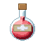{ .item-icon }Medicine | 46 | 15 ❤ | — | the same as the Revival Elixir | Regeneration III for 0:20 |

The [Cook](cook.md) also needs the Antidote Powder, for the Fried Scorpion. The Medicine is rare and takes 2 of each powder (Thunder Powder, Flame Powder, Gunpowder, Ice Powder).

### 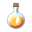{ .item-icon }The Revival Elixir

Made from a Hydramandrake, a Rainbow Phoenix, a Crossbone Butterfly and a Spirit Firefly; it stacks to 16.

- **Drunk**, it works like the other remedies: it heals **20 ❤** and cures the effects listed in the table above.
- **Carried**, it saves your life: if you would die with one anywhere in your inventory, one is used up instead. You come back at **half your max health**, cleared of every effect, with **Regeneration II for 0:30** and **Absorption II for 0:05**.
    - A Totem of Undying held in your hand is used first.
    - It does not save you from damage that nothing can block, such as falling into the void or /kill.

## Powders

Each powder recipe gives **two** powders.

| Powder | Chemist level | Made from |
|---|---|---|
| Thunder Powder | 12 | a Lightning Beetle |
| Flame Powder | 18 | a Fire Hercules |
| Ice Powder | 20 | an Ice Sunfish |
| Gunpowder (the ordinary Minecraft item) | 26 | 3 Explosive Rock Fragments and a log |

Where the powders go:

- the Medicine and the Experiment Equipment;
- the Instant Freeze Ball (Ice Powder);
- the [Inventor](inventor.md)'s Enhanced Bombs (Gunpowder);
- the [Musician](musician.md)'s Battle March scores (Flame Powder);
- some of the [Tailor](tailor.md)'s garments (Flame Powder, Thunder Powder, Gunpowder);
- the [Blacksmith](blacksmith.md)'s Pop Green (Gunpowder).

## Battle balls

You throw a ball like a snowball, and it bursts where it lands. Every living thing within **2.5 blocks** of the burst is caught, except the thrower. Throws have a 0.5 second cooldown, and balls stack to 16. Each recipe gives **two balls**.

| Ball | Chemist level | Made from | What it does |
|---|---|---|---|
| 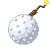{ .item-icon }Salt Ball | 14 | 1 Crystallised Salt, 1 Cobweb | **Slowness II for 0:04** to everything caught; **12 damage** (6 ❤) to what a Kage Kage no Mi shadow animates (Mine Mine no Mi's Nightmare Soldier, Doppelman, Tsuno Tokage); **6 damage** (3 ❤) to undead and water creatures |
| Poison Ball | 24 | 1 Clawed Scorpion, 1 Clay Ball | **Poison II for 0:06** |
| Sleep Ball | 28 | 2 Sleep Honey, 2 Clay Ball | **Slowness IV, Blindness and Weakness II**, all for 0:08 |
| 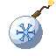{ .item-icon }Instant Freeze Ball | 32 | 6 Ice Powder, 1 Crystallised Salt, 2 Clay Ball | **Slowness IV for 0:05**, and targets freeze solid as in powder snow and stay frozen a little longer; still water around the burst turns to **thin ice** that melts again a few seconds later |

## 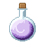{ .item-icon }The Potion of Forgetting (level 30, Crew mode only)

Made from a Golden Matsutake, a Mystery Mushroom, Bitter Grass, a Medicinal Herb and a Glass Bottle; it is rare, stacks to 16, and is found nowhere else.

- Drinking it opens the choice of a new trade (not the one you already have). It is used up **only when you confirm** a choice, so closing the book keeps the potion.
- On a confirmed choice, **all your trade XP is wiped**, in every trade, and you take up the new trade from the start.
- In **Solo** mode the recipe does not exist, the potion is left out of the creative tab, and a stray potion cannot be drunk.

See [Trades and levels](../trades-and-levels.md) for how the choice works.

## 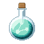{ .item-icon }The Potion of Second Thoughts (level 20) { #the-potion-of-second-thoughts }

Made from a Mystery Mushroom, Bitter Grass, a Medicinal Herb and a Glass Bottle; it stacks to 16. It gives talent points back, in Solo and in Crew alike.

- Drinking it opens a book with the trades you spent talent points in. Pick **one**: every point you spent in that trade comes back to you, to spend again as you like. Its abilities leave your list and your bar until you take their talents again.
- It is used up **only when you confirm**, so closing the book keeps the potion.

See [Talents](../trades-and-levels.md#talents).

## { .item-icon }The Rumble Ball (level 42)

Made from a Golden Egg, a Golden Fruit and a Golden Hercules; it is rare. It is eaten quickly, at any time.

- **A Zoan user** gets **Rumble for 3:00**, and **all their ability cooldowns end at once**. While Rumble lasts, they are stronger whenever they are transformed: **+4 attack damage, +6 armour, +50 % knockback resistance, +25 % speed**.
    - The Hito Hito no Mi (Chopper's fruit), which has no forms in Mine Mine no Mi, gets the boost without transforming.
    - The boost switches on when the user transforms and off when they change back (checked twice a second), and it ends with the effect.
- **A second Rumble Ball while Rumble is still on is an overdose.** The Rumble is lost, and the user gets Nausea (0:15), Weakness II (0:30) and Slowness II (0:15).
- **Anyone who is not a Zoan user** only gets Nausea for 0:10: "Nothing happens: only a Zoan's body answers a Rumble Ball."

## 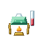{ .item-icon }The Experiment Equipment (level 50)

Made from 2 of each powder and an Instant Freeze Ball; it is rare and does not stack. This is the Chemist's apparatus: **kept in your inventory**, it gives each brew at the Laboratory a **15 % chance to yield one extra**. That chance is rolled only when your talents (Double Brew and its small talents) have not already given one.

## Talents

Every 5 Chemist levels give you a **talent point** (10 at level 50, 20 at level 100). Spend them in the Chemist's web of talents, opened by the **Talents** button on the trade's page of the trades book or with the **Talents** key (**J** by default). Each talent costs one point. You can take a talent that starts the web, or one linked to a talent you already have. Small talents of one kind add up. A point stays spent until a [Potion of Second Thoughts](chemist.md#the-potion-of-second-thoughts) gives them back. See [Talents](../trades-and-levels.md#talents).

| Talent | Kind | What it gives | Linked to |
|---|---|---|---|
| Full flask 1 | small, start | 2% more chance that a brew gives one more | Double Brew |
| { .item-icon }Double Brew | **major** | 10% chance that a brew gives one more | Full flask 1, Full flask 2, Thick fumes 1 |
| Full flask 2 | small | 2% more chance that a brew gives one more | Double Brew, Potent Remedies, Full flask 3 |
| Thick fumes 1 | small | What the balls you throw do lasts 5% longer | Double Brew, Wide Burst |
| { .item-icon }Potent Remedies | **major** | Your remedies heal and feed 50% more | Full flask 2, Clean bench 1, Thick fumes 2 |
| Full flask 3 | small | 2% more chance that a brew gives one more | Full flask 2 |
| { .item-icon }Wide Burst | **major** | The balls you throw reach 1 block further | Thick fumes 1, Thick fumes 2, Thick fumes 3 |
| Clean bench 1 | small | 2% more of your brews give an ingredient back | Potent Remedies, Thrift, Fighting Chemist 1 |
| Thick fumes 2 | small | What the balls you throw do lasts 5% longer | Potent Remedies, Wide Burst, Lasting Fumes |
| Thick fumes 3 | small | What the balls you throw do lasts 5% longer | Wide Burst, Steady Hands |
| { .item-icon }Thrift | **major** | 25% of your brews give an ingredient back | Clean bench 1, Clean bench 2, Thick fumes 4 |
| Fighting Chemist 1 | small | Your Chemist abilities hit 5% harder | Clean bench 1, Acid Flask |
| 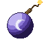{ .item-icon }Lasting Fumes | **major** | What the balls you throw do lasts 50% longer | Thick fumes 2, Thick fumes 4, Thick fumes 5 |
| 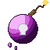{ .item-icon }Steady Hands | **major** | 20% of the balls you throw are not used up | Thick fumes 3 |
| Clean bench 2 | small | 2% more of your brews give an ingredient back | Thrift, Chemist's Notes, Clean bench 3 |
| Thick fumes 4 | small | What the balls you throw do lasts 5% longer | Thrift, Lasting Fumes, Concentrate |
| Acid Flask | **ability** | Needs your Experiment Equipment. Throw a flask that burns and poisons where it lands. Gives the ability **Acid Flask** | Fighting Chemist 1, Fighting Chemist 2 |
| Thick fumes 5 | small | What the balls you throw do lasts 5% longer | Lasting Fumes, Field Dressing |
| { .item-icon }Chemist's Notes | **major** | You earn 15% more Chemist XP | Clean bench 2, Lab hand 1, Fighting Chemist 3 |
| Clean bench 3 | small | 2% more of your brews give an ingredient back | Clean bench 2 |
| { .item-icon }Concentrate | **major** | Your remedies heal and feed 25% more again | Thick fumes 4, Lab hand 1, Lab hand 2 |
| Fighting Chemist 2 | small | Your Chemist abilities hit 5% harder | Acid Flask |
| { .item-icon }Field Dressing | **ability** | Needs your Experiment Equipment. You get 10 health back and are cured of poison and wither. Gives the ability **Field Dressing** | Thick fumes 5, Lab hand 3 |
| Lab hand 1 | small | You earn 5% more Chemist XP | Chemist's Notes, Concentrate |
| Fighting Chemist 3 | small | Your Chemist abilities hit 5% harder | Chemist's Notes, Smoke Screen |
| Lab hand 2 | small | You earn 5% more Chemist XP | Concentrate, Fighting Chemist 4 |
| Lab hand 3 | small | You earn 5% more Chemist XP | Field Dressing |
| { .item-icon }Smoke Screen | **ability** | Needs your Experiment Equipment. A cloud round you blinds and slows your foes. Gives the ability **Smoke Screen** | Fighting Chemist 3, Fighting Chemist 5 |
| Fighting Chemist 4 | small | Your Chemist abilities hit 5% harder | Lab hand 2 |
| Fighting Chemist 5 | small | Your Chemist abilities hit 5% harder | Smoke Screen |

The numbers after the names of small talents only tell them apart on this page: in game, small talents of one kind have the same name.

### Combat abilities

Taking an ability talent puts its ability in the **Profession** tab of the abilities screen, and you place it on your bar yourself. It costs nothing from your bag. Its small "Fighting Chemist" talents make the Chemist's abilities hit harder. Damage is on the base mod's scale, as in the ability screen.

| Ability | What it does | Needs | Cooldown | Damage | Range |
|---|---|---|---|---|---|
| **Acid Flask** | With your Experiment Equipment in your bag throw a flask of acid. It bursts where it lands. Every enemy within 3 blocks is burnt and poisoned for 4 seconds. A player or a boss half as long | Experiment Equipment in your bag | 12 s | 25 | 3 blocks |
| **Field Dressing** | With your Experiment Equipment in your bag dress your wounds. You get 10 health back and are cured of poison and wither | Experiment Equipment in your bag | 25 s | — | — |
| **Smoke Screen** | With your Experiment Equipment in your bag break a smoke flask at your feet. Every enemy within 4 blocks is blinded and slowed for 4 seconds. A player or a boss half as long | Experiment Equipment in your bag | 15 s | — | 4 blocks |

### If you had the trade before 0.5.0

The perks by level are gone. The first time you play 0.5.0, your points are put for you on the talents that took their place, level by level, as long as you have points:

| Level | Points first put on |
|---|---|
| 10 | Full flask 1, Double Brew |
| 25 | Full flask 2, Potent Remedies |
| 40 | Clean bench 1, Thrift |

## The recipes

Every Laboratory recipe, with the Chemist level that unlocks it and the XP it pays:

| Makes | Level | XP | Ingredients |
|---|---|---|---|
| { .item-icon }Mix Candy | 1 | 12 | 2 × { .item-icon }Mystery Mushroom, { .item-icon }Sweet Sap |
| { .item-icon }Healing Candy | 2 | 14 | 4 × { .item-icon }Medicinal Herb, { .item-icon }Sweet Sap |
| { .item-icon }Dual Action Tonic | 4 | 18 | 2 × { .item-icon }Mystery Mushroom, { .item-icon }Bitter Grass, { .item-icon }Coconut |
| { .item-icon }Healing Tonic | 5 | 20 | 4 × { .item-icon }Medicinal Herb, { .item-icon }Coconut |
| { .item-icon }Stamina Candy | 7 | 24 | 2 × { .item-icon }Wilted Carrot, { .item-icon }Sweet Sap |
| 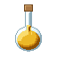{ .item-icon }Stamina Tonic | 10 | 30 | 2 × { .item-icon }Wilted Carrot, { .item-icon }Coconut |
| { .item-icon }Thunder Powder ×2 | 12 | 34 | 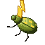{ .item-icon }Lightning Beetle |
| { .item-icon }Antidote Powder | 14 | 38 | 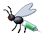{ .item-icon }Doctor Hornet, 3 × { .item-icon }Bitter Grass |
| { .item-icon }Salt Ball ×2 | 14 | 38 | { .item-icon }Crystallised Salt, Cobweb |
| { .item-icon }Flame Powder ×2 | 18 | 46 | 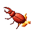{ .item-icon }Fire Hercules |
| { .item-icon }Ice Powder ×2 | 20 | 50 | { .item-icon }Ice Sunfish |
| { .item-icon }Potion of Second Thoughts | 20 | 50 | { .item-icon }Mystery Mushroom, { .item-icon }Bitter Grass, { .item-icon }Medicinal Herb, Glass Bottle |
| { .item-icon }Poison Ball ×2 | 24 | 58 | 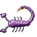{ .item-icon }Clawed Scorpion, Clay Ball |
| Gunpowder ×2 | 26 | 62 | 3 × { .item-icon }Explosive Rock Fragment, any logs |
| { .item-icon }Sleep Ball ×2 | 28 | 66 | 2 × 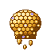{ .item-icon }Sleep Honey, 2 × Clay Ball |
| { .item-icon }Potion of Forgetting | 30 | 70 | { .item-icon }Golden Matsutake, { .item-icon }Mystery Mushroom, { .item-icon }Bitter Grass, { .item-icon }Medicinal Herb, Glass Bottle |
| { .item-icon }Restorative Drug | 30 | 70 | { .item-icon }Salamandrake, 3 × { .item-icon }Lotus Seed, { .item-icon }Giant Devil Hand Moth |
| { .item-icon }Instant Freeze Ball ×2 | 32 | 74 | 6 × { .item-icon }Ice Powder, { .item-icon }Crystallised Salt, 2 × Clay Ball |
| { .item-icon }Revival Elixir | 36 | 82 | { .item-icon }Hydramandrake, { .item-icon }Rainbow Phoenix, { .item-icon }Crossbone Butterfly, 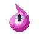{ .item-icon }Spirit Firefly |
| { .item-icon }Rumble Ball | 42 | 94 | 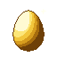{ .item-icon }Golden Egg, { .item-icon }Golden Fruit, 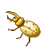{ .item-icon }Golden Hercules |
| { .item-icon }Medicine | 46 | 102 | 2 × { .item-icon }Thunder Powder, 2 × { .item-icon }Flame Powder, 2 × Gunpowder, 2 × { .item-icon }Ice Powder |
| { .item-icon }Experiment Equipment | 50 | 110 | 2 × { .item-icon }Thunder Powder, 2 × { .item-icon }Flame Powder, 2 × Gunpowder, 2 × { .item-icon }Ice Powder, { .item-icon }Instant Freeze Ball |

## Advancements

The **Chemist** tab ("Compound the islands' remedies at the Laboratory") holds:

- **Lab Coat** (build a Laboratory) and **Apprentice Chemist** (reach Chemist level 5);
- one advancement per notable item: Sweet Relief (Mix Candy), First Aid (Healing Tonic), Second Wind (Stamina Tonic), The Doctor Is In (Antidote Powder), Bottled Storm (Thunder Powder), Black Powder (Gunpowder), A Pinch of Salt (Salt Ball), Poison Pill (Poison Ball), Sweet Dreams (Sleep Ball) and Cold Snap (Instant Freeze Ball);
- four challenges: **Back on Your Feet** (compound a Restorative Drug), **Second Life** (a Revival Elixir), **Rumble!** (a Rumble Ball) and **The Last Flask** (both the Medicine and the Experiment Equipment).
