# Lumberjack

The Lumberjack fells trees that grew in the world and plants saplings. The trade leads to the three great trees: the **Kuuigosu**, the **Burning Tree** and, at the top of the trade, the giant **Treasure Tree Adam**. The [Carpenter](carpenter.md) builds hulls from their woods.

| | |
|---|---|
| Workstation | none: you work in the forest |
| Tools | the **Woodsman's Axe** and the **Felling Saw**, made by the [Inventor](inventor.md) |
| Levels | 1 to 100; felling the Adam needs level 50 |

## Felling for XP

Felling pays per log, by the tree it came from:

| Log from | XP per log |
|---|---|
| Any other tree (vanilla's, Mine Mine no Mi's…) | 1 |
| The fruit trees' woods (Red Fruit, Blue Fruit, Brown Fruit, Horrific Pear, Golden Fruit, Palm) | 2 |
| Kuuigosu | 3 |
| Burning Tree | 4 |
| Treasure Tree Adam | 6 |

The log, the wood block and both stripped forms all count. **Planting any sapling** pays 1 XP (not in Creative).

**Only wood that grew counts.**

- A log a player placed is marked: breaking it again pays nothing and is never doubled, whoever placed it.
- The log must belong to a **standing tree**: leaves somewhere along its trunk, or a trunk taller than 24 logs.

## The tools

Both are made by the [Inventor](inventor.md) at the Workshop.

- { .item-icon }**Woodsman's Axe** (Inventor 20: 2 Pure Iron Ore, 3 Diamond Fragments, 2 Mysterious Parts, 2 logs)
    - Diamond tier, 1 800 uses, repaired with Diamond Fragments.
    - Its tooltip reads "A Lumberjack's second log turns up 25% more often": the second-log chance your talents give is multiplied by 1.25, so Second Log's 15 % becomes 18.75 %.
    - It hits for less than a diamond axe, on purpose.
- 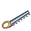{ .item-icon }**Felling Saw** (Inventor 35: 4 Pure Iron Ore, 3 Mysterious Parts, 2 logs)
    - Iron tier, 1 200 uses, repaired with Pure Iron Ore.
    - Its tooltip reads "One cut brings down the trunk, up to 64 logs". It follows the logs of the same wood that are joined to the cut, diagonals included, upward and outward but never below the cut, and it skips logs a player placed.
    - Each log costs one use, pays its XP, and can be doubled by the Second Log talent and its small talents.

## The three great trees

| | Kuuigosu | Burning Tree | Treasure Tree Adam |
|---|---|---|---|
| Grows wild in | Beach, Stony Shore, Mangrove Swamp | Badlands, Eroded Badlands, Wooded Badlands, Savanna Plateau, Windswept Savanna | Dark Forest, Old Growth Spruce Taiga, Old Growth Pine Taiga |
| How rare | about 1 chunk in 22 | about 1 chunk in 40 | about 1 chunk in 1 600 |
| Shape | a straight trunk 6–9 blocks high, round crown | a straight trunk 5–7 blocks high, round crown; the leaves **glow** | a giant 68–92 blocks high, a trunk 13 blocks across flaring to 19 at the foot, a crown about 31 across on several branches; the trunk is **hollow**, with a doorway and a ledge of logs winding up inside |
| Sapling from its leaves | 8 % (Fortune: 10 / 12 / 15 %) | 8 % (Fortune: 10 / 12 / 15 %) | 0.05 % (Fortune: 0.06 / 0.07 / 0.08 %) |
| Planting the sapling | Lumberjack 15 | Lumberjack 25 | Lumberjack 50 |
| Bone meal | works | works | **refused**; the sapling also grows about 60 times more slowly than a normal one |
| Felling | anyone | anyone | **only a Lumberjack of level 50** |
| XP per log | 3 | 4 | 6 |

- They grow wild only where the ground would take their sapling.
- Only a Lumberjack can plant these three saplings. The fruit trees' saplings can be planted by a [Farmer](farmer.md) or a Lumberjack.
- Anyone else who tries to fell the Adam sees "The Adam does not give. Only a Lumberjack of level 50 can fell it." and the block does not break. The lock covers only its log, its wood and their stripped forms: its leaves, its planks and everything made from them are free to anyone.

## The woods

Cruise adds **nine wood sets**: the six fruit-tree woods (Red Fruit, Blue Fruit, Brown Fruit, Horrific Pear, Golden Fruit, Palm) and the Lumberjack's three (Kuuigosu, Burning Tree, Adam).

- Each set has thirteen blocks: Log, Stripped Log, Wood, Stripped Wood, Planks, Slab, Stairs, Fence, Fence Gate, Door, Trapdoor, Button and Pressure Plate. An axe strips the log and the wood as in vanilla.
- The woodwork recipes are ordinary crafting-table recipes, the same as vanilla's, and belong to no trade: they give no trade XP. Any of a wood's logs gives 4 Planks, 4 Logs give 3 Wood (4 Stripped Logs give 3 Stripped Wood), and the rest follow the usual vanilla patterns.
- The planks count as ordinary planks in any recipe that takes "any planks".
- **Burning Tree wood never catches fire**: it is not flammable and lava does not set it alight. The Burning Tree hull is the fireproof one (see [Boats](../boats.md)).

This table lists the nine woods and their sets:

| Wood | Its set |
|---|---|
| 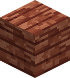{ .block-mini }Adam | 11 crafting recipes: planks, wood, stripped wood, stairs, slab, fence, fence gate, door, trapdoor, button, pressure plate |
| 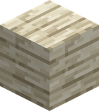{ .block-mini }Blue Fruit | 11 crafting recipes: planks, wood, stripped wood, stairs, slab, fence, fence gate, door, trapdoor, button, pressure plate |
| 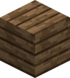{ .block-mini }Brown Fruit | 11 crafting recipes: planks, wood, stripped wood, stairs, slab, fence, fence gate, door, trapdoor, button, pressure plate |
| 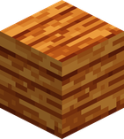{ .block-mini }Burning Tree | 11 crafting recipes: planks, wood, stripped wood, stairs, slab, fence, fence gate, door, trapdoor, button, pressure plate |
| 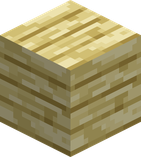{ .block-mini }Golden Fruit | 11 crafting recipes: planks, wood, stripped wood, stairs, slab, fence, fence gate, door, trapdoor, button, pressure plate |
| 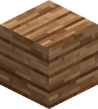{ .block-mini }Horrific Pear | 11 crafting recipes: planks, wood, stripped wood, stairs, slab, fence, fence gate, door, trapdoor, button, pressure plate |
| 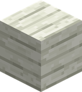{ .block-mini }Kuuigosu | 11 crafting recipes: planks, wood, stripped wood, stairs, slab, fence, fence gate, door, trapdoor, button, pressure plate |
| 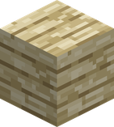{ .block-mini }Palm | 11 crafting recipes: planks, wood, stripped wood, stairs, slab, fence, fence gate, door, trapdoor, button, pressure plate |
| 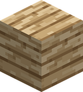{ .block-mini }Red Fruit | 11 crafting recipes: planks, wood, stripped wood, stairs, slab, fence, fence gate, door, trapdoor, button, pressure plate |

The [Carpenter](carpenter.md) builds hulls and lockers from Kuuigosu, Burning Tree and Adam Planks, and Adam Planks also go into the [Blacksmith](blacksmith.md)'s Kuro Kabuto.

## Talents

Every 5 Lumberjack levels give you a **talent point** (10 at level 50, 20 at level 100). Spend them in the Lumberjack's web of talents, opened by the **Talents** button on the trade's page of the trades book or with the **Talents** key (**J** by default). Each talent costs one point. You can take a talent that starts the web, or one linked to a talent you already have. Small talents of one kind add up. A point stays spent until a [Potion of Second Thoughts](chemist.md#the-potion-of-second-thoughts) gives them back. See [Talents](../trades-and-levels.md#talents).

| Talent | Kind | What it gives | Linked to |
|---|---|---|---|
| Good swing 1 | small, start | Logs give 5% faster under your axe | Strong Arm |
| { .item-icon }Strong Arm | **major** | Logs give 50% faster under your axe | Good swing 1, Good swing 2, Clean cut 1, Green hand 1 |
| Good swing 2 | small | Logs give 5% faster under your axe | Strong Arm, Woodcraft 1 |
| Clean cut 1 | small | 2% more chance that a log you fell gives two | Strong Arm, Second Log |
| Green hand 1 | small | Leaves you break drop saplings 10% more often | Strong Arm, Green Thumb |
| Woodcraft 1 | small | A log you fell gives 5% more Lumberjack XP | Good swing 2, Heartwood |
| 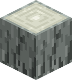{ .block-mini }Second Log | **major** | 15% chance that a log you fell gives two | Clean cut 1, Clean cut 2, Kept edge |
| { .item-icon }Green Thumb | **major** | Leaves you break drop saplings twice as often | Green hand 1, Green hand 2, Planter |
| 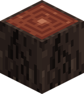{ .block-mini }Heartwood | **major** | Logs of the Kuuigosu the Burning Tree and the Adam give 25% more Lumberjack XP | Woodcraft 1, Woodcraft 2, Fighting Lumberjack 1, Fighting Lumberjack 2 |
| Clean cut 2 | small | 2% more chance that a log you fell gives two | Second Log, Sharp Teeth |
| Kept edge | small | 8% chance that a log does not wear your tool | Second Log, Sharp Teeth |
| Green hand 2 | small | Leaves you break drop saplings 10% more often | Green Thumb, Forester |
| Planter | small | A sapling you plant gives 1 more Lumberjack XP | Green Thumb, Forester |
| Woodcraft 2 | small | A log you fell gives 5% more Lumberjack XP | Heartwood, Good swing 3, Clean cut 3 |
| Fighting Lumberjack 1 | small | Your Lumberjack abilities hit 5% harder | Heartwood, Timber |
| Fighting Lumberjack 2 | small | Your Lumberjack abilities hit 5% harder | Heartwood, Whirling Axe |
| { .item-icon }Sharp Teeth | **major** | Your Felling Saw brings down 96 logs in one cut instead of 64 | Clean cut 2, Kept edge, Fighting Lumberjack 3 |
| { .item-icon }Forester | **major** | 10% of the saplings you plant are not used up | Green hand 2, Planter, Fighting Lumberjack 4 |
| Good swing 3 | small | Logs give 5% faster under your axe | Woodcraft 2, Woodsman's Luck |
| Clean cut 3 | small | 2% more chance that a log you fell gives two | Woodcraft 2, Old Growth |
| { .item-icon }Timber | **ability** | Needs an axe. A great blow from above on a foe. It fells him for 2 seconds. Gives the ability **Timber** | Fighting Lumberjack 1, Fighting Lumberjack 3 |
| { .item-icon }Whirling Axe | **ability** | Needs an axe. Spin and hit every foe around you. They are thrown back. Gives the ability **Whirling Axe** | Fighting Lumberjack 2, Fighting Lumberjack 4 |
| Fighting Lumberjack 3 | small | Your Lumberjack abilities hit 5% harder | Timber, Sharp Teeth |
| Fighting Lumberjack 4 | small | Your Lumberjack abilities hit 5% harder | Whirling Axe, Forester |
| { .item-icon }Woodsman's Luck | **major** | 5% of the logs you fell give a Sweet Sap | Good swing 3, Woodcraft 3 |
| 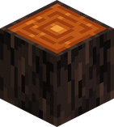{ .block-mini }Old Growth | **major** | Logs of a trunk taller than 12 give 50% more Lumberjack XP | Clean cut 3, Woodcraft 4 |
| Woodcraft 3 | small | A log you fell gives 5% more Lumberjack XP | Woodsman's Luck, Axe Throw |
| Woodcraft 4 | small | A log you fell gives 5% more Lumberjack XP | Old Growth, Axe Throw |
| { .item-icon }Axe Throw | **ability** | Needs an axe. Throw it straight ahead. You keep your axe. Gives the ability **Axe Throw** | Woodcraft 3, Woodcraft 4, Fighting Lumberjack 5 |
| Fighting Lumberjack 5 | small | Your Lumberjack abilities hit 5% harder | Axe Throw |

The numbers after the names of small talents only tell them apart on this page: in game, small talents of one kind have the same name.

### Combat abilities

Taking an ability talent puts its ability in the **Profession** tab of the abilities screen, and you place it on your bar yourself. It costs nothing from your bag. Its small "Fighting Lumberjack" talents make the Lumberjack's abilities hit harder. Damage is on the base mod's scale, as in the ability screen.

| Ability | What it does | Needs | Cooldown | Damage | Range |
|---|---|---|---|---|---|
| **Timber** | With an axe in hand bring it down on the enemy you look at. It hurts them a lot and fells them for 2 seconds. A player or a boss is felled half as long | an axe in hand | 12 s | 60 | 4 blocks |
| **Whirling Axe** | With an axe in hand spin on yourself. Every enemy around you is hit and thrown back | an axe in hand | 10 s | 30 | 3.5 blocks |
| **Axe Throw** | With an axe in hand throw it straight ahead. You keep your axe | an axe in hand | 8 s | 35 | — |

### If you had the trade before 0.5.0

The perks by level are gone. The first time you play 0.5.0, your points are put for you on the talents that took their place, level by level, as long as you have points:

| Level | Points first put on |
|---|---|
| 10 | Good swing 1, Strong Arm |
| 25 | Clean cut 1, Second Log |
| 40 | Green hand 1, Green Thumb |

## Advancements

The **Lumberjack** tab opens at Lumberjack level 1: Apprentice Lumberjack (level 5), Three Woods (hold a Kuuigosu Log and a Burning Tree Log), and the challenge **The Tree That Cannot Be Chopped Down** (fell the Treasure Tree Adam: getting an Adam Log is enough), which rewards 100 experience points.
