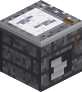
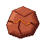
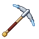
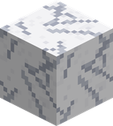
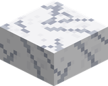
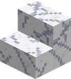
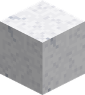
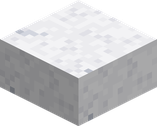
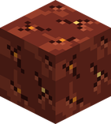

# Miner

The Miner earns XP by breaking ore and certain rocks. As the trade grows, the rock starts to give up **finds** on top of its normal drops: Diamond Fragments, Marble, Kairoseki, Dial Fragments, Pure Iron Ore and more. At the **Masonry**, the Miner turns those finds into marble blocks, iron and diamonds.

| | |
|---|---|
| Workstation | { .block-mini }**Masonry** |
| How it is made | 8 Stone around a Crafting Table |
| Tools | any pickaxe of the right tier; the **Enhanced Pick-axe** is made by the [Inventor](inventor.md) |
| Levels | 1 to 100; new finds up to level 50 |

## What counts

- The block must be broken **in Survival**, with a tool that would normally harvest it (a pickaxe of the right tier for an ore).
- **Silk Touch turns the trade off**: a block taken whole gives no XP and no finds.
- The Explosive Rock and Mine Mine no Mi's dials specifically need a **pickaxe**.

## XP from breaking

Ores pay Miner XP at any level: the rarer the ore, the more it pays, and Ancient Debris pays the most. Plain Deepslate, Tuff, Calcite and Diorite pay nothing of their own; they only pay when a find turns up. Each find that drops pays its own extra XP on top.

This table gives the XP each block pays when broken:

| Breaking | XP |
|---|---|
| any coal ores | 7 |
| any copper ores | 7 |
| Nether Quartz Ore | 7 |
| any iron ores | 14 |
| any redstone ores | 14 |
| any gold ores | 21 |
| any lapis ores | 21 |
| Kairoseki Ore, Deepslate Kairoseki Ore | 35 |
| any diamond ores | 42 |
| any emerald ores | 42 |
| Ancient Debris | 70 |

## Finds in the rock

From **Miner level 5**, some blocks can turn up finds as well as their normal drops.

- Each find is rolled **separately** every time the block is broken, so a block with several possible finds can give more than one at once.
- Each find starts at a set Miner level; the professions book lists it as an unlock at the lowest level where it appears.
- A player who does not practise the Miner trade gets no finds at all.

This table lists every find, the block it comes from, its chance, the Miner level it needs and the extra XP it pays:

| Breaking | Can turn up | Chance | Level | XP |
|---|---|---|---|---|
| Explosive Rock | { .item-icon }Explosive Rock Fragment | 100 % | 5 | 21 |
| any diamond ores | { .item-icon }Diamond Fragment | 30 % | 5 | 14 |
| Axe Dial, Breath Dial, Eisen Dial, Flame Dial, Flash Dial, Impact Dial, Milky Dial, Reject Dial | { .item-icon }Dial Fragment | 100 % | 10 | 35 |
| Calcite | { .item-icon }Marble | 8 % | 10 | 21 |
| Diorite | { .item-icon }Marble | 4 % | 10 | 21 |
| Kairoseki Ore, Deepslate Kairoseki Ore | Kairoseki | 25 % | 15 | 14 |
| any iron ores | { .item-icon }Iron Scrap | 12 % | 18 | 28 |
| any iron ores | { .item-icon }Pure Iron Ore | 10 % | 25 | 28 |
| any coal ores | { .item-icon }Explosive Rock Fragment | 8 % | 28 | 35 |
| Deepslate | { .item-icon }Diamond Fragment | 0.4 % | 35 | 53 |
| Deepslate, Tuff | { .item-icon }Mysterious Parts | 0.3 % | 38 | 56 |
| Kairoseki Ore, Deepslate Kairoseki Ore | Dense Kairoseki | 10 % | 42 | 70 |
| any iron ores | { .item-icon }Pure Iron Ore | 15 % | 45 | 28 |
| Ancient Debris | Netherite Scrap | 25 % | 46 | 88 |
| Deepslate, Tuff | Kairoseki | 0.15 % | 50 | 105 |
| Star Core | { .item-icon }Star Fragment | 100 % | 50 | 210 |

Two finds are worth a closer look:

- **Pure Iron Ore** from iron ores has two separate rolls: one from level 25 and a second one from level 45, on top of the first.
- **Mysterious Parts** (from level 38) and **Kairoseki** (from level 50) can turn up in plain Deepslate and Tuff, very rarely.

### The Explosive Rock

Red, cracked boulders two to three blocks across, half buried, found in **badlands, desert and mountain** biomes (in roughly one chunk in five there).

- A **Miner of level 5 or more** who breaks one with a pickaxe gets 1 to 3 { .item-icon }**Explosive Rock Fragments**. About 12 % of the time, a **Rock Lizard** was hiding inside.
- Anyone else sets it off: a small blast that hurts but breaks no blocks, and leaves them nothing.

### Dials

From **Miner 10**, breaking one of Mine Mine no Mi's dials (Axe, Breath, Eisen, Flame, Flash, Impact, Milky or Reject Dial) with a pickaxe shatters it into 2 to 4 { .item-icon }**Dial Fragments**, **instead of** the dial itself. Below level 10, the dial breaks and drops as normal.

### Marble

There is no marble ore: **Marble** only comes from breaking **Calcite** (8 %) and **Diorite** (4 %), from Miner 10.

### The Star Core

Now and then a star falls in the wild and lies on the ground for one day: a shell of dark rock around a core of Kairoseki ore, with a few diamond, gold and emerald ores and a **Star Core** at its heart. A Miner gets the usual XP and finds from its ores. See [Events at sea](../events-at-sea.md#a-falling-star).

- The Star Core holds one **Star Fragment**, found nowhere else.
- Only a **Miner of level 50** can take it, with a **diamond pickaxe or better**. Nobody else can break the Star Core, so nobody can waste it.
- The Star Fragment is kept for the master crafts of the highest levels, which are still to come. Until then the Prospector buys it for **15 000 Belly**, more than anything else he takes (see [Merchants and contracts](../merchants-and-contracts.md)).

## The Enhanced Pick-axe

{ .item-icon }The **Enhanced Pick-axe** is made by the [Inventor](inventor.md) at the Workshop (Inventor 25: 5 Diamond Fragments, 3 Mysterious Parts, 1 log).

- Diamond's mining tier, 1 800 uses, repaired with Diamond Fragments.
- Its tooltip reads "A Miner's finds turn up 25% more often". It multiplies what your talents give: with Keen Pick (×1.5), ×1.875 in all.

## The Masonry

The Masonry is the Miner's workstation; it needs a pickaxe to be picked back up. Every recipe asks for a Miner level and pays Miner XP.

It turns Marble into building blocks (Marble Block, Marble Slab, Marble Stairs, Polished Marble and Polished Marble Slab), **Pure Iron Ore** into Iron Ingots, and **Diamond Fragments** into a Diamond. All marble blocks need at least a stone pickaxe to drop.

These are the Masonry's recipes:

| Makes | Level | XP | Ingredients |
|---|---|---|---|
| { .block-mini }Marble Block | 1 | 12 | 4 × { .item-icon }Marble |
| { .block-mini }Marble Slab ×6 | 5 | 20 | 3 × { .block-mini }Marble Block |
| { .block-mini }Marble Stairs ×4 | 8 | 26 | 3 × { .block-mini }Marble Block |
| { .block-mini }Polished Marble ×4 | 14 | 38 | 4 × { .block-mini }Marble Block |
| { .block-mini }Polished Marble Slab ×6 | 16 | 42 | 3 × { .block-mini }Polished Marble |
| Iron Ingot ×2 | 30 | 70 | { .item-icon }Pure Iron Ore |
| Diamond | 44 | 98 | 9 × { .item-icon }Diamond Fragment |

## Where the finds go

- **Explosive Rock Fragments** become Gunpowder for the [Chemist](chemist.md).
- **Dial Fragments** become the Mysterious Dial and the Jet Dial for the [Inventor](inventor.md).
- **Pure Iron Ore** goes into the Inventor's Magnet, Woodsman's Axe, Felling Saw and Hull Ram, the [Carpenter](carpenter.md)'s Adam boats, the [Blacksmith](blacksmith.md)'s Warabide Sword and several [Tailor](tailor.md) pieces.
- **Kairoseki** and **Dense Kairoseki** feed the Blacksmith's sea-stone weapons and handcuffs.

## Talents

Every 5 Miner levels give you a **talent point** (10 at level 50, 20 at level 100). Spend them in the Miner's web of talents, opened by the **Talents** button on the trade's page of the trades book or with the **Talents** key (**J** by default). Each talent costs one point. You can take a talent that starts the web, or one linked to a talent you already have. Small talents of one kind add up. A point stays spent until a [Potion of Second Thoughts](chemist.md#the-potion-of-second-thoughts) gives them back. See [Talents](../trades-and-levels.md#talents).

| Talent | Kind | What it gives | Linked to |
|---|---|---|---|
| Sharp eye 1 | small, start | Your finds in the rock turn up 5% more often | Keen Pick |
| { .item-icon }Keen Pick | **major** | Your finds in the rock turn up 50% more often | Sharp eye 1, Good arm 1, Clean strike 1, Ore sense 1 |
| Good arm 1 | small | Rock and ore give 5% faster under your pickaxe | Keen Pick, Stone Breaker |
| Clean strike 1 | small | 2% more chance that an ore gives its drops twice | Keen Pick, Double Strike |
| Ore sense 1 | small | An ore gives 5% more Miner XP | Keen Pick, Prospector |
| { .item-icon }Stone Breaker | **major** | Rock and ore give 25% faster under your pickaxe | Good arm 1, Sharp eye 2, Good arm 2, Kept point |
| { .item-icon }Double Strike | **major** | 10% chance that an ore gives its drops twice | Clean strike 1, Clean strike 2 |
| { .item-icon }Prospector | **major** | An ore gives 25% more Miner XP | Ore sense 1, Ore sense 2 |
| Sharp eye 2 | small | Your finds in the rock turn up 5% more often | Stone Breaker, Deep Digger |
| Good arm 2 | small | Rock and ore give 5% faster under your pickaxe | Stone Breaker, Fighting Miner 1 |
| Kept point | small | 8% chance that an ore does not wear your tool | Stone Breaker, Sharp eye 3 |
| Clean strike 2 | small | 2% more chance that an ore gives its drops twice | Double Strike, Rich Vein, Ground Breaker |
| Ore sense 2 | small | An ore gives 5% more Miner XP | Prospector, Pick Strike, Gem Cutter |
| { .item-icon }Deep Digger | **major** | Your finds in deepslate and tuff turn up twice as often | Sharp eye 2, Ore sense 3, Sharp eye 4, Fighting Miner 2 |
| Fighting Miner 1 | small | Your Miner abilities hit 5% harder | Good arm 2, Ground Breaker, Seastone Sense |
| Sharp eye 3 | small | Your finds in the rock turn up 5% more often | Kept point, Gem Cutter, Blast Rock |
| { .item-icon }Rich Vein | **major** | 10% more chance that an ore gives its drops twice | Clean strike 2, Good arm 3 |
| { .item-icon }Ground Breaker | **ability** | Needs a pickaxe. A shock wave runs 8 blocks ahead. Foes on its way are thrown up. Gives the ability **Ground Breaker** | Fighting Miner 1, Good arm 3, Clean strike 2 |
| { .item-icon }Pick Strike | **ability** | Needs a pickaxe. A blow on a foe. It holds him for 1 second. Gives the ability **Pick Strike** | Ore sense 2, Ore sense 4 |
| { .item-icon }Gem Cutter | **major** | 20% chance that a find comes with one more | Sharp eye 3, Ore sense 4, Ore sense 2 |
| Ore sense 3 | small | An ore gives 5% more Miner XP | Deep Digger, Fighting Miner 3 |
| Sharp eye 4 | small | Your finds in the rock turn up 5% more often | Deep Digger, Seastone Sense |
| Fighting Miner 2 | small | Your Miner abilities hit 5% harder | Deep Digger, Blast Rock |
| Seastone Sense | **major** | Your finds in Kairoseki ore turn up twice as often | Sharp eye 4, Fighting Miner 4, Fighting Miner 1 |
| { .block-mini }Blast Rock | **ability** | Needs a pickaxe. Throw an Explosive Rock. It bursts on 3 blocks and breaks no block. Gives the ability **Blast Rock** | Fighting Miner 2, Fighting Miner 5, Sharp eye 3 |
| Good arm 3 | small | Rock and ore give 5% faster under your pickaxe | Ground Breaker, Rich Vein |
| Ore sense 4 | small | An ore gives 5% more Miner XP | Gem Cutter, Pick Strike |
| Fighting Miner 3 | small | Your Miner abilities hit 5% harder | Ore sense 3 |
| Fighting Miner 4 | small | Your Miner abilities hit 5% harder | Seastone Sense |
| Fighting Miner 5 | small | Your Miner abilities hit 5% harder | Blast Rock |

The numbers after the names of small talents only tell them apart on this page: in game, small talents of one kind have the same name.

### Combat abilities

Taking an ability talent puts its ability in the **Profession** tab of the abilities screen, and you place it on your bar yourself. It costs nothing from your bag. Its small "Fighting Miner" talents make the Miner's abilities hit harder. Damage is on the base mod's scale, as in the ability screen.

| Ability | What it does | Needs | Cooldown | Damage | Range |
|---|---|---|---|---|---|
| **Ground Breaker** | With a pickaxe in hand strike the ground. A shock wave runs 8 blocks straight ahead. Every enemy on its way is hit and thrown up | a pickaxe in hand | 12 s | 35 | 8 blocks |
| **Pick Strike** | With a pickaxe in hand strike the enemy you look at. It hurts them a lot and holds them for 1 second. A player or a boss is held half as long | a pickaxe in hand | 9 s | 55 | 4 blocks |
| **Blast Rock** | With a pickaxe in hand throw an Explosive Rock. It bursts where it lands and hurts every enemy within 3 blocks. It breaks no block | a pickaxe in hand | 12 s | 40 | 3 blocks |

### If you had the trade before 0.5.0

The perks by level are gone. The first time you play 0.5.0, your points are put for you on the talents that took their place, level by level, as long as you have points:

| Level | Points first put on |
|---|---|
| 10 | Sharp eye 1, Keen Pick |
| 25 | Clean strike 1, Double Strike |
| 40 | Clean strike 2, Rich Vein |

## Advancements

The **Miner** tab opens at Miner level 1: Apprentice Miner (level 5), Diamond in the Rough (find a Diamond Fragment), Carved in Stone (find Marble), Sea-Prism Stone (mine Kairoseki), Handle With Care (break an Explosive Rock into fragments) and Shell Shock (shatter a dial into Dial Fragments).
