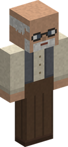
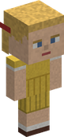
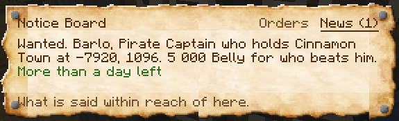
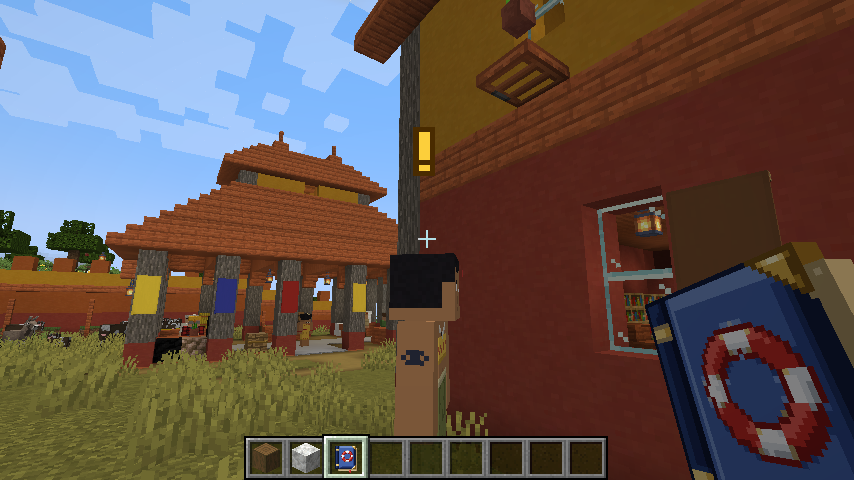
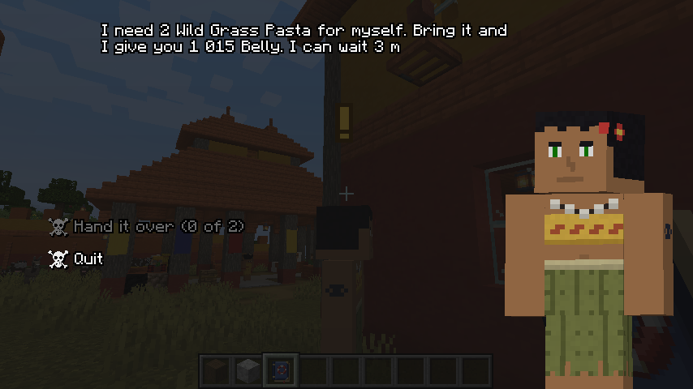
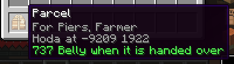
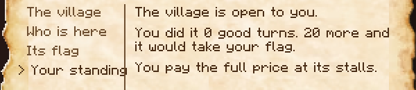

# Villages

The islands are lived in. **One Piece villages** rise in five lands, each in its land's own look, each with its own name, its people and their day. They are where the [merchants](merchants-and-contracts.md) set up their stalls, where the merchant ship anchors, and where the [village events](village-events.md) happen. One place in three is larger: a walled [town](towns.md). Since 0.7.0 a village can [grow into a town](#prosperity-a-village-grows) too.

!!! note "Only in new land"
    Villages are part of the world's generation: they appear in land that has not been explored yet. **Villages already made keep their shape**: what 0.4.0 brings (the four new looks, the halls, the towns, the pirates' and the Revolutionaries' villages) is found in new land only. A village made before has no hall, and never passes under a flag.

!!! note "Minecraft's own villages no longer generate"
    Since 0.4.0 a world has Cruise's villages alone. They grow in the same lands, and about one more in six stands where a vanilla village would have taken the room. With the vanilla villages go the villagers and their trades, the iron golems and the raids. Villages already generated stay as they are, and the log book no longer counts them among the places to find. To have both kinds, set `withVanillaVillages = true` under `villages` in `config/inocruise-common.toml`; it is read when the server or the world starts. The older `vanillaVillages` setting is no longer read. See [Configuration](configuration.md#villages).

## Five lands, five looks

A village takes the look of the land around it, even when it stands on that land's beach. Who heads it, and what his building is called, follows the land too.

| Land | Where | How it is built | Its people | At its head | His building |
|---|---|---|---|---|---|
| **Plains** | plains, sunflower plains, meadows | white walls and red roofs | the villagers shown [below](#the-people) | Mayor | Town Hall |
| **Desert** | desert | sandstone houses with flat roofs behind crenellated parapets, terracotta and glazed tiles, cloth awnings, a dome on the tavern and on the hall, jars where the plains have barrels; no timber and no brick | turbans and head cloths, long robes worn open, wide sashes, sandals | Governor | Governor's Palace |
| **Snowy plains** | snowy plains | spruce planks on a foot of stone, stone chimneys, roofs in steps that carry the snow, firewood by the doors, carved ice on the square | long coats, fur hats, knitted caps, scarves and mittens | Chief | Great Hall |
| **Savanna** | savanna | acacia and fired clay: walls of yellow or red clay or of logs, roofs of four slopes far out over the walls, a gallery on posts over each door, a square of beaten earth round a well of clay | bare to the waist in skirts of grass, their hair in a knot, a necklace of white stones | Elder | Elders' Hall |
| **Taiga** | taiga | rough stone, mossy at the foot, between posts of logs; roofs of logs laid in steps under a ridge beam, pumpkins behind the houses, shields along the hall | dressed as Elbaf's people: horned helmets, furs, bright tunics, braids | Jarl | Longhouse |

Everything a village has is there under each look: the square and its well, the tavern, the workshops, the windmill inland, the port, the lighthouse and the shipyard by the sea, the notice board, the events, the flag.

- Under the snow the lanes stay clear, and a village by a frozen sea has its port all the same: the ice takes its piers and its boats.
- In the savanna a new block, the **Terracotta Chimney Cap**, smokes on the chimneys.
- A pirate crew's blockhouse is built in the land's own way; the Marines' post and the Revolutionaries' camp are the same everywhere.

**A village stands in a clearing.** No tree grows on a village's ground (its plots, its lanes, a town's wall) nor within eight blocks of it, in any land: the trees round a village are whole, and the forest begins a few steps from its houses. A tree you plant in a village grows as anywhere.

## What a village is made of

| | |
|---|---|
| **The market square** | a well, a bell, the notice board and four stalls. The travelling merchants set up here. |
| **The hall** | on the square, with a mast on its roof and the village's flag on it. The one at the village's head is there by day. See [The hall and its flag](#the-hall-and-its-flag). |
| **The tavern** | with its barkeeper, who sells the rumours of the events. In the evening a musician plays there: a flute, a violin or a guitar, and the Musician's own tunes. |
| **Trade buildings** | four to six of them: restaurant, forge, workshop, laboratory, sewing room, tannery, masonry. |
| **Houses** | one inhabitant in every house and every workshop. |
| **By the water** | a port with its piers, a shipyard and a fisherman's house on stilts, and on the sea a lighthouse. A fishing boat, and sometimes a dinghy, are moored at the piers. |
| **Inland** | a windmill, with its fields of wheat, Bitter Grass and Medicinal Herb. |
| **The farm** | animals in its pen; a cat or a dog hangs about the square. |

A village on a slope has roads that climb from house to house: every door is joined to the market square, with never more than one block to step up. Smoke rises from the chimneys (each wears a **Chimney Cap**, a [block](blocks.md#village-blocks) you can take for your own roof), and the bell rings at dawn and at dusk. The coastal villages made since 0.4.0 are a little wider.

**Every village has a name**: Honey Village, Anchor Town, Komura... It comes up on your screen as you walk in, and the Navigator's [Log Book](bestiary-and-logbook.md) keeps the names of the villages you have been to. A place made since 0.4.0 whose name is a word is called a Village or a Town for what it is; villages already made keep their names.

**One place in four is a town**: about twice a village's houses, more than twice its people, a workshop of every trade, a wall, guards, and four buildings no village has. See [Towns](towns.md).

## The hall and its flag

Every village made since 0.4.0 has a hall on its market square. In the plains it is the town hall: the tallest house on the square, with a stepped gable, a balcony over its doors and a mast on its roof. The desert's palace is under a dome; the savanna's hall keeps the stepped gable.

**The one at the village's head** (the mayor in the plains; see the [table](#five-lands-five-looks) for the others) is there by day, behind his desk. Right click him and he tells you:

- what his village is: its name, its people, its workshops, its port, and whether it is a town;
- who is there: the Marines, a pirate crew, the Revolutionaries, a group of players, or nobody;
- what it would take to put the village under your flag: see [A village under your flag](village-flags.md).

He is one of the villagers. Striking him is a crime like any other, and if he is killed another one comes three days later.

**The flag on the mast says who holds the village.**

| On the mast | Who holds the village |
|---|---|
| The Marines' flag | the Marines, who keep a post in it or a base beside it |
| A Jolly Roger like no other | a pirate crew: each has its own name and its own flag |
| The Revolutionary Army's flag | the Revolutionaries, who have a camp near it |
| The flag of a group of players (for a crew, its own Jolly Roger) | the players who took it |
| A bare mast | nobody, or a village whose people are all dead |

## Whose village

Of eight new villages:

| How many | Whose | What stands there |
|---|---|---|
| Three in eight | **the Marines'** | for two of them a small **Marine post** among the houses, with a few soldiers; for the third a large **Marine base** beside the village, with its captains and its prison |
| Two in eight | **a pirate crew's** | a blockhouse among the houses, with its crow's nest; or, by the sea, their ship moored off the port, a gangway running to her from the foot of the lighthouse, their Jolly Roger at her masthead |
| One in eight | **the Revolutionary Army's** | their camp apart from the village: three tents round a fire in a clearing, some thirty blocks from the last houses, with no path to it |
| Two in eight | **nobody's** | a bare mast |

- By the sea, where there is water enough for a ship, pirates are twice as many: they have the villages the Marines' post would have had.
- Where the land will not do for the large base, the village has the post instead. Where the land around a village is too rough or too wet for a camp, the village is nobody's.
- Villages already made keep whoever they had.

**Those who keep a village walk about in it** (since 0.4.1). Their captain and the first man of each post keep their place; the others are on the square by day, at the tavern in the evening, and go back to their post at night. The Revolutionaries all stay in their camp. Each of them has a **name**, shown with his rank when you look at him: "Dorn, Marine Captain". One who falls is relieved three days later. Ask the one at the village's head **where they are**: he says how many are left, and you see them through the walls for a minute (see [By force](village-flags.md#by-force)).

**The Marines** come for whoever commits a crime in the village. Every Marine player has the friend's price at the stalls of a Marine village: 10 % off.

**A pirate crew's men** are no friends of the Marines or the Bounty Hunters, whom they strike on sight. Anyone else they leave alone, unless struck first; they remember a blow for five minutes.

**The Revolutionaries.** Eight of them keep the camp, soldiers, brutes and a captain: fighters of their own, in capes, goggles and hooded cloaks. Like a crew's men they strike the Marines and the Bounty Hunters on sight and leave everyone else alone, unless struck first. Every Revolutionary player has the friend's price in such a village. The camp is no part of the village: nothing mends it, and breaking it is nobody's crime.

A village that someone keeps is not won by good turns or by a great bounty: it is taken from them by force. A village that nobody holds can pass under your flag. Both are told in [A village under your flag](village-flags.md).

## Playing a civilian

**Everyone starts as a civilian** (since 0.6.0). The character creator's book no longer offers a side: you earn one by what you do. A player who already had a side keeps it. A server can give the choice back with `civilianStart = false`, under `factions` in `serverconfig/inocruise-server.toml` (see [Configuration](configuration.md#inocruise-servertoml)).

The Civilian has its own flag, wood brown.

- **No bounty, no loyalty.** The Marines, the World Government, the Bounty Hunters and the Revolutionaries leave you alone. Pirates and bandits do not.
- **Striking the law.** The first and the second Marine or man of the World Government you strike in one game day are warned of: "You struck a man of the law". Strike a **third** that day and you are a **pirate**. The count starts again each new day.
- **They strike back.** A Bounty Hunter or a Revolutionary you strike may strike you back for **30 seconds** after your last blow.
- **Raids.** A civilian holds no village, but he can help one. When a [raid](village-flags.md#raids) is beaten off, the village pays each civilian who fought it **50 Belly for every raider he beat**, from its coffer as far as it holds, and counts **a good turn** for each raider.
- **Taking from a village's chests** is a civilian's crime (since 0.6.0), as it is in a Marine base. A weapon or a Devil Fruit box makes you a **pirate** at once; anything else counts as one strike. It also costs the village's [reputation](#your-name-in-a-village).

### Becoming a Bounty Hunter

A town's notice board has a **Bounty Clerk** beside it (in towns made since 0.6.0). A civilian with no bounty, whom the town counts as a **Friend**, can sign up with him.

- He names the hunt: the nearest pirate den or pirate ship within 3,000 blocks that no player holds.
- He pays for each of its men you bring down: **500 Belly** for a grunt, **1,500** for a brute, **5,000** for a captain, and each one raises your name in the town that gave the hunt.
- You leave the Bounty Hunters at any clerk, for nothing.

### Joining the Revolutionary Army

A **Hooded Stranger** hides in the cache of a town's [black market](towns.md#the-black-market). The barkeeper tells a civilian of him once the town counts them as a **Friend**; never a Marine, a man of the World Government, a Bounty Hunter or a pirate.

- He takes only a civilian with no bounty, a Friend of the town, and gives a task first: help beat off a [raid](village-flags.md#raids), or bring down the man of a [wanted notice](#the-notice-board).
- You can leave through any contact: with no bounty you are a civilian again, with one a pirate.

## The people

Fishermen, farmers, craftsmen and townspeople live there, with **two or three children** in each village. Right click one to hear what he has to say.

**Everyone has a name** (since 0.4.1): a name of his land, shown with his trade when you look at him - "Marlo, Farmer", "Sena, Innkeeper". The villagers, the children, a town's guards and keepers and the one at the village's head all have one; the people of villages already made get theirs as you come near. Now and then one tells you who he is, or speaks of a neighbour by name. The tavern's barkeeper, the merchants and the people of the events keep their title.

| Time of day | Where they are |
|---|---|
| Morning and afternoon | at work: the fishermen on the pier, the farmer at the mill, the craftsmen at the workshops |
| Noon | on the market square |
| Evening | at the tavern |
| Night, or when danger comes | at home |

The children play tag on the square by day and go home before the adults. Two villagers who cross stop for a word.

The villagers have **eight looks**; the two children stand half as tall as an adult.

<figure markdown>

<figcaption>Fisherman</figcaption>
</figure>

<figure markdown>

<figcaption>Farmer</figcaption>
</figure>

<figure markdown>

<figcaption>Craftsman</figcaption>
</figure>

<figure markdown>

<figcaption>Townswoman</figcaption>
</figure>

<figure markdown>

<figcaption>Young Woman</figcaption>
</figure>

<figure markdown>

<figcaption>Old Man</figcaption>
</figure>

<figure markdown>
{ style="height: 64px" }
<figcaption>Boy</figcaption>
</figure>

<figure markdown>
{ style="height: 64px" }
<figcaption>Girl</figcaption>
</figure>

In 3D: drag to turn, scroll or pinch to zoom; the buttons change the look.

These are the people of the plains. In the four other lands they dress for the place: see the [table](#five-lands-five-looks).

**They know who you are.** A pirate whose bounty has reached **100,000 Belly** is known: people step away from him and have only a wary word. A Marine is welcome. The people of a village that your group rules by fear step away from you too. The nobles of a town's [noble quarter](towns.md#the-noble-quarter) are warier still: for them any pirate with a bounty is one too many.

Pirates and bandits do not appear in the middle of a village.

**Six faces for each kind** (since 0.7.0). Each kind of villager - fishermen, farmers, guards, heads, innkeepers, bankers, children and the rest - has six faces in each of the five lands, so two neighbours rarely look alike. A town's arena masters and nobles have six faces each too. Villagers already in a world keep the face they had.

**Modified humans are turned away** (since 0.7.0). A player of [Race Race no Mi](../race-race-no-mi/index.md)'s modified humans finds no merchant to deal with, no head of a village who will talk, and no reputation for their good deeds. The inn, the warehouse, the bank and the bounty office stay open to them.

## Hands off the villagers

| What you do | What it costs |
|---|---|
| Strike a civilian | your bounty rises by 100 Belly, and the village is **closed to you for a day** |
| Kill a civilian | your bounty rises by 1,000 Belly, and the village is closed to you for **three days** |
| The same to a child, or to a [town's guard](towns.md#the-guards) | double |
| Row a moored boat away from the port | a theft: it costs what a blow costs |
| Break the village's blocks by hand | the first two in a day are warnings; each one after that costs what a blow costs |

A player whose faction has no bounty, a Marine, loses loyalty instead. The civilians around run home, and the village's Marines come for you; in a town its guards come too.

- The one at the village's head is a villager like the others: the same costs.
- **Killing one of a village's people earns nothing**, whoever it is.
- A death that follows your blow by a moment (a fall, a fire, your own animals) is counted as yours.
- A crime in a village that flies your own group's flag also costs it some of its [loyalty](village-flags.md#loyalty).

**A crime tells what it cost** (since 0.7.0): striking or killing a villager says how much your bounty went up, or your Marine loyalty went down, and how much reputation you lost.

**Fighting back is no crime** (since 0.7.0). When a mob of any mod attacks you first in a village, the blocks your fruit's attacks break while you fight it, and the villagers and guards they catch, cost you nothing for half a minute after its last blow. The village rebuilds the blocks as usual. Blocks you break by hand and villagers you punch still count.

While a village is **closed** to you, its people refuse to talk, its merchants do not trade with you and its notice board will not deal with you. A closed town also has no room for you at its inn, takes nothing from you at its warehouse and closes the stall you rent in its market hall, and its guards go for you on sight. Sitting in a moored boat at the pier costs nothing; rowing it away does.

## Villages mend themselves

A village can be damaged, and recovers. Whatever broke it (an ability, an explosion, fire, a hand), it puts itself back block by block, from the ground up, once it has been left in peace for **three minutes**: the ruins last as long as the fight, then a house is back in about half a minute.

- **What you build in a village is cleared away** as it mends and handed back to you, dropped where it stood: a chest comes back with what it held.
- **A village's own blocks give nothing** when they break, and its chests come back empty.
- **Breaking them by hand is a crime.** The first two blocks in a day are warnings; the third closes the village to you and raises your bounty, as striking a villager does.
- **A village whose people were all killed no longer mends**: its ruins stay.

A server chooses what happens to its villages' blocks with `villageDamage`, under `villages` in the world's `serverconfig/inocruise-server.toml` (in `config/inocruise-common.toml` before 0.7.0):

| Value | What it does |
|---|---|
| `MEND` (default) | a village can be damaged and mends, as told above |
| `FORBID` | on top of that, nothing can be broken or built in a village by hand, by an explosion or by an ability |
| `NOTHING` | villages are not protected at all, and what is broken stays broken |

A player in creative mode is outside these rules: what he changes in a village stays. See [Configuration](configuration.md#villages).

## The notice board

On the market square, a board has two notes: the day's orders, and the news.

**The orders.** The board shows **five small orders every morning**, one for each supplying trade: fishing, hunting, mining, farming and cooking.

- An order asks for one to three of an everyday good of that trade.
- It pays **1.3 to 1.5 times** what the goods are worth to their merchant, in Belly, with a Merchant's sales bonus on top.
- It pays **XP in the trade** too, if you practise it: half of what producing the goods gave.
- One order in four adds a small gift.
- The first player to deliver takes the order.
- Each order is one of the village's people's: the pointer on it says who asks.
- An order delivered is a good turn done to the village: after twenty good turns it will take [your flag](village-flags.md#by-trust).

The bigger orders are the merchants' [contracts](merchants-and-contracts.md), and a town's [warehouse](towns.md#the-warehouse) buys in bulk.

**The news.** The second note tells every event running within 2,000 blocks, as a barkeeper would tell it, with how long it still lasts. A ship at anchor gives its coordinates; a school of fish, a fallen star, a migration, a storm or the fog give a way and a distance. It costs nothing: you only have to come and read. The events themselves are told in [Village events](village-events.md) and [Events at sea](events-at-sea.md).

**Wanted notices** (since 0.4.2). At the head of its news a board may post one man: the captain who leads the Marines or the pirates **holding a village nearby**, by his name and rank, with the village he holds and where it lies.

- A village the Marines keep, or nobody, posts a pirate captain; one a pirate crew or the Revolutionaries keep posts a Marine officer. It is the nearest such leader within 3,000 blocks.
- Whoever strikes the last blow is paid **5,000 Belly by every village that posted him**, and has done each of them a good turn.
- Nothing is paid for a man of your own side: a Marine who beats a Marine captain gets nothing, and the notice comes down.
- A notice stays **a week**, or until its man falls or is relieved. The board is then bare for three days before the next.

## Errands

Since 0.4.2 the people ask things for themselves. Now and then **one inhabitant of a village, two in a town**, has an **exclamation mark** over his head, seen from 24 blocks. Speak to him: he says what he wants, what he gives for it and how long he waits, and a button hands it over once you carry it all.

He waits **3 days**, then somebody else asks. The first player to bring it has it. Guards, children and the keepers of the inn, the warehouse and the hall ask nothing, and a village with nobody at its head has no errands.

| What he asks | Who asks | What it pays |
|---|---|---|
| **Goods of a trade** | a fisherman: fish, now and then Bait or a Scent Lure; a farmer: crops; a craftsman: ores; the women: a Cook's dishes; an old man: a Hunter's catches | 1.5 to 1.7 times what the goods are worth (the board pays 1.3 to 1.5), XP in the trade, a Merchant's bonus |
| **A parcel to carry** (one time in four) | anyone who asks, for somebody he names in another living village within 4,000 blocks | paid on arrival by the one it is for: 200 Belly and 1 more for every 2 blocks of the way, 2,000 at most |
| **A remarkable catch** (one time in four) | a fisherman: one fish of a given size, bigger than most of its kind; an old man: one creature of the rarer half of the Hunter's | 1.8 to 2 times what such a catch is worth, XP in the trade |

- **The Parcel** is an item: whom it is for, where he lives and what he pays are written on it. The one who waits for it shows the mark too, for 7 days; if he is not about, the one at his village's head takes it for him. He pays however late it comes.

- A fish too small is not taken. Of several big enough, the smallest goes.
- Every errand done is **a good turn** for the village that asked: after twenty it will take [your flag](village-flags.md#by-trust). For a parcel, it is the village that sent it.

## Where you stand

The window of the one at a village's head has a part named **Your standing** (since 0.4.2):

- the **good turns** you did the village, and how many are left before it would take your flag;
- what its **stalls take off** for you, and why: a Merchant's bargain, a fever you helped with, your flag or your side;
- for one of the group that holds it, its **loyalty**.

A village closed to you does not open that window: its head says **for how long** it stays closed, in hours under a day, in days from there.

## Your name in a village

Since 0.6.0 every village and town keeps a **reputation** for each player, in seven steps:

| Step | Points | What it means |
|---|---|---|
| **Sworn Enemy** | -300 and below | no errands, the hall is shut to you |
| **Hated** | -299 to -200 | no errands, the hall is shut to you, stalls 25 % dearer |
| **Distrusted** | -199 to -100 | stalls 10 % dearer |
| **Unknown** | -99 to 99 | |
| **Liked** | 100 to 199 | stalls 5 % cheaper, a loan at the [bank](towns.md#the-bank) |
| **Friend** | 200 to 299 | stalls 10 % cheaper, errands pay 10 % more, a larger loan, the [Bounty Clerk](#becoming-a-bounty-hunter) and the barkeeper's secrets |
| **Hero** | 300 and above | stalls 15 % cheaper, errands pay 20 % more, the largest loan |

- **Where you start.** A civilian, a Marine, a Bounty Hunter or a Revolutionary starts every village at **Liked** (100); a pirate at **Distrusted** (-100).
- **What raises it.** An errand +10, an order +5, a [warehouse](towns.md#the-warehouse) order +15 (shared by the pieces each player brought), a [wanted notice](#the-notice-board)'s captain brought down +40, a raid beaten off +40, your first plot bought in a town +15, each man of a bounty hunt +10, and +1 for every 1,000 Belly you sell there.
- **What lowers it.** Taking from a chest -20, a blow on one of its people -15, a death -60, a guard's death -100.
- **Hero** of a village earns the title **Village Hero**.
- **It spreads.** Your crew gets a quarter of each good deed, but none of your wrongs: since 0.7.0 each player answers for their own. The villages within 1,000 blocks get a tenth of either. A bad name fades by one step every 30 days.
- **You are told** (since 0.7.0): a line on your screen says "Reputation +10 at" the village, and the chat tells you when you become Liked, Hated and so on.
- **A way back for the hated** (since 0.7.0). A village that hates you, or calls you its sworn enemy, takes a **fine** at its town hall: **100 Belly for each point** that brings you back to Unknown. Its errands stay open to you too, and each one done raises you as usual. A Sworn Enemy with empty hands can walk to the town hall: the guards let them come. Draw a weapon or strike, and they come for you again.
- **Your plot stays yours.** Whatever the town thinks of you, even while it is closed to you for a crime, its head still talks to you about your plot and your fine.

## Marines

Three new villages in eight are the Marines': two have a small **Marine post** with a few soldiers, and one stands next to a large **Marine base**, with its captains and its prison. The others are a pirate crew's, the Revolutionaries' or nobody's: see [Whose village](#whose-village).

## No monsters

Since 0.4.1 **no monster spawns in a living village or town**: by night or in a dark corner, no hostile creature appears on its ground, from its foundations up, and no phantom comes for whoever stands in one.

- Monsters still **walk in from outside**: a town's [guards](towns.md#the-guards) keep their work.
- Spawners, eggs and commands work as anywhere; the fighters of a raid or an assault and the creatures of the events are untouched.
- A village whose people are all dead has its monsters back.
- A server can turn this off: `monstersInVillages`, see [Configuration](configuration.md). A data pack can let some monsters through, with the entity tag `inocruise:spawns_in_villages`.

## Life and death of a village

**New inhabitants.** A village does not stay empty after a death. Three days later, at dawn, someone new moves into the house: a fisherman after a fisherman, a child after a child, a musician at the tavern again, a new head at the hall. They only arrive while nobody is looking. The farm's animals and the cat or dog of the square come back the same way.

**A village can die.** Kill all the people of a village but one, before anyone new has moved in, and the village is dead, until it [lives again](#a-dead-village-lives-again):

- nobody comes to live there, and the last inhabitant leaves at dawn;
- the travelling merchants and the merchant ship stay away, and its notice board is closed;
- its name comes up in grey, as an abandoned village;
- it no longer mends, its mast stands bare, and a flag that flew over it comes down;
- everyone on the server is told, and the killers share a very large bounty: **25,000 Belly for each inhabitant the village had**, split by how many each of them killed; since 0.7.0 that bounty [climbs with each village](#village-killers-are-hunted).

## A dead village lives again

Since 0.7.0 a dead village does not stay a ruin.

- **With time**: **7 days** after it died, people move back in by themselves.
- **Paid for**: at the dead village's notice board, a player **Liked or better** by a living village within 1,000 blocks can pay **2,000 Belly for each of its people** to bring it back. It counts as a good deed.
- **The Carpenter's repopulation plan**: made at the Shipyard at Carpenter level 30, and laid in a dead village. It says why when it is refused: on open ground, or on a server where villages are not brought back.

Its people come back **one each dawn**, the head first, and the village mends its broken blocks as usual. A block of yours standing where it had another stays.

See [Configuration](configuration.md#revival).

## Prosperity: a village grows

Since 0.7.0 every village has a **prosperity**, in points. Treat it well and it grows, building by building, into a walled town; harm it and it falls back.

| What happens | Points |
|---|---|
| A day nobody harms it | +1 |
| 1,000 Belly of trade with its merchants and stalls | +1 |
| An order or an errand done there | +5 |
| A raid beaten back | +10 |
| 500 Belly given at its town hall | +1 |
| A blow on one of its people | -5 |
| One of its blocks broken by hand | -1 |
| A raid lost | -20 |
| A murder | a whole step down |

**Four steps.**

| Step | From | What it brings |
|---|---|---|
| **Modest** | 0 | where a village starts |
| **Prosperous** | 30 | new houses with their people, and a barracks with its guards |
| **Flourishing** | 80 | the workshops of the trades it lacks, an inn, a warehouse and a market hall |
| **Town** | 150 | walls, a bank, a bounty office, a colosseum and plots for sale: see [Towns](towns.md) |

- **Built before your eyes.** Each new building rises block by block over a day, one at a time, on the free land round the village, as the town plan has it.
- **Nothing of yours is torn down.** A building waits while something of yours stands on its spot, and skips a spot in the sea or on a cliff. The walls follow the ground and only fill air and leaves: where a tree trunk or a block of yours stands on their line, they leave a gap.
- **A town that falls back** under 150 points is a village again by name. Its bank, inn, warehouse, market hall, colosseum and bounty office close and their keepers leave, its barracks' guards too, and nothing new is built until it climbs back. Nothing is destroyed.
- **See how it is doing.** Its step shows when you walk in ("Fuchsia - prosperous village"), and the head's window has a page with a bar to the next step and a box to **give Belly**.
- **New worlds make towns as before**, at 150 points. In a world played with 0.6.1, towns start as towns and villages at 0.

Every number here, and the whole system, is a setting of the world: see [Configuration](configuration.md#prosperity).

## A village defends itself

Since 0.7.0:

- **Guards of its own.** Every village has **2 guards**, and a town 2 more beside its barracks' own, posted round the square. One who dies is back three days later, like any villager. In a world played with 0.6.1, each village gets its two guards the first time a player comes near it.
- **The Marines come to help.** When a player kills a villager and a Marine post or base stands within **1,000 blocks**, **4 soldiers and a captain** land at the edge of the village **30 seconds** later and go for the killer. Once a day per village. Nobody comes in a peaceful world.
- **Villagers run.** A frightened villager far from home runs away from the attacker, out of the village, and comes back when the fright is over.

See [Configuration](configuration.md#defence) to change or turn this off.

## Village killers are hunted

Since 0.7.0 wiping out villages is punished harder.

- **A bounty that climbs.** Each village you help wipe out within **30 days** of the last one doubles your part of its bounty again: x1, x2, x4... After 30 days with none, the count falls back to zero. The whole server is told. The bounty stops at the highest Mine Mine no Mi allows.
- **Banned from the towns.** Every living village within **1,000 blocks** of the dead one closes to you for **30 days**.
- **Someone comes for you**, from your **second** village on, at the next dusk, out of any village: either the Marines' **vice admiral** with his squad, or **bounty hunters**, drawn each time.
    - The hunters come 3 times in 10, and 1 time in 10 more for each 10 million Belly of your bounty, up to 8 in 10. A Marine player always gets the hunters.
    - Under 10 million Belly, two hunters come; up to 50 million, three hunters and a seasoned one; above that, a veteran with Haki and two seasoned hunters.
    - The vice admiral's squad grows with each village after that, up to twelve men; past that it gets stronger ranks instead: brutes, snipers, then captains.
    - They follow you for a day, and come back when you log in again. When the hunt ends while you are far away or in another dimension, the whole squad leaves.
    - Beaten by a player or a crewmate, each hunter leaves Belly, and sometimes his weapon.
- **No hiding behind your side.** A Marine or a civilian who wiped out villages is fought for real by those sent after them. A Marine who kills the hunters or the Marines sent after them loses no Marine loyalty for it.
- **A Bounty Hunter player** sees at the [bounty office](towns.md#the-bounty-office) who is hunted.

See [Configuration](configuration.md#punishment).

## Finding one

- **How many.** In a world made since 0.6.0 there is a place every **24 chunks**, and one in three is a [town](towns.md). Both are options of the world, set when it is made (`spacing` and `townShare` in `serverconfig/inocruise-server.toml`, see [Configuration](configuration.md#inocruise-servertoml)). A world made before keeps its old spacing, 34 chunks, and one town in four.
- A Navigator's [Sea Chart](trades/navigator.md) of the village kind leads to the nearest of these villages not yet charted, and to one of Minecraft's villages when there is none in reach. A chart drawn to a town is named for it.
- The arrival of the [merchant ship](events-at-sea.md#the-merchant-ship) names the village it anchors off, when there is one with a port near. A port on a river is too shallow for it.
- The [village events](village-events.md) are announced with the name of their village and its coordinates.

### For operators: `/cruise locate`

| Command | What it finds |
|---|---|
| `/cruise locate village` | the nearest village |
| `/cruise locate town` | the nearest town |
| `/cruise locate town desert`, `/cruise locate village taiga`... | the nearest place of that size in that land's look: `plains`, `desert`, `snowy`, `savanna` or `taiga` |
| `/cruise locate snowy`... | the land alone: the nearest village or town in that look |
| `/cruise locate adam_tree` | the nearest Adam tree |

The answer gives the place's name, where it is and how far; click the coordinates to go there. A rare kind is far: the search may take a minute, and the server goes on meanwhile.

## Commands for operators

Since 0.7.0 `/cruise` has commands to test things without waiting (operators, permission level 2). A village left out is the one you stand in, and a player left out is you; `<set/add>` means one word or the other.

| Command | What it does |
|---|---|
| `/cruise village info [village] [player]` | a village and a player in it |
| `/cruise village reputation <set/add> <points/step> <value> [village] [player]` | a player's reputation there, in points or in steps |
| `/cruise village keepers respawn [village]` | the keepers put back |
| `/cruise village event <kind> [village]` | an event started now: `raid`, `assault`, `distress`, `feast`, `fever`, `concert`, `swordsmith` or `tournament` |
| `/cruise village prosperity show [village]` | its [prosperity](#prosperity-a-village-grows) |
| `/cruise village prosperity <set/add> <points> [village]` | its prosperity changed |
| `/cruise village prosperity step up [village]` | to the start of the next step |
| `/cruise village prosperity build [village]` | the next building its step brings, whole, now |
| `/cruise bank balance set <amount> [player]` | an account's balance |
| `/cruise bank loan set <amount> [player]`, `/cruise bank loan clear [player]` | a loan from the town you stand in |
| `/cruise bank box set <size> [player]`, `/cruise bank box lock [player]` | a deposit box of 9, 18 or 27 squares |
| `/cruise bank week` | the addon's clock a week on, and the bank's turn at once |
| `/cruise prices <show/reset> [village]` | a village's regional prices and gluts |
| `/cruise blackmarket box [village]` | the black market's Devil Fruit box |
| `/cruise trade level set <trade> <level> [player]` | a trade's level |
| `/cruise trade xp add <trade> <amount> [player]` | trade XP, as if earned |
| `/cruise collection fill <kind> [player]` | a [collection](bestiary-and-logbook.md) filled: `herbs`, `minerals`, `woods`, `dishes` or `tunes` |
| `/cruise clock <day/week> advance` | the addon's clock a day or a week on (the hour stays the world's) |
| `/cruise arena tier set <tier> [player]` | a player's tier at the colosseum of the town you stand in (0 clears) |

`/cruise locate` is told [above](#for-operators-cruise-locate).
