# The beasts

The prison keeps beasts as guards. They hunt intruders and freed prisoners near their post, never the jailers nor the prisoners shut in their cells.

| Beast | Level | What it is |
|---|---|---|
| **Blugori** | 1 and 2 | the base mod's blue gorilla, on the jailers' side |
| **Venomous Spider** | 1 | a poisonous spider of the blade forest |
| **Basilisk** | 2 | a great serpent with a rooster's front, one per tower |
| **Manticore** | 2 | a lion with a man's face, in packs, and it talks |
| **Puzzle Scorpion** | 2 | scorpions in swarms |
| **Sphinx** | 2 | the boss of level 2, before the great door |
| **Minotaurus**, **Minorhinoceros**, **Minokoala**, **Minozebra** | 4 | the four demon guards |
| **White Wolf** | 5 | the Wolf Unit, in packs, in the fir forest |

Turn a beast round (drag), zoom (scroll or pinch), and pick another with the buttons:

## What every beast does

- It hunts **only within reach of its post**, and heals slowly when it has nobody to fight.
- A foe it sees but cannot reach (beyond its post's reach, or with no way to him) gets a **Beast Roar**: a wave of sound that hits from afar, every five seconds.
- It leaps at a foe standing above its way.

Their strength follows the level, as the jailers' does. They drop nothing but the Blugori.

## The Blugori

<figure markdown>
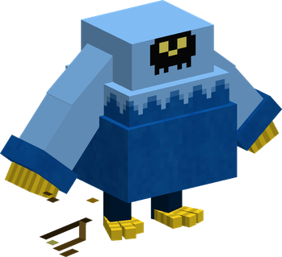
<figcaption>Blugori</figcaption>
</figure>

The base mod's blue gorilla with its axe and its moves, here on the jailers' side, with a hooded guard's strength. **One on each side** of level 1's cloister, **six** on level 2 in place of most jailers. It drops the base mod's Blugori loot.

## The venomous spiders

<figure markdown>
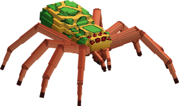
<figcaption>Venomous Spider</figcaption>
</figure>

In the blade forest of level 1, one at each post. **Venomous Spider Bite** poisons for 7 seconds; **Venomous Spider Leap** jumps on a foe 3 to 6 blocks away, hits harder and poisons too.

## The Basilisk

<figure markdown>
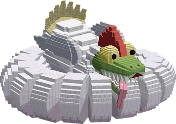
<figcaption>Basilisk</figcaption>
</figure>

One per tower, coiled at its post in the maze of level 2: a rooster's front and a green lizard's head on a snake **about 20 blocks long**, the front standing 6 blocks high. **8,800 Doriki, 220 health, armour 10.** It broods until it sees an intruder or is hit, then stands.

- **Basilisk Bite**, every second and a half.
- **Basilisk Tail Whip** hits those beside or behind it, within 8 blocks.
- **Basilisk Cry** slows everyone within 10 blocks for 4 seconds, once each chase.

A boss bar shows while it fights.

## The Manticores

<figure markdown>
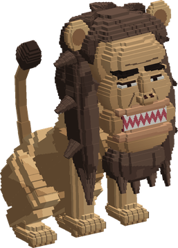
<figcaption>Manticore</figcaption>
</figure>

**Packs of three** in the corridors of level 2: a lion with a man's face, each with one of four faces. When one finds a foe, the pack around joins in. **Manticore Claw** at close range, **Manticore Pounce** on a foe 4 to 10 blocks away.

**It talks**: when it spots a foe, and now and then while it sits near a player, it rears up and says something over its head — *"Pants! Pants!"*, *"My bounty was 30 million!"*, sixteen lines in all.

## The puzzle scorpions

<figure markdown>
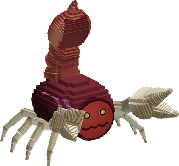
<figcaption>Puzzle Scorpion</figcaption>
</figure>

**Swarms of three** in the maze of level 2. **Puzzle Scorpion Pinch** at close range; **Puzzle Scorpion Sting** hits harder and poisons (Poison II, 8 seconds).

## The Sphinx

<figure markdown>
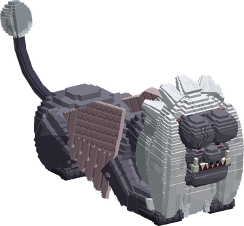
<figcaption>Sphinx</figcaption>
</figure>

The boss of level 2, lying in **its hall before the great door** to the stairs down: a slate lion with mauve wings and a man's grey face, **about 11 blocks tall** standing. **24,000 Doriki, 600 health, armour 14**, and nothing pushes it back. **Hits on its head do half as much again.**

- It lies down until an intruder comes into its hall, and lies down again after 30 seconds with nobody to fight.
- **Sphinx Claw**, every second and a half; **Sphinx Charge** on a foe 8 to 20 blocks away; **Sphinx Slam**, more often below half its health.
- **The third slam on the same spot breaks through the floor** — down to level 3.
- It mutters noodle names over its head (*"Raaamen..."*, *"Udooon..."*), and thanks you for the meal when it kills you.

A boss bar shows to those in its hall.

## The demon guards

<figure markdown>
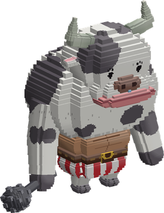
<figcaption>Minotaurus</figcaption>
</figure>

<figure markdown>
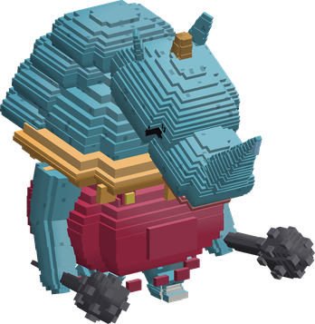
<figcaption>Minorhinoceros</figcaption>
</figure>

<figure markdown>
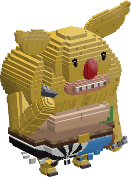
<figcaption>Minokoala</figcaption>
</figure>

<figure markdown>
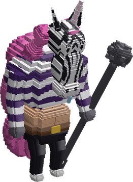
<figcaption>Minozebra</figcaption>
</figure>

The four jailer beasts of level 4, **one of each per tower**, about 5 blocks tall, in the hall around the stairs down to level 5. **9,800 Doriki, armour 14**, hard to push back. Each fights near its place and walks back to it after ten seconds with nobody to fight. A boss bar shows while one fights.

| Demon guard | Its blow | Its other move |
|---|---|---|
| **Minotaurus**, a Holstein bull | **Minotaurus Club** | **Demon Charge**: a run at a foe 6 to 14 blocks away that hits hard and throws back |
| **Minorhinoceros**, a shy teal rhino who hides his face | **Minorhinoceros Clubs**, two clubs | **Demon Charge** |
| **Minokoala**, a yellow koala who eats a leaf | **Minokoala Punch**, quick, with a knuckle-duster | — |
| **Minozebra**, a zebra | **Minozebra Mace**, the heaviest | **Minozebra Push**: a shove that throws a foe far back |

## The white wolves

<figure markdown>
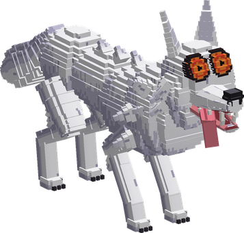
<figcaption>White Wolf</figcaption>
</figure>

**The Wolf Unit**: six packs of four in the snowed-in forest of level 5, each following its leader. When one finds a foe, the pack joins in. **White Wolf Bite** at close range, **White Wolf Leap** on a foe 3 to 6 blocks away.

## Spawn eggs

In the **Impel Down** creative tab: the Sphinx, the Basilisk, the Manticore, the venomous spider, the puzzle scorpion, the white wolf and the four demon guards. The Blugori has none of its own (the base mod's egg makes the base mod's Blugori).
