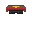
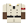
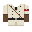
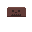
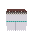
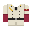
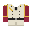

# Blocks and items

Everything Impel Down adds that has an item is in its own creative tab, **Impel Down**. Nothing in the tower can be crafted: its blocks and uniforms come from the creative tab or from the tower's chests.

## Blocks

Turn a block round (drag), zoom (scroll or pinch), and pick another with the buttons:

| Block | What it is |
|---|---|
| **Impel Wall** | The tower's shell. **Unbreakable**, and no Devil Fruit goes through it. |
| **Impel Bricks**, **Slab**, **Stairs**, **Wall** | The floors between levels and the inner walls. A pickaxe breaks them; an explosion does not. |
| **Cell Door**, **Dark Cell Door** | Iron doors: a hand does not open them, redstone does, and so does the [cell key](keys.md#cell-keys) of their level. The dark ones are level 2's. |
| **Blade Log**, **Blade Leaves** | Level 1's blade trees. The leaves cut you while you move through them; they never decay, and only shears take them. |
| **Crimson Grass** | Level 1's red grass: it pricks you while you walk on it. The tower's people are not hurt. |

The tower also has blocks with no item, placed only by the tower:

| Block | What it is |
|---|---|
| **Giants' Cell Grille** | A grille 4 wide and 11 high, the front of a giants' cell. The cell key of its level or the control desk opens it, until the tower mends. |
| **Great Gate Leaf**, **Great Gate Iron** | The great gate of level 0, always shut. Walk against it to go out. Unbreakable. |
| **Icicle** | Level 5's icicles: they never melt. |
| **Lift Gate**, **Lift Desk** | The [staff lift](keys.md#the-lift-key)'s grille and its desk. |
| **Control Desk** | Level 0's desk that [opens the cells of a level](keys.md#the-master-key-and-the-control-desk). |
| **Surveillance Snail** | A den den mushi on the wall that [raises the alarm](the-tower.md#the-alarm). Easy to break. |
| **Weapon on a Table** | A sword or a pistol on a guards' table: freed prisoners take them. |

**Blocks the tower laid drop nothing** when broken, whatever breaks them: the [mending](the-tower.md#the-tower-mends-itself) puts them back. The ones you place yourself drop as usual.

## Uniforms

The tower's people wear their uniforms, and the tower's chests hold some. Each piece is **cloth**: no armour, never wears out. The guards never drop theirs.

| Set | Pieces | Where you find them |
|---|---|---|
| **Prisoner** | { .item-icon } Short-Sleeved Shirt, { .item-icon } Long-Sleeved Shirt, { .item-icon } Calf-Length Trousers, { .item-icon } Long Trousers, { .item-icon } Slip-Ons | the depots |
| **Jailer** | { .item-icon } Cap, { .item-icon } Cap and Glasses, { .item-icon } Coat, { .item-icon } Rifleman's Coat, { .item-icon } Trousers, { .item-icon } Boots | the armories, level 0's quarters |
| **Hooded guard** | { .item-icon } Hood, { .item-icon } Robe | the armories of levels 1 to 5 |
| **Officers** | { .item-icon } Officer's Cap, { .item-icon } Head Jailer's Coat | the offices |
| | { .item-icon } Chief of the Guard's Coat | the office of level 0, rarely |
| **Warden** | { .item-icon } Cap, { .item-icon } Greatcoat, { .item-icon } Trousers, { .item-icon } Boots | the warden's office on level 4, rarely |

## Other items

| Item | What it is |
|---|---|
| { .item-icon } **Frozen Ration** | Level 5's food, frozen hard: it cannot be eaten as it is. Thaw it into **bread** in a furnace, a smoker or on a campfire. |
| **Hidden Hook** | What a [jailed](jailed.md#escaping) player may find in his cell: held by his door, it forces the lock. |
| **Keys** | The cell keys, the Master Key and the Lift Key: see [keys, lifts and desks](keys.md). |

## Loot

The tower's chests are in its armories, depots, offices, laboratory, refectory and quarters. **The deeper, the richer**: more items, more Belly, rarer things. Level 3 keeps no food, and level 5's is frozen.

**Devil Fruit boxes** may be in any chest of the tower, more often the deeper. And every tower keeps **one box for certain on level 6**, always in the same depot chest. The server can change these chances (`fruitBoxes` in the [configuration](configuration.md#tower)). Chests fill again after each [mending](the-tower.md#the-tower-mends-itself).
