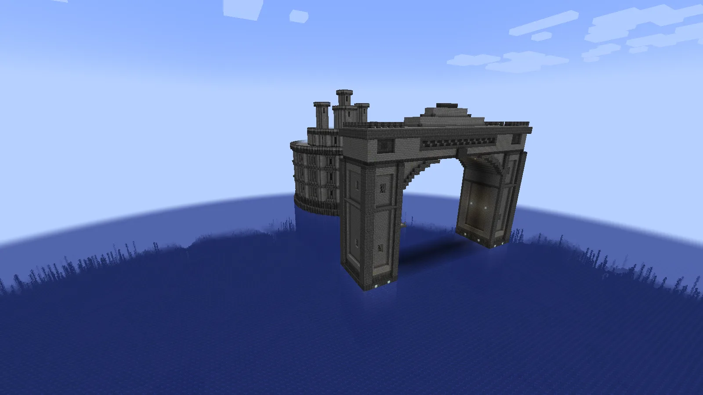
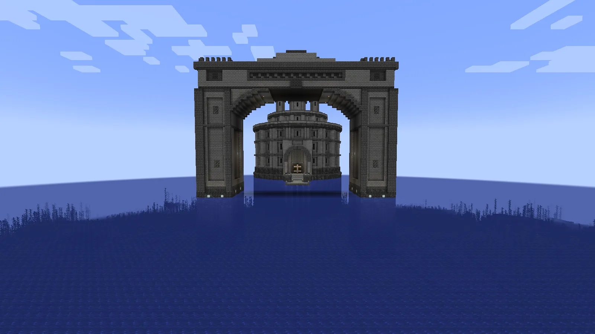
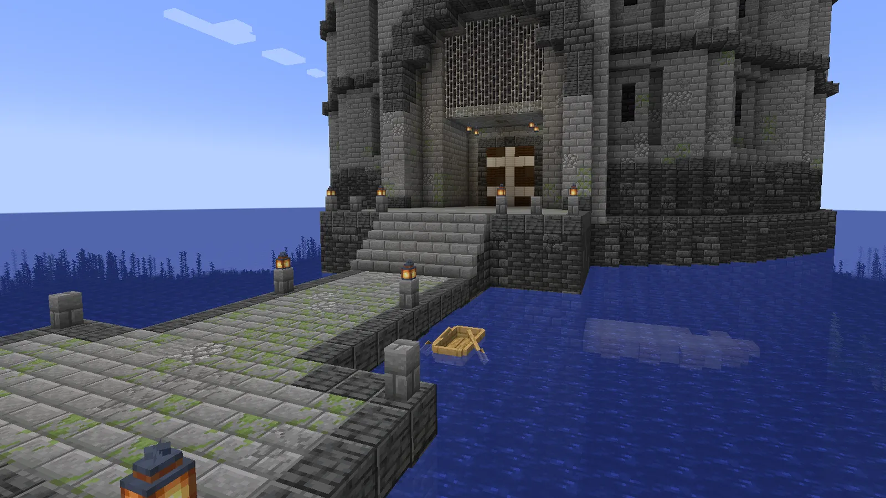

# Getting there

## The prisons in the sea

Prisons stand in the **deep oceans** of the overworld, never on land and never next to an ocean monument. The world is cut into squares of **3,072 blocks**, and **half** of them hold a prison, at the square's centre when it lies in deep ocean. Both numbers are in the [configuration](configuration.md).

```
/locate structure inoimpel:gate_of_justice
```

finds the nearest one in the overworld: the prison and its Gate of Justice are one structure.

[](places/prison-high.webp){ target="_blank" title="Open the picture full size" }

**The prison** is a great round drum of stone in the sea, about 65 blocks across, with a second storey and three small towers on its roof. It is solid: there is no inside to break into, its hidden stone is unbreakable.

**The Gate of Justice** stands 84 blocks south of it, on the line of its door: two pillars and an arch **40 blocks over the water**, 48 blocks between the pillars, a channel cleared under it for boats. It is an approach and nothing more: sailing through it takes you nowhere.

**The door** faces south. Before it, a landing, three steps and a **pier** where a boat is moored. Behind it a short passage under a raised portcullis ends at a replica of the tower's shut great gate.

<div class="mob-gallery" markdown>

<figure markdown>
[](places/gate-front.webp){ target="_blank" title="Open the picture full size" }
<figcaption>The Gate of Justice, from the south</figcaption>
</figure>

<figure markdown>
[](places/prison-door.webp){ target="_blank" title="Open the picture full size" }
<figcaption>The door and the pier</figcaption>
</figure>

</div>

## Going in

**Walk into the passage** behind the door, **on foot**: someone riding a boat or a mount leaves it at the door. You arrive in **the entrance hall of level 0**, inside the tower, the great gate at your back.

The tower is in a dimension of its own, **Impel Down** (`inoimpel:impel_down`): around it, the flat and endless sea of the **Calm Belt**, at the same X and Z as the prison in the overworld. Nothing spawns there of itself, and beds explode as in the Nether.

The entrance hall is **a safe place**: no guard is posted there, and the jailers leave alone a player there who has struck nobody. Its floor cannot be dug.

## The way out

The only way out is **the great gate of level 0**. Walk against its shut leaves and you are set down on the landing before the prison's door in the overworld, facing the pier. If the boat is gone, a new one is moored there.

There is no shortcut up: every level has to be walked back to level 0, unless you hold the [Lift Key](keys.md#the-lift-key). Going through the tower's walls with a Devil Fruit does not work either: a player found outside the tower's walls is put back where he last stood inside.

## Arrested

The other way in is [to lose a fight to the Marines](jailed.md) as a pirate or a revolutionary: you wake up in a cell, on a level set by your bounty.
