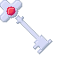
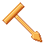
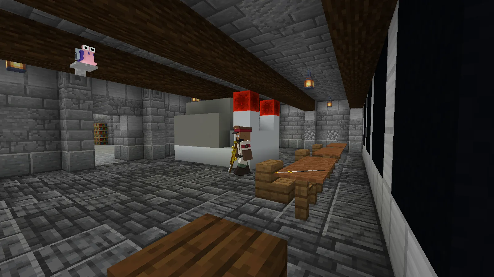

# Keys, lifts and desks

{ .pixelated }

Three kinds of keys, all taken from the guards. **A key works only in the prison it was taken in, and only until that prison [mends](the-tower.md#the-tower-mends-itself)**: after that, *"The locks were changed since this key was taken"*. A key from another prison says so, and one from the creative tab opens nothing.

| Key | What it opens | Who carries it |
|---|---|---|
| { .item-icon } **Cell Key**, one per level | the cell doors and giants' grilles of its own level | each head jailer, always; now and then a jailer (more often on level 0) |
| { .item-icon } **Master Key** | the control desk of level 0 | the chief of the guard, always |
| { .item-icon } **Lift Key** | the staff lift | the chief of the guard and the warden, always; a head jailer, one time in four |

## Cell keys

There are seven, one for each level, each with the colour of its level: **0** grey, **1** red, **2** green, **3** yellow, **4** orange, **5** ice blue, **6** violet. Use it on a cell door or a giants' grille of its own level to open it; on another level, *"This key is not for this level's cells"*. A giants' grille, once opened, stays open until the tower mends.

Everyone inside a cell you open is [freed](prisoners.md#breakouts).

## The master key and the control desk

{ target="_blank" title="Open the picture full size" }

The **control desk** stands in the surveillance room of level 0. Use it with the Master Key in hand and pick a level, 1 to 6: **every cell of that level opens at once** and all its prisoners are freed — but **that level's alarm goes off**.

## The lift key

The guards' **staff lift** runs in a shaft from level 6 to level 0, with a cabin on every level behind a tall iron grille, the **Lift Gate**.

- The Lift Key opens the whole grille; it shuts by itself a few seconds after the last one through. From inside the cabin it opens by hand.
- In the cabin, use the **Lift Desk** with the Lift Key in hand, and pick a level. The screen fades to black, chains rattle, and **everyone in the cabin** comes along.
- **Up to level 0**: always.
- **Down to a level**: only once you have **killed that level's head jailer** in this tower (*"Beat the head jailer of level N first"*). The tower forgets it when it mends.

The jailers never use the lift. The head jailer of each level stands before its grille.

## Losing your keys

Die in the tower and your keys fall where you died, not in the depot chest with the rest of your gear: someone else may pick them up.
