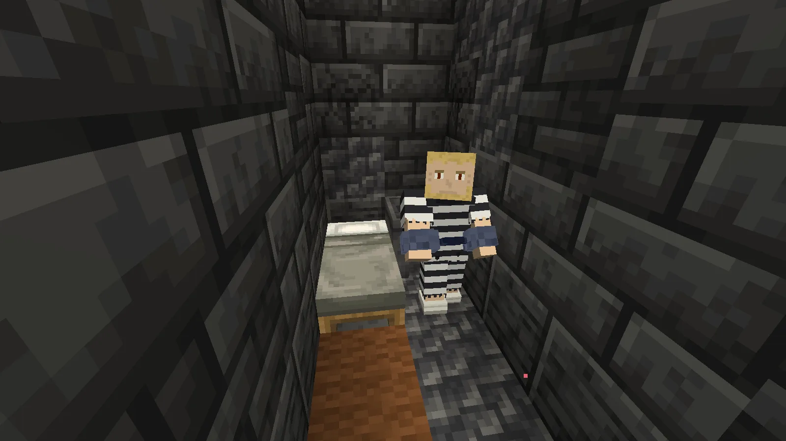
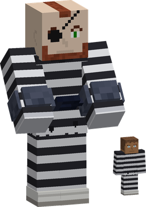

# The prisoners

Every level from 1 to 6 is full of prisoners in their cells, more of them than guards. Each wears the stripes — a short-sleeved shirt and calf-length trousers, or a long-sleeved shirt and long trousers — and slip-ons, kairoseki cuffs on his wrists, and a number on his name tag: the level's letter (E on level 1, then D, C, B, A, and S on level 6) and four digits.

## Life in the cells

{ target="_blank" title="Open the picture full size" }

They **wander** slowly about their cell, sit, lie down; half of them **sleep** at night, on the pallet when there is one free. Two in three **come to the bars** when a player walks by and follow him with their eyes. And they **talk**, a line over the head now and then:

| Mood | When | For example |
|---|---|---|
| begging | at the bars | *"Hey! You! Got a key?"*, *"Take me with you!"* |
| gloomy | anywhere | *"I counted the bricks. Twice."*, *"This bucket stinks."* |
| hungry | level 3 | *"I'd eat a boot right now."* |
| hot | level 4 | *"My feet are cooking!"* |
| cold | level 5 | *"Can't feel my toes!"* |
| sleepy | asleep | *"Five more minutes..."* |

On level 5 the prisoners are white with frost, and some are frozen whole in blocks of ice.

## Breakouts

Open a cell, by any means — a [cell key](keys.md#cell-keys), the [control desk](keys.md#the-master-key-and-the-control-desk), or by breaking its door or bars — and its prisoners are **freed** (the nearest player gets the advancement **Jailbreak**). A freed prisoner:

- loses his cuffs and gets a jailer's strength for his level;
- **runs for the great gate** of level 0, walking the tower's way up, and is gone once through it;
- **fights only those who go for him** — jailers, beasts — never a player nor another prisoner;
- picks up a weapon of his style on his way (a jailer's he beat, one from a guards' table, one from an armory): a sword, a pistol or a rifle; he drops it now and then when a player kills him.

The jailers go after freed prisoners. A freed prisoner pays nothing: **Belly and bounty do not come from freeing others.** [The tower's mending](the-tower.md#the-tower-mends-itself) puts new prisoners in the empty cells.

## Devil Fruits

Some prisoners hold a Devil Fruit, more often the deeper. They cannot use it while cuffed; freed, they use it against those chasing them. A prisoner's fruit is never dropped.

| Level | 1 | 2 | 3 | 4 | 5 | 6 |
|---|---|---|---|---|---|---|
| Chance of a fruit | 0.3 % | 1.5 % | 5 % | 8 % | 15 % | 25 % |
| Its tier | 1 | 1 | 2 (sometimes 1) | 2 (sometimes 1) | 3 (sometimes 2) | 3 (sometimes 2) |

## Races and giants

With **[Race Race no Mi](../race-race-no-mi/index.md)** installed, some prisoners are of other races, more of them and rarer ones the deeper: fishmen, Skypieans, minks, Shandias and Tontattas from level 1, cyborgs and Birkans from level 2, modified humans, buccaneers and giants from level 3, Oni and Wotans from level 4, and on level 6 Elbaf giants, ancient giants and Lunarians.

**The giants** (a Wotan or bigger) are jailed only in a cell tall enough for them: on level 6, **the giants' cells** along each avenue, and for **the ancient giants** the great giants' cell at the end of each avenue. Freed, a giant walks to his level's hall and is gone in a cloud of dust.

<figure markdown>

<figcaption>An ancient giant of level 6, beside a man</figcaption>
</figure>

**Without Race Race no Mi**, every prisoner is human, and the giants' cells stay empty.

A whole datapack can change who is jailed where: `data/inoimpel/prison_races/level1.json` to `level6.json`, each race with its weight in percent (humans have the rest).
