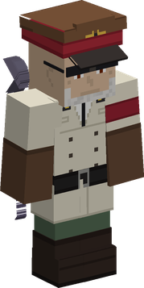
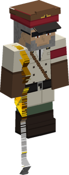
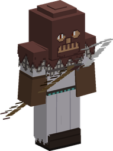
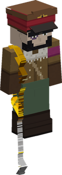
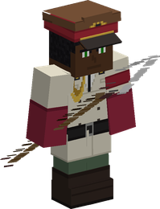
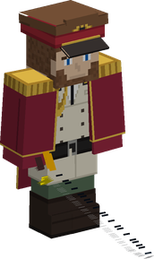
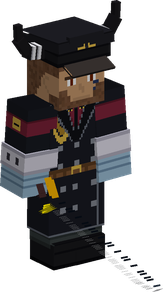

# The staff

The tower's guards are the World Government's own: **jailers** with batons, **riflemen**, **hooded guards** (the torturers) with spears, a **head jailer** on each level from 1 to 6, the **chief of the guard** on level 0 and the **warden** on level 6. They get stronger the deeper you go, and they fight like the base mod's Marines, with fighting styles, techniques and haki. The Marines are their allies.

Turn a guard round (drag), zoom (scroll or pinch), and pick another with the buttons:

## Who they go after

- **Intruders**: any player in survival or adventure who is not shut in a cell. A **Marine** who has struck nobody is left alone, and so is a player in the **entrance hall** of level 0 who has struck nobody. Bounty hunters are intruders.
- Whoever **strikes a jailer**: the jailers around join in.
- **Freed prisoners**.

A jailer follows his foe anywhere, stairs included; one out of reach above him gets a leap, or the nearest idle rifleman is called. After ten seconds with nobody to fight, he walks back to his post. When a [surveillance snail](the-tower.md#the-alarm) raises the alarm, the jailers of that level go to where the intruder was seen.

## Jailers, riflemen and hooded guards

<figure markdown>

<figcaption>Jailer</figcaption>
</figure>

<figure markdown>

<figcaption>Jailer Rifleman</figcaption>
</figure>

<figure markdown>

<figcaption>Hooded guard</figcaption>
</figure>

<figure markdown>

<figcaption>Jailer of level 5</figcaption>
</figure>

- **The jailer** carries a **baton** and wears the jailer's cap (some with dark glasses), coat, trousers and boots.
- **The rifleman** carries a **rifle** and shoots from afar, a bullet hitting for 1.5 times his blow. He wears the coat with its sling. Riflemen hold the outer corridors, the far ways and the galleries.
- **The hooded guard** is a jailer in the hood and skull mask of the torturers, with a long robe and a **spear**. He has 30 % more Doriki than a uniformed jailer of his level, and fights one rank higher from level 3 down. None on level 0; half the jailers of levels 1 to 6 are hooded, four in five on level 4.
- On **level 5**, the jailers wear a winter coat.

**Their techniques.** From level 1 down, a baton carries the techniques **Knockout Blow, Flurry, Sweep, Parry**, a spear **Thrust, Spear Charge, Spear Whirl, Spear Throw** ([what each does](../../akumalib/ability-base-classes/weapon-techniques.md)): one technique on level 1, two for a brute (levels 2 and 3), three for a captain (levels 4 to 6), slower to come back than a player's. Level 0's jailers use none. Captains also know a Rokushiki technique, and some jailers use **Busoshoku Haki**, more the deeper.

**Their strength**, by the level they stand on. Their health is their Doriki / 40.

| Level | Doriki | Health | Blow | Armour | Haki users (uniform / hood) |
|---|---|---|---|---|---|
| 0 | 400 – 1,000 | 20 – 25 | 1 | 0 | none |
| 1 | 1,000 – 2,100 | 25 – 52 | 2 | 0 | 0 % / 5 % |
| 2 | 1,800 – 3,200 | 45 – 80 | 3.5 | 1 | 5 % / 10 % |
| 3 | 2,700 – 4,300 | 67 – 107 | 4.5 | 2 | 15 % / 25 % |
| 4 | 3,800 – 5,400 | 95 – 135 | 6 | 3 | 25 % / 35 % |
| 5 | 5,000 – 6,500 | 125 – 162 | 8 | 4 | 40 % / 50 % |
| 6 | 6,000 – 7,300 | 150 – 182 | 10 | 5 | 50 % / 60 % |

The blow is the whole hit, weapon included. Every number here is in the [configuration](configuration.md#tower).

**Their rounds.** When a player is [jailed](jailed.md), a jailer of his level walks past his bars every few minutes, his cell key on him.

## The head jailers

<figure markdown>

<figcaption>Head Jailer</figcaption>
</figure>

One on each level from 1 to 6, standing before the **staff lift**'s grille. He has the top Doriki of his level and three and a half times a jailer's health, wears the officer's cap and the head jailer's coat, and **half of them hold a Devil Fruit** (a common one on levels 1 and 2, a better one below). Each draws a **fighting class**: a brawler with his fists, a swordsman with a katana, or a baton or spear fighter who knows all four techniques of his weapon.

He fights only near his post and ignores the alarm. Kill him and he drops **his level's cell key**, sometimes the **Lift Key**; and the lift then [takes you down to his level](keys.md#the-lift-key).

| Level | Doriki | Health |
|---|---|---|
| 1 | 2,100 | 184 |
| 2 | 3,200 | 280 |
| 3 | 4,300 | 376 |
| 4 | 5,400 | 472 |
| 5 | 6,500 | 569 |
| 6 | 7,300 | 639 |

## The chief of the guard

<figure markdown>

<figcaption>Chief of the Guard</figcaption>
</figure>

He waits in **his office on level 0**, in the officer's cap and a maroon coat with a cape edged in gold. **6,300 Doriki, 472 health, armour 12**, a **Devil Fruit** of the second tier, advanced haki and up to two Rokushiki techniques; he dodges, closes in and reads your moves (Future Sight). He draws a fighting class as a head jailer does. A boss bar shows while he fights.

He always drops the **Master Key** and the **Lift Key**.

## The warden

<figure markdown>

<figcaption>Warden</figcaption>
</figure>

The master of the prison, at **his post in the hall of level 6**, in a black horned cap and a greatcoat. **7,500 Doriki, 1,500 health, armour 16**, a **Devil Fruit** of the third tier, and the same arts as the chief of the guard. A boss bar shows while he fights.

He always drops the **Lift Key**. Beating him on level 6 is the challenge **Rock Bottom**.

## What they drop

Jailers often carry a pouch of Belly, more the deeper, and once in a while the cell key of their level (more often on level 0, which has no head jailer). The head jailers, the chief and the warden drop the keys above. **None of them drops his weapon, his uniform or his fruit.** There are no spawn eggs for the head jailers, the chief and the warden.
