# The tower

The tower goes down from the entrance to the Eternal Hell, seven levels stacked one under the other, each wider and harder than the one above. Each level shows its number and name when you reach it, and has its own fog, sounds and particles.

| Level | Name | What it is | Across |
|---|---|---|---|
| **0** | Impel Down | the entrance, the offices, the armory, the depot | about 100 blocks |
| **1** | Crimson Hell | a forest of blade trees | about 175 |
| **2** | Wild Beast Hell | a maze full of beasts, the Sphinx's hall | about 175 |
| **3** | Starvation Hell | a desert under a vault; you starve fast | about 255 |
| **4** | Blazing Hell | a lake of fire and the cauldron of boiling blood | about 255 |
| **5** | Freezing Hell | snow, towers of ice, white wolves; the cold freezes you | about 255 |
| **6** | Eternal Hell | the great cells, the giants' cells, the warden | about 175 |

## Going down

Each level has its own way down to the next, and they are not all stairs:

| From | To | Way down |
|---|---|---|
| 0 | 1 | stairs from the entrance hall |
| 1 | 2 | **a pit** at the far north end of the forest: you fall into a basin of water on level 2 and live. Nobody climbs it back. The guards have their own stairs. |
| 2 | 3 | the Sphinx's wide stairs, behind the great door |
| 3 | 4 | **the vent** in the middle of the desert, under a giant fan, and stairs beside it. Jump down the vent without aiming for a safe place and you die. |
| 4 | 5 | stairs, through the demon guards' hall |
| 5 | 6 | spiral stairs |

The way back up is the same, on foot, to the great gate of level 0. The guards' **staff lift** runs from level 6 to level 0, but it takes a [Lift Key](keys.md#the-lift-key).

## Level 0, the entrance

[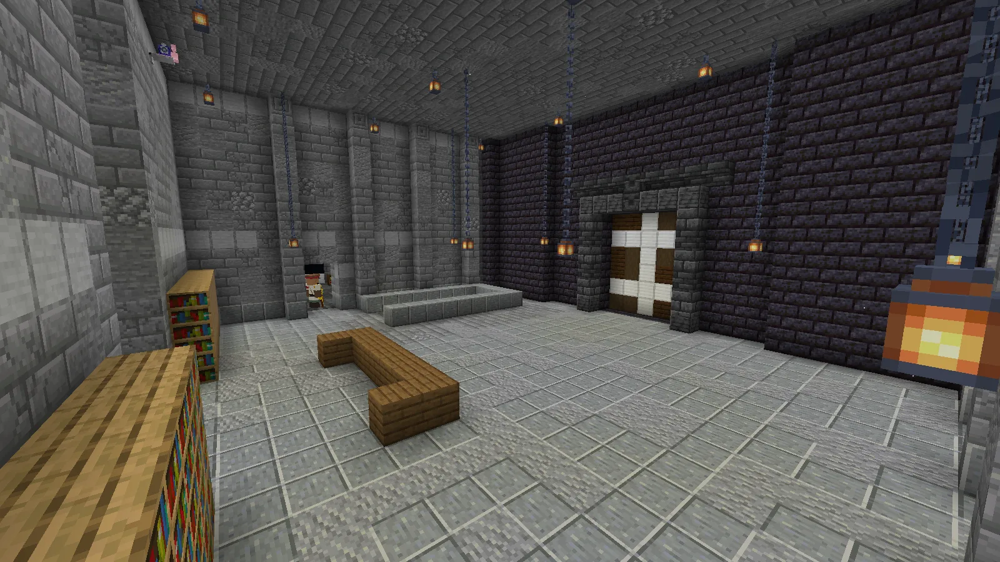](places/level-0-hall.webp){ target="_blank" title="Open the picture full size" }

The only level that is not a prison: the administration. The great gate on the south side opens on **the entrance hall** (a desk facing the gate, the registers, the stairs down), a safe place where no guard is posted.

- **West**, the prisoners' intake: a search room with two transit cells, a boiling bath, a changing room, and **the depot**, where the guards keep what they take from prisoners.
- **East**, the **surveillance room**: a wall of screens, **the great snail** that watches the whole tower, and **the control desk** that opens the cells of a level (it takes the [Master Key](keys.md#the-master-key-and-the-control-desk)).
- **North**, a gallery and a corridor to the lift, past an office, **the chief of the guard's office** (he waits there), a medical laboratory, **the armory**, the refectory and its kitchen, the dormitory, and the room of the gates' controls.

Level 0's jailers are the weakest of the tower and use no haki. There is no head jailer on level 0.

<figure markdown>
[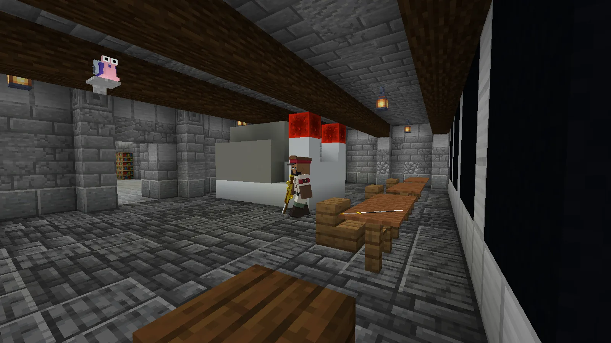](places/level-0-surveillance.webp){ target="_blank" title="Open the picture full size" }
<figcaption>The surveillance room: the screens and the control desk</figcaption>
</figure>

<figure markdown>
[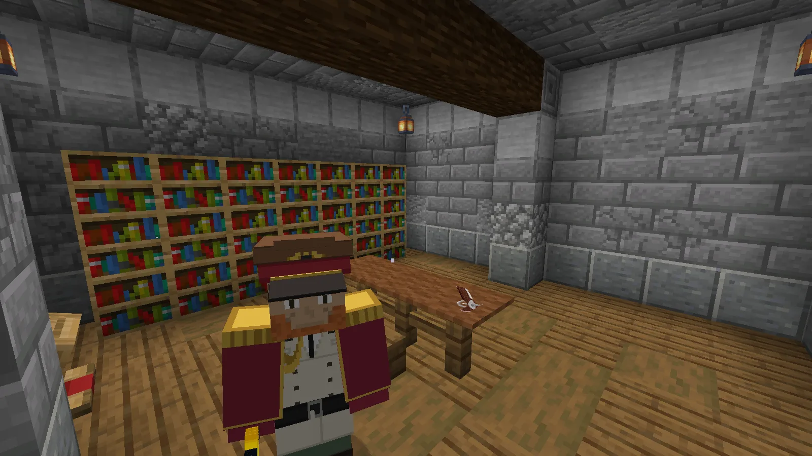](places/level-0-chiefs-office.webp){ target="_blank" title="Open the picture full size" }
<figcaption>The chief of the guard in his office</figcaption>
</figure>

<figure markdown>
[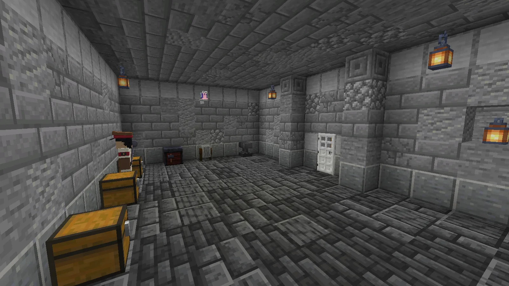](places/level-0-armory.webp){ target="_blank" title="Open the picture full size" }
<figcaption>The armory</figcaption>
</figure>

<figure markdown>
[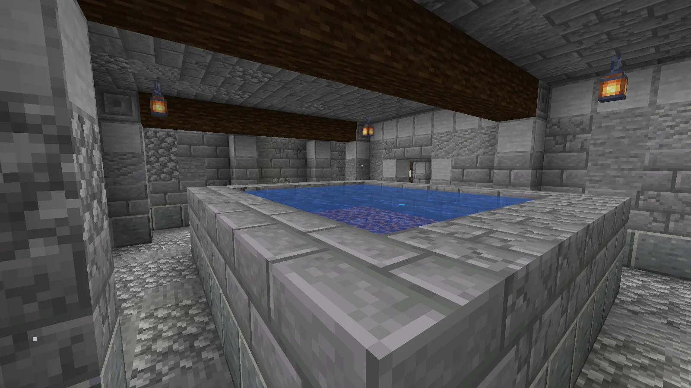](places/level-0-boiling-bath.webp){ target="_blank" title="Open the picture full size" }
<figcaption>The boiling bath of the intake</figcaption>
</figure>

## Level 1, Crimson Hell

[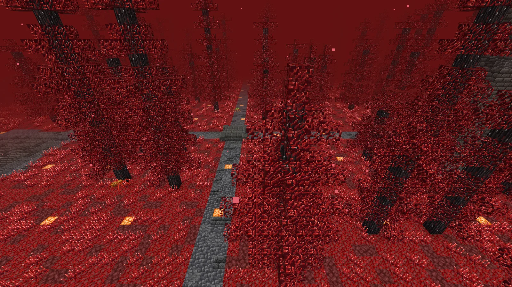](places/level-1.webp){ target="_blank" title="Open the picture full size" }

A forest of **blade trees** under a red sky of rock, on **crimson grass**. The grass pricks you as you walk on it, and the leaves of the blade trees cut you as you go through them: the tower's people are not hurt. Two trails cross the forest and meet at a dais in the middle. A cloister runs round the forest, its cells behind bars of sea stone.

Who is there: **venomous spiders** in the forest, jailers along the cloister with riflemen at its sides, **a Blugori** on each side, and the head jailer by the lift.

<figure markdown>
[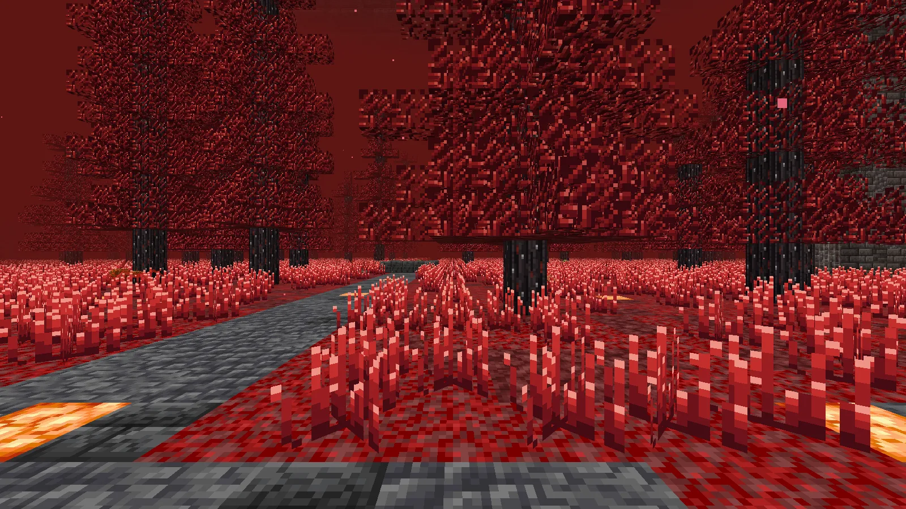](places/level-1-trail.webp){ target="_blank" title="Open the picture full size" }
<figcaption>A trail through the forest</figcaption>
</figure>

<figure markdown>
[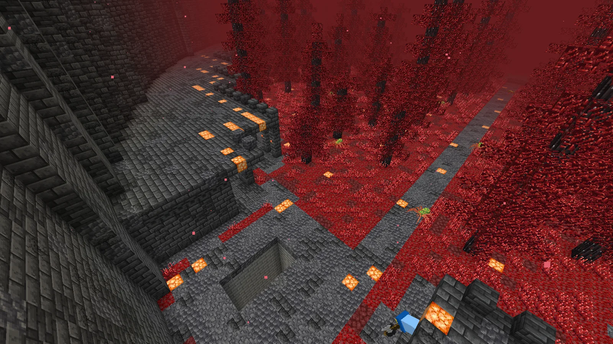](places/level-1-plaza.webp){ target="_blank" title="Open the picture full size" }
<figcaption>A plaza at the edge of the forest</figcaption>
</figure>

<figure markdown>
[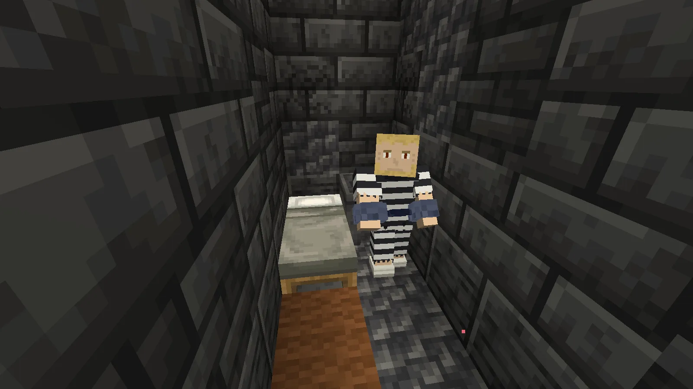](places/level-1-cell.webp){ target="_blank" title="Open the picture full size" }
<figcaption>A solitary cell</figcaption>
</figure>

## Level 2, Wild Beast Hell

[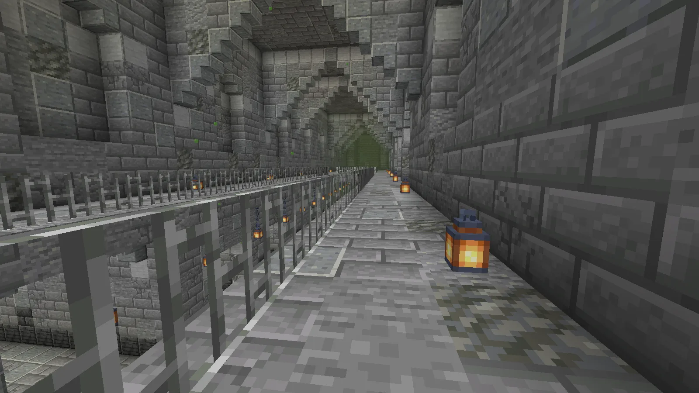](places/level-2.webp){ target="_blank" title="Open the picture full size" }

A **maze** of wide, high corridors of blue-grey stone, cells under its arches, and a great gallery down its middle with walkways and a bridge. At its end, **the Sphinx's hall**, ringed with cells, before the riveted **great door** behind which the stairs go down.

Who is there: **the Sphinx**, **the Basilisk**, packs of **Manticores** and swarms of **puzzle scorpions**, six **Blugori** in place of most jailers, riflemen in the outer corridors, and the head jailer.

<figure markdown>
[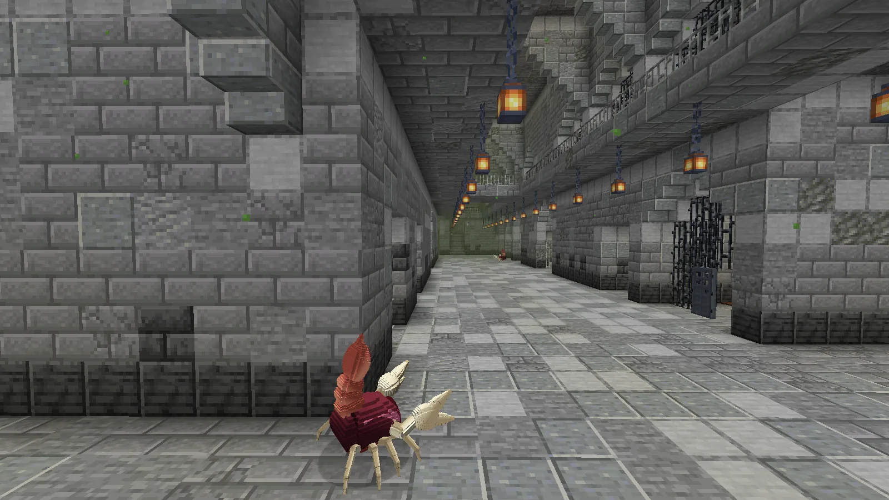](places/level-2-walkway.webp){ target="_blank" title="Open the picture full size" }
<figcaption>The gallery's walkways and cells</figcaption>
</figure>

<figure markdown>
[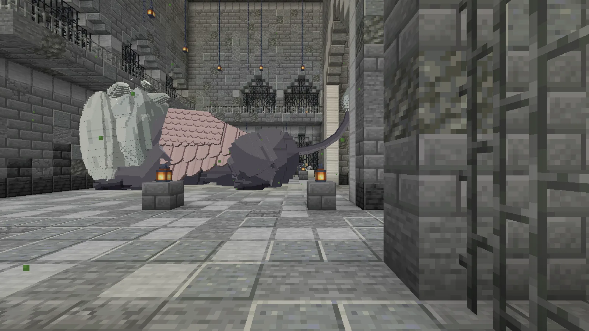](places/level-2-sphinx-hall.webp){ target="_blank" title="Open the picture full size" }
<figcaption>The Sphinx lying in its hall</figcaption>
</figure>

## Level 3, Starvation Hell

[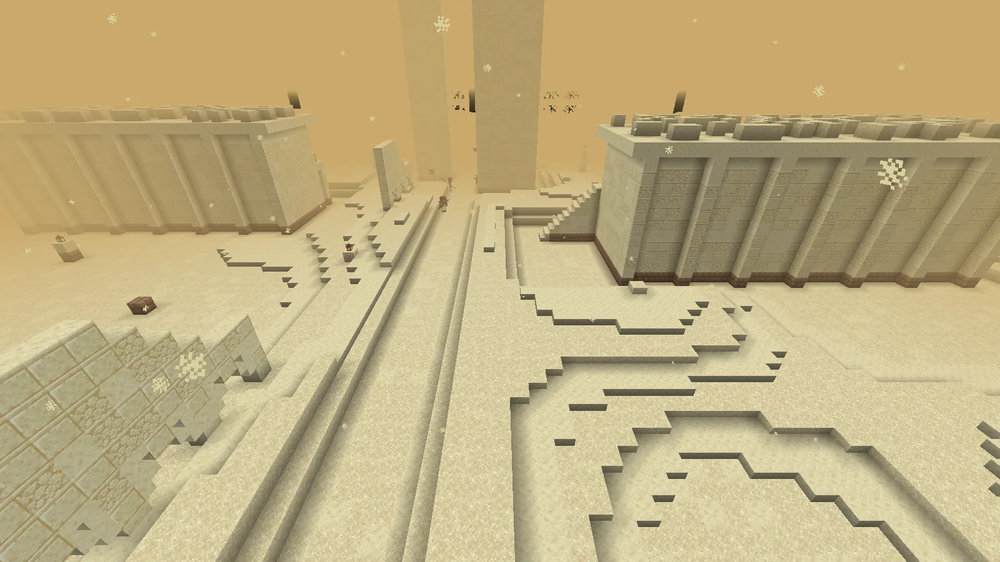](places/level-3.webp){ target="_blank" title="Open the picture full size" }

A **desert** of dunes under a high vault, with ruins and broken pillars. Ten great blocks of cells, two storeys each, crowded common cells behind arcades. In the middle, **the vent** down to level 4, under a giant fan, with a spiked beam hanging on chains.

**You starve here**: hunger drains twice as fast, and the heat from below boils away the water you pour out of a bucket. Few guards: riflemen on the far ways, batons by the vent.

<figure markdown>
[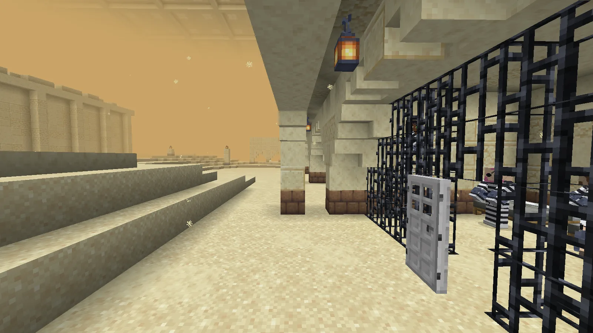](places/level-3-cells.webp){ target="_blank" title="Open the picture full size" }
<figcaption>A block of cells and its arcade</figcaption>
</figure>

## Level 4, Blazing Hell

[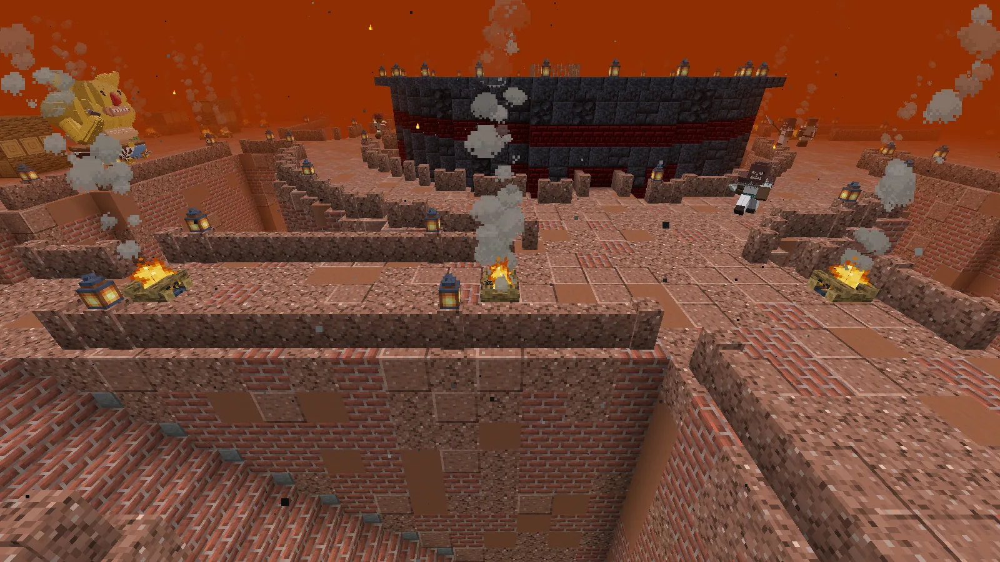](places/level-4.webp){ target="_blank" title="Open the picture full size" }

A round hall of warm brick, lit red, embers rising. **A lake of fire** fills the floor; walks, bridges and islands stand over it. In the middle, under level 3's vent, **the cauldron of boiling blood**, a black pot full of lava in a ring of fire, with a railed pier. Four bridges lead to four islands: the stairs from level 3, the stairs down to level 5 through **the demon guards' hall**, the warden's office and the kitchens beside the lift, and a woodyard. Two storeys of cells line the great wall.

Water poured from a bucket boils away here too. Who is there: **the four demon guards** — Minotaurus, Minorhinoceros, Minokoala and Minozebra — and jailers, four in five of them **hooded**.

<figure markdown>
[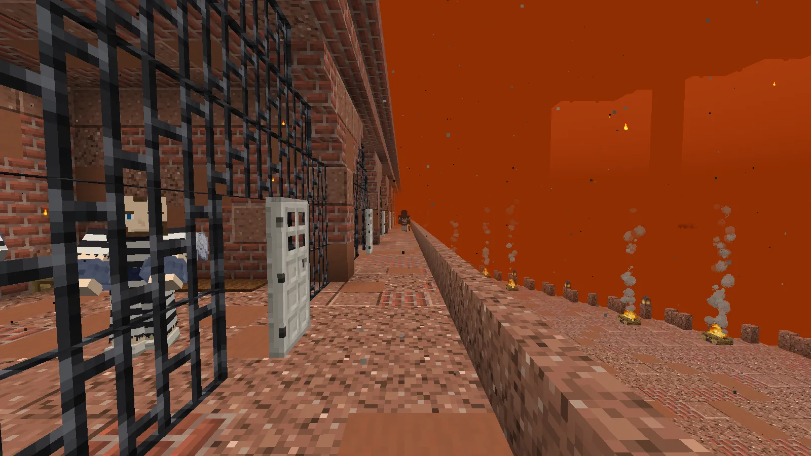](places/level-4-cells.webp){ target="_blank" title="Open the picture full size" }
<figcaption>Cells under the arches</figcaption>
</figure>

<figure markdown>
[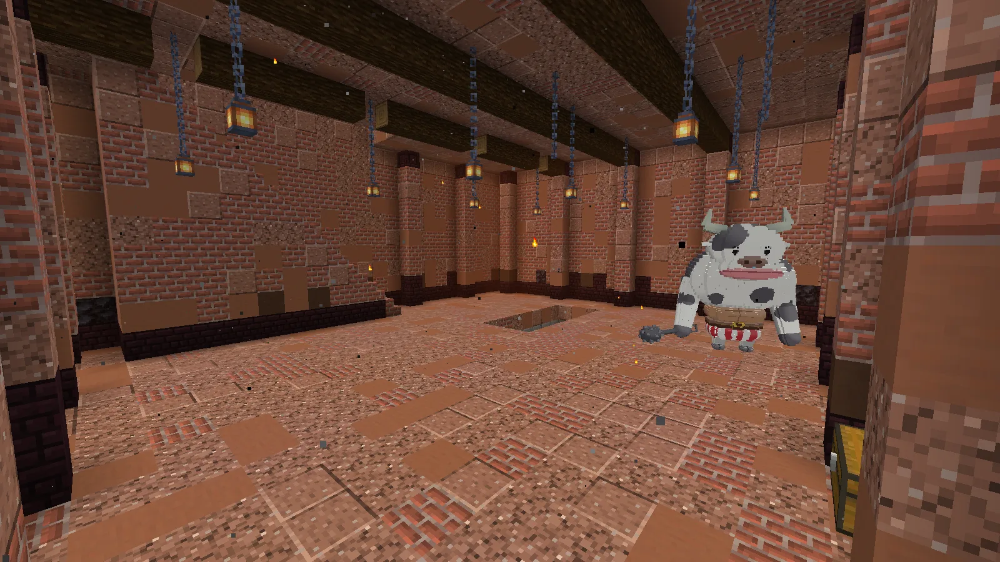](places/level-4-demon-guards.webp){ target="_blank" title="Open the picture full size" }
<figcaption>The demon guards' hall</figcaption>
</figure>

<figure markdown>
[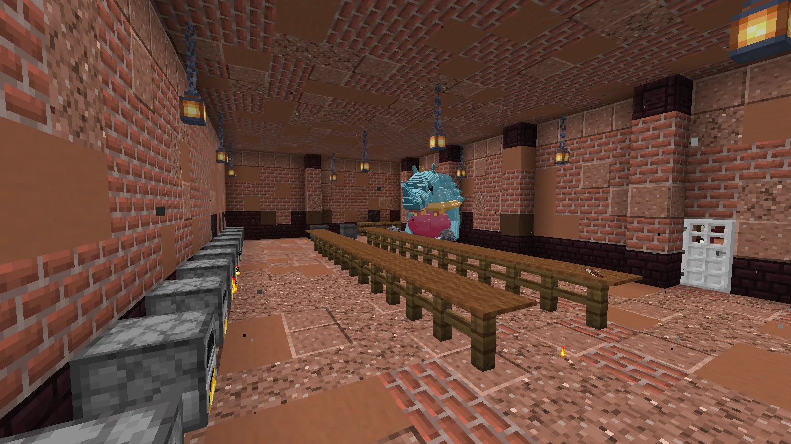](places/level-4-kitchens.webp){ target="_blank" title="Open the picture full size" }
<figcaption>The kitchens, and Minorhinoceros</figcaption>
</figure>

## Level 5, Freezing Hell

[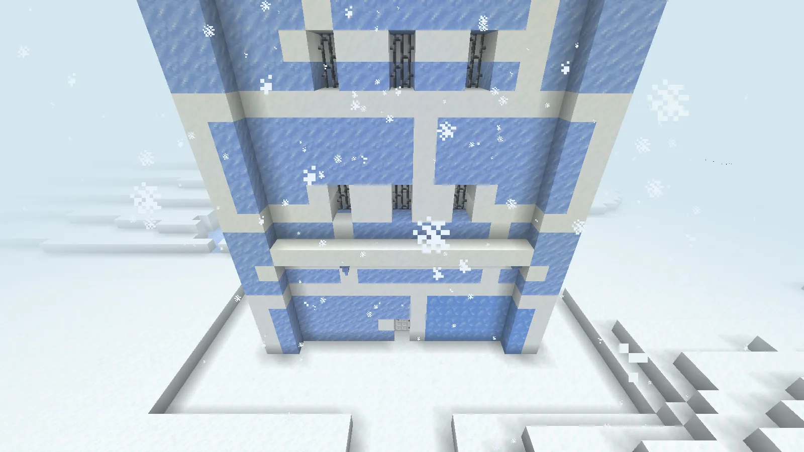](places/level-5.webp){ target="_blank" title="Open the picture full size" }

A **snow** plain under a pale vault, in a white fog. **Towers of ice** on a ring hold the cells, joined by arches hung with chains; a lone tower in the middle holds one cell. A snowed-in fir forest runs along the wall, with an abandoned office at its back. Prisoners frozen in blocks of ice, icicles everywhere.

**The cold freezes you** as powder snow does, then hurts you once you are frozen through. **Leather armour** keeps it out, and so does an ice or snow fruit (Hie Hie, Yuki Yuki). Who is there: packs of **white wolves** in the forest, riflemen by the stairs, batons by the lone tower. The jailers wear a winter coat.

<figure markdown>
[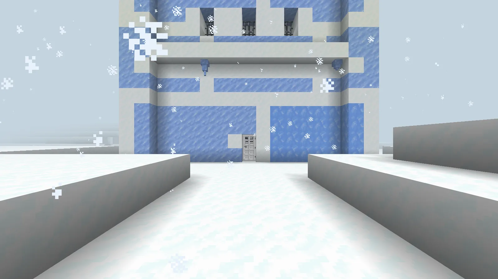](places/level-5-plain.webp){ target="_blank" title="Open the picture full size" }
<figcaption>The snow plain</figcaption>
</figure>

<figure markdown>
[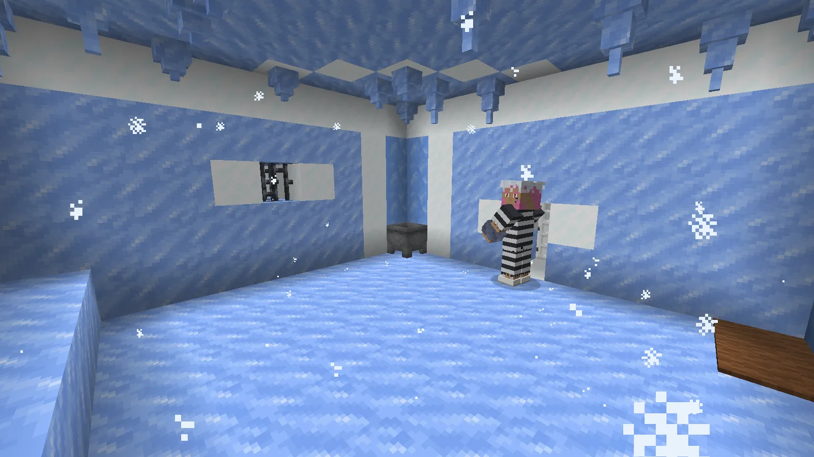](places/level-5-lone-cell.webp){ target="_blank" title="Open the picture full size" }
<figcaption>The lone cell, its prisoners frozen white</figcaption>
</figure>

<figure markdown>
[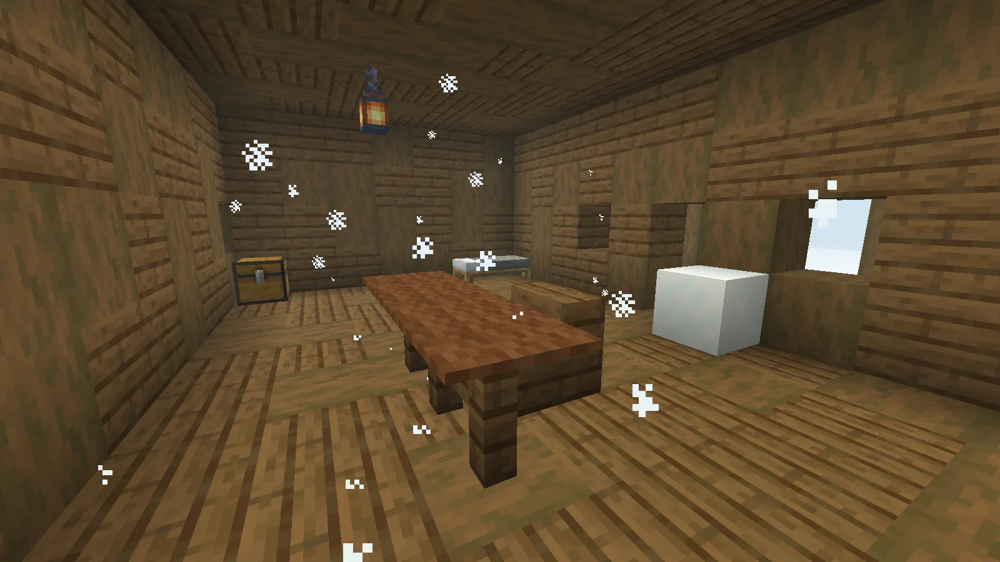](places/level-5-office.webp){ target="_blank" title="Open the picture full size" }
<figcaption>The abandoned office</figcaption>
</figure>

## Level 6, Eternal Hell

[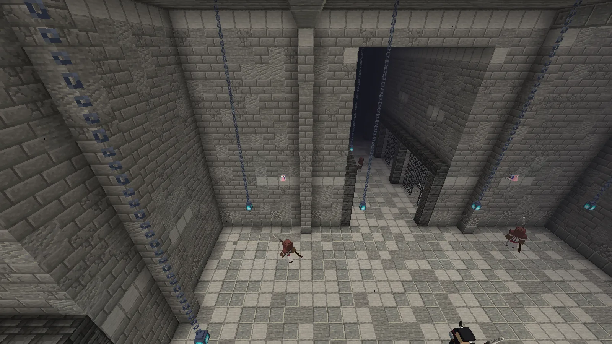](places/level-6.webp){ target="_blank" title="Open the picture full size" }

A flagged hall in a dark blue light, and **four wide avenues** in a cross, lined with high cells behind dark iron grilles. Along each avenue, **giants' cells**, and at its end the great giants' cell. The warden's post is in the hall.

Who is there: **the warden**, riflemen down the avenues, batons in the hall, and the head jailer. One of the level's depot chests always holds a **Devil Fruit box**.

<figure markdown>
[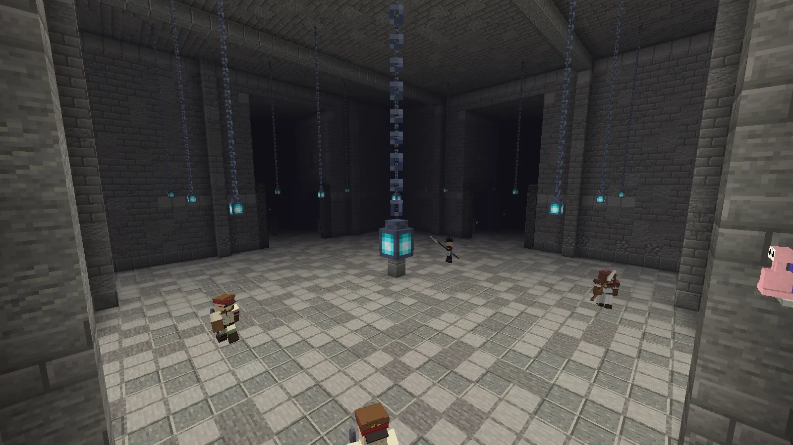](places/level-6-hall.webp){ target="_blank" title="Open the picture full size" }
<figcaption>The hall, its soul lanterns on chains</figcaption>
</figure>

<figure markdown>
[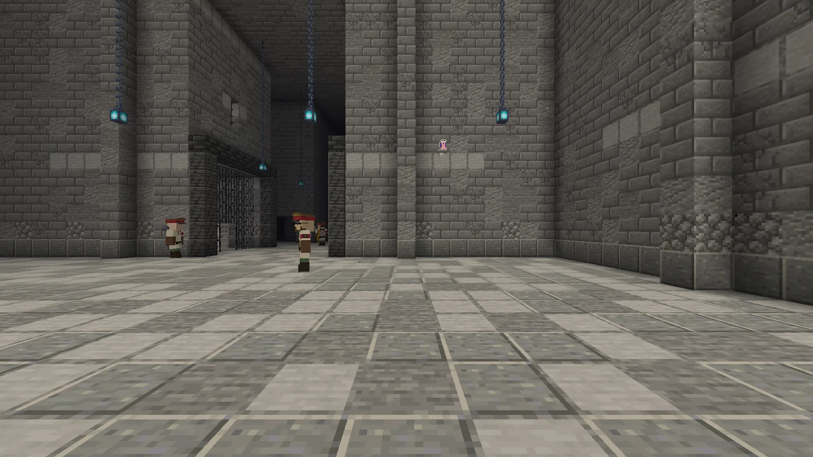](places/level-6-avenue.webp){ target="_blank" title="Open the picture full size" }
<figcaption>An avenue</figcaption>
</figure>

<figure markdown>
[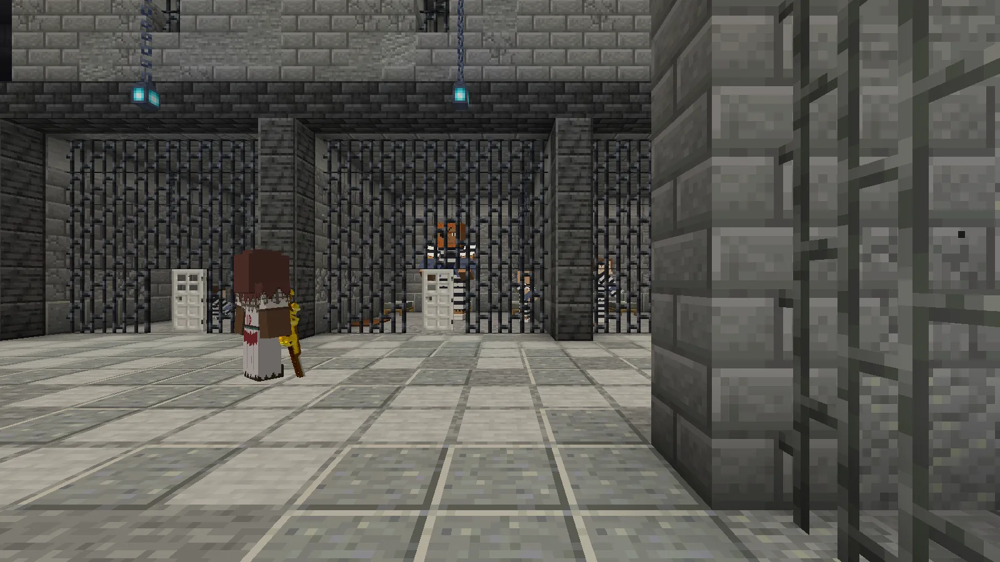](places/level-6-giants-cells.webp){ target="_blank" title="Open the picture full size" }
<figcaption>The tall grilles of the cells</figcaption>
</figure>

## The guards' posts

The tower's people are put down by hidden **posts** when a player comes within **48 blocks**; guards and beasts vanish when every player is 128 blocks away. A post sends a few replacements for those killed, then stays empty until [the tower mends](#the-tower-mends-itself): a post is not a farm. The chiefs, the Sphinx, the demon guards and the prisoners come back new at each mending.

## The alarm

**Surveillance snails** hang on the walls, by the guards' posts and the ways in and out of each level (on level 5 only by the stairs: the cold stops them). A snail sees **12 blocks** before it. When it sees an intruder, a bell rings, the chat says *"Alarm! An intruder on level N"*, and that level's jailers go to where he was seen, for **30 seconds** after he was last seen.

Who is an intruder: any player in survival or adventure, except a Marine who has struck nobody, a player in the entrance hall who has struck nobody, and a prisoner shut in his cell. Bounty hunters are intruders. Breaking the floor between two levels raises the alarm on both.

**Break the great snail** of level 0's surveillance room (half of it is enough) and **the whole tower's alarm is cut**, until the tower mends.

## Death in the tower

Die in a tower and the guards take your gear to **a depot chest of the level you fell on**; the chat says which way it is. What does not fit falls where you died, and **the prison's keys always fall there**.

## The tower mends itself

**30 minutes** after the last player leaves a tower, it is set back as it was built:

- what was dug, broken or built comes back; **what you placed drops as items**;
- chests fill again the first time they are opened (a depot chest that still keeps someone's gear is left alone);
- the posts are reset: guards, chiefs, beasts and prisoners return, freed prisoners are replaced;
- cell doors are shut, and every key taken before stops working: *"The locks were changed since this key was taken"*.

A player who has not moved for 10 minutes, a player in creative, a prisoner shut in his cell or a player in the entrance hall does not hold the mending off; after **3 hours** it comes anyway, players inside or not. The three times are in the [configuration](configuration.md#tower). Blocks the tower laid **drop nothing** when broken: a tower that mends is not a mine.

## Beds

The guards' beds are furniture: using a bed in the tower does nothing.
