# Hebi Hebi no Mi, Model: Hydra

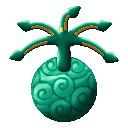{ .mod-icon }

| | |
|---|---|
| **Type** | Mythical Zoan |
| **Box** | { .box-icon } Golden |
| **Chance per opening** | golden **3.39%**, iron **0.170%**, wooden **0.008%** ([how it works](index.md#box-odds)) |
| **Abilities** | 16: 14 active, 2 passive |
| **Transformations** | [Hydra Heavy Point](#hydra-heavy-point), [Hydra Guard Point](#hydra-guard-point) |

In 3D: drag to turn, scroll or pinch to zoom. The pictures show all nine heads: the hydra starts with three.

Found in the base mod's **golden Devil Fruit box**. Eat it and its abilities appear in the ability menu, grouped under the fruit.

!!! note "About the values"
    The values are those of the ability's tooltip in game, with the base mod's default settings. Damage is shown on the base mod's scale, as in the ability screen.

## Hydra Heavy Point { #hydra-heavy-point }

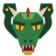{ .ability-icon } *Active · Transformation*

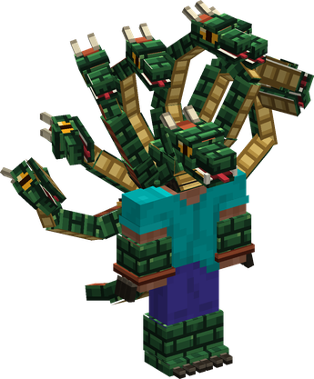{ .form-picture }

Transforms the user into a hydra hybrid, which focuses on speed and reach.

## Hydra Guard Point { #hydra-guard-point }

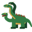{ .ability-icon } *Active · Transformation*

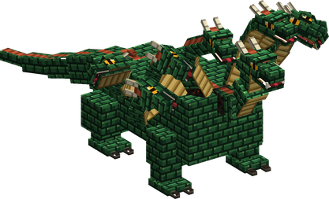{ .form-picture }

Transforms the user into a hydra, which focuses on defense and holding its ground.

## King Cobra Strike { #king-cobra-strike }

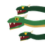{ .ability-icon } *Active*

Every head bites at once, each one a different enemy in front of the user. The heads that have no enemy left bite again for less damage.

| Stat | Value |
|---|---|
| Damage type | Physical |
| Haki | Hardening |
| Cooldown | 8 s |
| Damage | 6–26 |

## Python Coil { #python-coil }

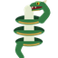{ .ability-icon } *Active*

The necks grab the target and crush it. The target and the user cannot move, the hold lasts longer with more heads

| Stat | Value |
|---|---|
| Damage type | Physical, Blunt |
| Haki | Hardening |
| Cooldown | 15 s |
| Charge | 2–5 s |
| Damage | 2.5 |

## Severed Head { #severed-head }

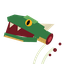{ .ability-icon } *Active*

The user tears off one of their own heads and throws it, it bites what it hits and pins it. Costs a head and a bit of health, then 2 heads grow back.

| Stat | Value |
|---|---|
| Damage type | Projectile, Physical |
| Haki | Imbuing |
| Cooldown | 12 s |
| Projectile damage | 8 |

## Diamondback Guard { #diamondback-guard }

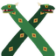{ .ability-icon } *Active*

The necks cross in front of the user and block part of the damage coming from the front, half with 3 heads and up to four fifths with 9 heads. The user is slowed and can still lose a head.

| Stat | Value |
|---|---|
| Cooldown | 14 s |
| Hold | 4 s |

## Hydra's Blood { #hydras-blood }

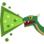{ .ability-icon } *Active*

The heads spit the blood of the hydra on the enemies in front of the user. It deals little damage but stops them from healing, it lasts longer with more heads

| Stat | Value |
|---|---|
| Damage type | Internal |
| Element | Poison |
| Haki | Special |
| Cooldown | 12 s |
| Damage | 3 |

## Taipan Geyser { #taipan-geyser }

{ .ability-icon } *Active*

Spits a jet of blood that hits everything in a line and leaves a pool where it lands, enemies standing in the pool are slowed and cannot heal.

| Stat | Value |
|---|---|
| Damage type | Internal |
| Element | Poison |
| Haki | Special |
| Cooldown | 8 s |
| Hold | 8 s |
| Range | 3 blocks (area) |
| Damage | 6 |

## Boomslang Blitz { #boomslang-blitz }

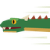{ .ability-icon } *Active*

The user lunges forward with the heads first, hitting everyone in the way and knocking them back

| Stat | Value |
|---|---|
| Damage type | Physical |
| Haki | Hardening |
| Cooldown | 10 s |
| Damage | 10 |

## Anaconda Press { #anaconda-press }

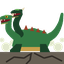{ .ability-icon } *Active*

The hydra jumps where the user is looking and lands with its whole weight, crushing everyone under it. The damage is higher in the middle.

| Stat | Value |
|---|---|
| Damage type | Physical, Blunt |
| Haki | Hardening |
| Cooldown | 20 s |
| Charge | 1 s |
| Range | 4 blocks (area) |
| Damage | 9–18 |

## Molt { #molt }

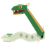{ .ability-icon } *Active*

The user sheds their skin, removing every harmful effect and breaking free from grabs and pins, but not from Seastone or handcuffs. The empty skin attracts mobs for 6 seconds.

| Stat | Value |
|---|---|
| Cooldown | 30 s |

## Kingsnake's Feast { #kingsnakes-feast }

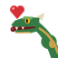{ .ability-icon } *Active*

The middle head bites the target and eats part of it, healing the user and making the next head grow back twice as fast

| Stat | Value |
|---|---|
| Damage type | Physical |
| Haki | Hardening |
| Cooldown | 18 s |
| Damage | 8 |
| Heal | 6 |

## Frenzy { #frenzy }

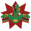{ .ability-icon } *Active*

For 10 seconds every head bites the nearby enemies on its own all around the user. An enemy can only be bitten by 3 heads at a time so more heads means more enemies bitten.

| Stat | Value |
|---|---|
| Damage type | Physical |
| Haki | Hardening |
| Cooldown | 25 s |
| Hold | 10 s |
| Range | 3.5 blocks (area) |
| Damage | 2–6 |

## Nine Heads { #nine-heads }

{ .ability-icon } *Active*

Every neck grows at once even the burned ones, giving the user 9 heads for 20 seconds.

After that the hydra is left with 1 head and no head grows back for 20 seconds

| Stat | Value |
|---|---|
| Cooldown | 120 s |
| Hold | 20 s |

## Lernaean Heads { #lernaean-heads }

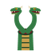{ .ability-icon } *Passive*

The hydra has 3 heads and can have up to 9. While transformed, a hit that deals a tenth of the user's health or more cuts off a head which absorbs part of the hit, then 2 heads grow back after a few seconds.

A head cut off by fire or while the user is burning does not grow back for 30 seconds

## Poison Immunity { #hydra-poison-immunity }

{ .ability-icon } *Passive*

The user is immune to poison, to the poison of the Doku Doku no Mi and to the blood of another hydra.
