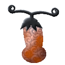
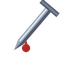
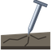
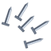
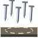
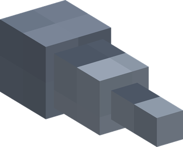
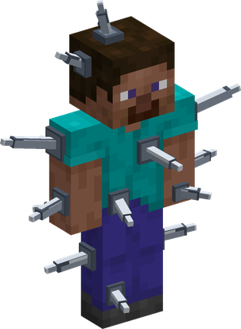
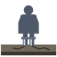
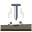

# Kugi Kugi no Mi

{ .mod-icon }

| | |
|---|---|
| **Type** | Paramecia |
| **Theme** | Nails |
| **Box** | { .box-icon } Wooden |
| **Chance per opening** | wooden **2.32%** ([how it works](index.md#box-odds)) |
| **Abilities** | 6: 6 active, 0 passive |
| **Transformations** | [Kugi Yoroi](#kugi-yoroi) |
| **Effects applied** | { .effect-mini }[Nailed](../effects.md#effect-nailed) |

In 3D: drag to turn, scroll or pinch to zoom.

Found in the base mod's **wooden Devil Fruit box**. Eat it and its abilities appear in the ability menu, grouped under the fruit.

!!! note "About the values"
    The values are those of the ability's tooltip in game, with the base mod's default settings. Damage is shown on the base mod's scale, as in the ability screen.

## Kugizuke { #kugizuke }

{ .ability-icon } *Active*

{ .form-picture }

Applies { .effect-mini }[Nailed](../effects.md#effect-nailed)

Throws a big nail that pins the target to the ground where it stands.

| Stat | Value |
|---|---|
| Damage type | Projectile, Physical |
| Element | Metal |
| Haki | Imbuing |
| Cooldown | 12 s |
| Damage | 5 |

## Kugibari { #kugibari }

{ .ability-icon } *Active*

{ .form-picture }

Applies { .effect-mini }[Nailed](../effects.md#effect-nailed)

Throws a few small nails, each one slows the target more and 3 nails pin it to the ground.

| Stat | Value |
|---|---|
| Damage type | Projectile, Physical |
| Element | Metal |
| Haki | Imbuing |
| Cooldown | 8 s |
| Damage | 2.5 |

## Kugi Ame { #kugi-ame }

{ .ability-icon } *Active*

{ .form-picture }

Applies { .effect-mini }[Nailed](../effects.md#effect-nailed)

Marks a spot and then rains small nails on it, each one slows the target more and 3 nails pin it to the ground

| Stat | Value |
|---|---|
| Damage type | Projectile, Physical |
| Element | Metal |
| Haki | Imbuing |
| Cooldown | 14 s |
| Range | 4 blocks (area) |
| Damage | 2.5 |

## Kugi Yoroi { #kugi-yoroi }

{ .ability-icon } *Active · Transformation*

{ .form-picture }

Applies { .effect-mini }[Nailed](../effects.md#effect-nailed)

Nails come out of the user's whole body, enemies hitting the user in melee are damaged and get a nail and anything touching the user is damaged every second.

| Stat | Value |
|---|---|
| Cooldown | 16 s |
| Hold | 10 s |
| Damage type | Slash, Physical |
| Element | Metal |
| Haki | Hardening |
| Damage | 2.5 |

## Kugi Dome { #kugi-dome }

{ .ability-icon } *Active*

The user nails their own feet to the ground, they cannot move but take no knockback and less damage until the ability ends.

| Stat | Value |
|---|---|
| Cooldown | 10 s |
| Hold | 10 s |

## Kuginuki { #kuginuki }

{ .ability-icon } *Active*

Pulls out every nail from every nearby target at once, dealing more damage the more nails they had

| Stat | Value |
|---|---|
| Damage type | Internal, Slash |
| Element | Metal |
| Haki | Special |
| Cooldown | 14 s |
| Range | 20 blocks (area) |
| Damage | 7–23 |
