# Kutsu Kutsu no Mi

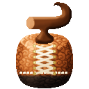{ .mod-icon }

| | |
|---|---|
| **Type** | Paramecia |
| **Theme** | Shoes |
| **Box** | { .box-icon } Wooden |
| **Chance per opening** | wooden **2.32%** ([how it works](index.md#box-odds)) |
| **Abilities** | 7: 7 active, 0 passive |

In 3D: drag to turn, scroll or pinch to zoom.

Found in the base mod's **wooden Devil Fruit box**. Eat it and its abilities appear in the ability menu, grouped under the fruit.

!!! note "About the values"
    The values are those of the ability's tooltip in game, with the base mod's default settings. Damage is shown on the base mod's scale, as in the ability screen.

## Water Soles { #water-soles }

{ .ability-icon } *Active*

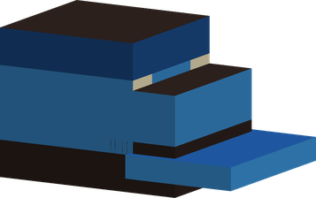{ .form-picture }

The user can walk on water and lava like on solid ground. Crouching makes the user sink.

| Stat | Value |
|---|---|
| Cooldown | 2 s |
| Hold | ∞ s |

## Wall Soles { #wall-soles }

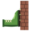{ .ability-icon } *Active*

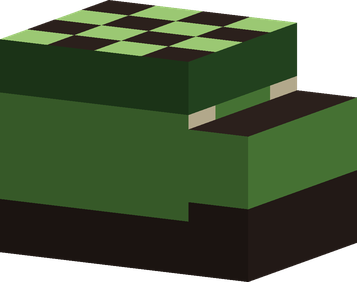{ .form-picture }

The user can climb walls by walking into them, stay on them and hang from ceilings. Crouching makes the user let go

| Stat | Value |
|---|---|
| Cooldown | 2 s |
| Hold | ∞ s |

## Silent Soles { #silent-soles }

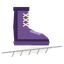{ .ability-icon } *Active*

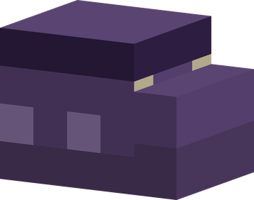{ .form-picture }

The user makes no footsteps and no vibrations, mobs only notice the user from a quarter of the normal distance.

| Stat | Value |
|---|---|
| Cooldown | 2 s |
| Hold | ∞ s |

## Weighted Soles { #weighted-soles }

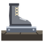{ .ability-icon } *Active*

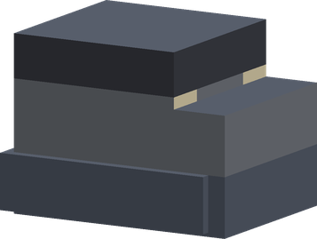{ .form-picture }

The user becomes very heavy, they take no knockback but walk slower. Stomp hits harder and wider while this is active.

| Stat | Value |
|---|---|
| Cooldown | 2 s |
| Hold | ∞ s |

## Spring Soles { #spring-soles }

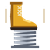{ .ability-icon } *Active*

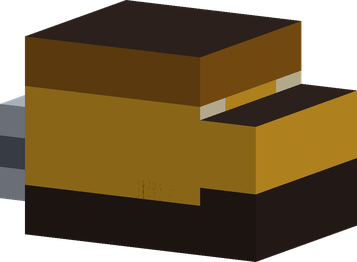{ .form-picture }

The user jumps about 7 blocks high and takes no fall damage. Crouching makes the user jump normally

| Stat | Value |
|---|---|
| Cooldown | 2 s |
| Hold | ∞ s |

## Skate Soles { #skate-soles }

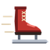{ .ability-icon } *Active*

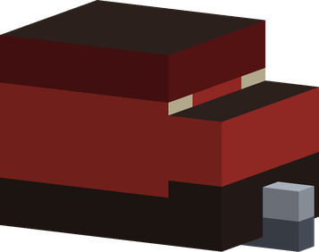{ .form-picture }

The user skates fast on any ground and slides for a while before stopping.

| Stat | Value |
|---|---|
| Cooldown | 2 s |
| Hold | ∞ s |

## Stomp { #stomp }

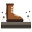{ .ability-icon } *Active*

The user stomps the ground, damaging everyone nearby and launching them up. Hits harder and wider while Weighted Soles is active.

| Stat | Value |
|---|---|
| Damage type | Blunt, Indirect |
| Haki | Hardening |
| Cooldown | 6 s |
| Damage | 10–16 |
| Range | 4–6 blocks (area) |
