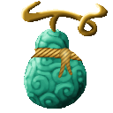

# Oki Oki no Mi

{ .mod-icon }

| | |
|---|---|
| **Type** | Paramecia |
| **Theme** | Law |
| **Box** | { .box-icon } Golden |
| **Chance per opening** | golden **3.39%**, iron **0.170%**, wooden **0.008%** ([how it works](index.md#box-odds)) |
| **Abilities** | 16: 16 active, 0 passive |
| **Effects applied** | { .effect-mini }[Law: Blindness](../effects.md#effect-law-blindness), { .effect-mini }[Law: Ceasefire](../effects.md#effect-law-ceasefire), { .effect-mini }[Law: Disarm](../effects.md#effect-law-disarm), { .effect-mini }[Law: Grounded](../effects.md#effect-law-grounded), { .effect-mini }[Law: Halt](../effects.md#effect-law-halt), { .effect-mini }[Law: Inversion](../effects.md#effect-law-inversion), { .effect-mini }[Law: Levitate](../effects.md#effect-law-levitate), { .effect-mini }[Law: No Building](../effects.md#effect-law-no-building), { .effect-mini }[Law: No Escape](../effects.md#effect-law-no-escape), { .effect-mini }[Law: No Haki](../effects.md#effect-law-no-haki), { .effect-mini }[Law: No Healing](../effects.md#effect-law-no-healing), { .effect-mini }[Law: Retribution](../effects.md#effect-law-retribution), { .effect-mini }[Law: Reveal](../effects.md#effect-law-reveal), { .effect-mini }[Law: Silence](../effects.md#effect-law-silence), { .effect-mini }[Law: Truce](../effects.md#effect-law-truce), { .effect-mini }[Law: Walk](../effects.md#effect-law-walk) |

Found in the base mod's **golden Devil Fruit box**. Eat it and its abilities appear in the ability menu, grouped under the fruit.

!!! note "About the values"
    The values are those of the ability's tooltip in game, with the base mod's default settings. Damage is shown on the base mod's scale, as in the ability screen.

## Halt { #law-halt }

{ .ability-icon } *Active*

Applies { .effect-mini }[Law: Halt](../effects.md#effect-law-halt)

Creates a law that stops everyone in the zone from moving, including the user

| Stat | Value |
|---|---|
| Cooldown | 40 s |
| Hold | 5 s |

## Grounded { #law-grounded }

{ .ability-icon } *Active*

Applies { .effect-mini }[Law: Grounded](../effects.md#effect-law-grounded)

Creates a law that stops everyone in the zone from jumping or flying, including the user.

| Stat | Value |
|---|---|
| Cooldown | 25 s |
| Hold | 12 s |

## Levitate { #law-levitate }

{ .ability-icon } *Active*

Applies { .effect-mini }[Law: Levitate](../effects.md#effect-law-levitate)

Creates a law that makes everyone in the zone float up, including the user.

| Stat | Value |
|---|---|
| Cooldown | 30 s |
| Hold | 6 s |

## Truce { #law-truce }

{ .ability-icon } *Active*

Applies { .effect-mini }[Law: Truce](../effects.md#effect-law-truce)

Creates a law that stops everyone in the zone from hurting anyone, including the user

| Stat | Value |
|---|---|
| Cooldown | 40 s |
| Hold | 10 s |

## Ceasefire { #law-ceasefire }

{ .ability-icon } *Active*

Applies { .effect-mini }[Law: Ceasefire](../effects.md#effect-law-ceasefire)

Creates a law that stops projectiles from being fired in the zone, including by the user.

| Stat | Value |
|---|---|
| Cooldown | 25 s |
| Hold | 15 s |

## Silence { #law-silence }

{ .ability-icon } *Active*

Applies { .effect-mini }[Law: Silence](../effects.md#effect-law-silence)

Creates a law that stops every Devil Fruit power in the zone except the laws, including the user's powers.

| Stat | Value |
|---|---|
| Cooldown | 60 s |
| Hold | 8 s |

## No Healing { #law-no-healing }

{ .ability-icon } *Active*

Applies { .effect-mini }[Law: No Healing](../effects.md#effect-law-no-healing)

Creates a law that stops everyone in the zone from healing, including the user

| Stat | Value |
|---|---|
| Cooldown | 30 s |
| Hold | 15 s |

## No Escape { #law-no-escape }

{ .ability-icon } *Active*

Applies { .effect-mini }[Law: No Escape](../effects.md#effect-law-no-escape)

Creates a law that stops everyone from leaving the zone or teleporting out of it, including the user.

| Stat | Value |
|---|---|
| Cooldown | 30 s |
| Hold | 15 s |

## Disarm { #law-disarm }

{ .ability-icon } *Active*

Applies { .effect-mini }[Law: Disarm](../effects.md#effect-law-disarm)

Creates a law that stops everyone in the zone from using or attacking with an item, including the user. Bare hands still work

| Stat | Value |
|---|---|
| Cooldown | 40 s |
| Hold | 10 s |

## No Haki { #law-no-haki }

{ .ability-icon } *Active*

Applies { .effect-mini }[Law: No Haki](../effects.md#effect-law-no-haki)

Creates a law that stops all Haki in the zone, including the user's.

| Stat | Value |
|---|---|
| Cooldown | 45 s |
| Hold | 10 s |

## Reveal { #law-reveal }

{ .ability-icon } *Active*

Applies { .effect-mini }[Law: Reveal](../effects.md#effect-law-reveal)

Creates a law that makes everyone in the zone glow through walls and stops invisibility, including the user

| Stat | Value |
|---|---|
| Cooldown | 30 s |
| Hold | 20 s |

## Retribution { #law-retribution }

{ .ability-icon } *Active*

Applies { .effect-mini }[Law: Retribution](../effects.md#effect-law-retribution)

Creates a law that makes every hit dealt in the zone also hurt the one who dealt it, including the user.

| Stat | Value |
|---|---|
| Cooldown | 40 s |
| Hold | 10 s |

## Inversion { #law-inversion }

{ .ability-icon } *Active*

Applies { .effect-mini }[Law: Inversion](../effects.md#effect-law-inversion)

Creates a law that makes every heal in the zone deal damage instead, including for the user.

| Stat | Value |
|---|---|
| Cooldown | 50 s |
| Hold | 8 s |

## Blindness { #law-blindness }

{ .ability-icon } *Active*

Applies { .effect-mini }[Law: Blindness](../effects.md#effect-law-blindness)

Creates a law that blinds everyone in the zone, including the user

| Stat | Value |
|---|---|
| Cooldown | 35 s |
| Hold | 6 s |

## No Building { #law-no-building }

{ .ability-icon } *Active*

Applies { .effect-mini }[Law: No Building](../effects.md#effect-law-no-building)

Creates a law that stops blocks from being placed or broken in the zone, including by the user.

| Stat | Value |
|---|---|
| Cooldown | 30 s |
| Hold | 30 s |

## Walk { #law-walk }

{ .ability-icon } *Active*

Applies { .effect-mini }[Law: Walk](../effects.md#effect-law-walk)

Creates a law that stops everyone in the zone from running, including the user.

| Stat | Value |
|---|---|
| Cooldown | 25 s |
| Hold | 15 s |
