# Tori Tori no Mi, Model: Griffon

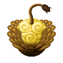{ .mod-icon }

| | |
|---|---|
| **Type** | Mythical Zoan |
| **Box** | { .box-icon } Golden |
| **Chance per opening** | golden **3.39%**, iron **0.170%**, wooden **0.008%** ([how it works](index.md#box-odds)) |
| **Abilities** | 12: 9 active, 3 passive |
| **Transformations** | [Griffon Fly Point](#griffon-fly-point), [Griffon Assault Point](#griffon-assault-point) |

In 3D: drag to turn, scroll or pinch to zoom.

Found in the base mod's **golden Devil Fruit box**. Eat it and its abilities appear in the ability menu, grouped under the fruit.

!!! note "About the values"
    The values are those of the ability's tooltip in game, with the base mod's default settings. Damage is shown on the base mod's scale, as in the ability screen.

## Griffon Fly Point { #griffon-fly-point }

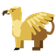{ .ability-icon } *Active · Transformation*

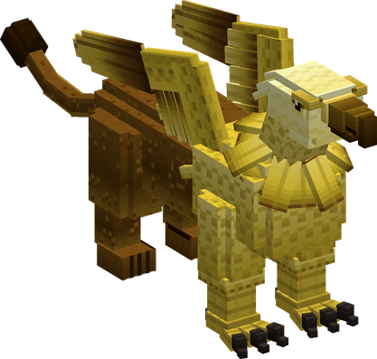{ .form-picture }

Transforms the user into a griffon, which flies, can carry an ally on its back and focuses on mobility.

## Griffon Assault Point { #griffon-assault-point }

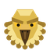{ .ability-icon } *Active · Transformation*

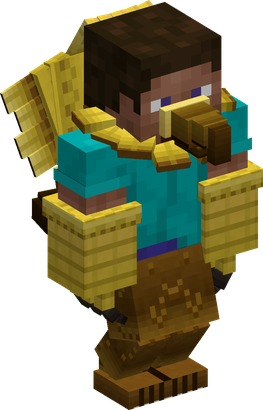{ .form-picture }

Transforms the user into a griffon hybrid, which flies and focuses on strength and its talons.

## Talon Grab { #talon-grab }

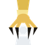{ .ability-icon } *Active*

Grabs the closest enemy in front of the user with the talons and carries it while flying for up to 4 seconds. The enemy is released if it hits the user.

The grab misses if the enemy moves away or is guarding when the talons close. The user flies slower while carrying an enemy

If there is no enemy in range, an ally who is crouching is carried instead for 10 seconds without taking damage, the ally can crouch again to be released.

| Stat | Value |
|---|---|
| Damage type | Physical, Slash |
| Haki | Hardening |
| Cooldown | 16 s |
| Hold | 4 s |
| Damage | 10 |

## Skydrop { #skydrop }

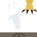{ .ability-icon } *Active*

Throws down the enemy held in the talons. It takes damage when landing, the damage is higher the longer it fell, up to 12 blocks.

An ally is released instead and takes no fall damage

| Stat | Value |
|---|---|
| Damage type | Physical, Blunt |
| Haki | Hardening |
| Cooldown | 3 s |
| Damage | 16–40 |

## Diving Strike { #diving-strike }

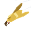{ .ability-icon } *Active*

The user dives where they are looking and crashes on everyone around the landing spot, the damage is higher the higher the dive started, up to 12 blocks.

| Stat | Value |
|---|---|
| Damage type | Physical, Blunt |
| Haki | Hardening |
| Cooldown | 14 s |
| Range | 3.5 blocks (area) |
| Damage | 16–40 |

## Wing Gale { #wing-gale }

{ .ability-icon } *Active*

The user flaps their wings once, damaging and pushing back the enemies in front and sending projectiles back.

While in the air it also pushes the user in the opposite direction, looking down launches the user up

| Stat | Value |
|---|---|
| Damage type | Indirect |
| Element | Wind |
| Haki | Special |
| Cooldown | 10 s |
| Damage | 12 |

## Lion's Roar { #lions-roar }

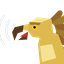{ .ability-icon } *Active*

The user roars, damaging every nearby enemy and making them slow and weak for 5 seconds.

The enemies hit by the roar can be seen by the user through walls for 10 seconds

| Stat | Value |
|---|---|
| Damage type | Indirect |
| Element | Shockwave |
| Haki | Special |
| Cooldown | 20 s |
| Range | 8 blocks (area) |
| Damage | 10 |

## Rending Talons { #rending-talons }

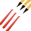{ .ability-icon } *Active*

Slashes the enemy in front of the user 3 times with the talons, the last slash makes it bleed.

| Stat | Value |
|---|---|
| Damage type | Physical, Slash |
| Haki | Hardening |
| Cooldown | 9 s |
| Damage | 27 |

## Hoard Guard { #hoard-guard }

{ .ability-icon } *Active*

Marks the chest or container the user is looking at as a hoard, up to 3 hoards. Anyone who opens or breaks one is slowed for 5 seconds and can be seen by the user through walls for a minute.

Using it on a hoard again removes the mark, using it anywhere else shows where the hoards are. A fourth hoard replaces the oldest one

| Stat | Value |
|---|---|
| Cooldown | 3 s |

## Keen Eyes { #keen-eyes }

{ .ability-icon } *Passive*

While in either griffon form, enemies the user can see are highlighted from very far away.

Requires Griffon Fly Point or Griffon Assault Point to be active.

## Griffon Rideable { #griffon-rideable }

{ .ability-icon } *Passive*

Allows other players to ride on the griffon's back.

## Griffon Flight { #griffon-flight }

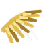{ .ability-icon } *Passive*

Allows the user to fly while transformed by jumping twice.

Requires Griffon Fly Point or Griffon Assault Point to be active.
