# Uma Uma no Mi, Model: Unicorn

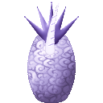{ .mod-icon }

| | |
|---|---|
| **Type** | Mythical Zoan |
| **Box** | { .box-icon } Golden |
| **Chance per opening** | golden **3.39%**, iron **0.170%**, wooden **0.008%** ([how it works](index.md#box-odds)) |
| **Abilities** | 13: 10 active, 3 passive |
| **Transformations** | [Uma Uma Walk Point](#uma-uma-walk-point), [Uma Uma Heavy Point](#uma-uma-heavy-point) |
| **Effects applied** | { .effect-mini }[Purified](../effects.md#effect-purified) |

In 3D: drag to turn, scroll or pinch to zoom.

Found in the base mod's **golden Devil Fruit box**. Eat it and its abilities appear in the ability menu, grouped under the fruit.

!!! note "About the values"
    The values are those of the ability's tooltip in game, with the base mod's default settings. Damage is shown on the base mod's scale, as in the ability screen.

## Uma Uma Walk Point { #uma-uma-walk-point }

{ .ability-icon } *Active · Transformation*

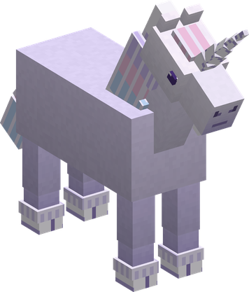{ .form-picture }

Transforms the user into a unicorn, which focuses on speed and can carry allies.

## Uma Uma Heavy Point { #uma-uma-heavy-point }

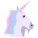{ .ability-icon } *Active · Transformation*

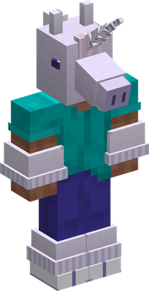{ .form-picture }

Transforms the user into a unicorn hybrid, which focuses on strength and the horn.

## Horn Thrust { #horn-thrust }

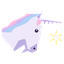{ .ability-icon } *Active*

Stabs the target with the horn, ignoring armor, absorption and Logia intangibility. In the Heavy Point it also lifts the target.

| Stat | Value |
|---|---|
| Damage type | Physical, Slash |
| Element | Light |
| Haki | Hardening |
| Cooldown | 8 s |
| Damage | 24 |
| Pierces | Armour, Logia |

## Unicorn Charge { #unicorn-charge }

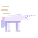{ .ability-icon } *Active*

The user gallops forward with the horn first, hitting everyone in the way and pushing them aside

| Stat | Value |
|---|---|
| Damage type | Physical |
| Haki | Hardening |
| Cooldown | 10 s |
| Hold | 1 s |
| Damage | 20 |

## Prism Lance { #prism-lance }

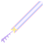{ .ability-icon } *Active*

Fires a beam of light from the horn that goes through every enemy in a line, ignoring armor, absorption and Logia intangibility.

| Stat | Value |
|---|---|
| Damage type | Indirect |
| Element | Light |
| Haki | Special |
| Cooldown | 12 s |
| Damage | 22 |
| Range | 30 blocks (line) |
| Pierces | Armour, Logia |

## Starfall { #starfall }

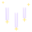{ .ability-icon } *Active*

Makes 5 lances of light fall on the spot the user is looking at, damaging the enemies where they land.

| Stat | Value |
|---|---|
| Damage type | Indirect |
| Element | Light |
| Haki | Special |
| Cooldown | 16 s |
| Damage | 6 |
| Range | 30 blocks (area) |

## Purify { #purify }

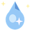{ .ability-icon } *Active*

Applies { .effect-mini }[Purified](../effects.md#effect-purified)

The light of the horn removes harmful effects except stuns from the user and nearby allies, heals them a bit and makes them immune to harmful effects for a few seconds

| Stat | Value |
|---|---|
| Cooldown | 25 s |
| Range | 12 blocks (area) |

## Sanctuary { #sanctuary }

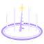{ .ability-icon } *Active*

Applies { .effect-mini }[Purified](../effects.md#effect-purified)

Creates a circle of light where the user stands. Allies inside regenerate and are immune to harmful effects, enemies inside are burned and weakened.

| Stat | Value |
|---|---|
| Damage type | Indirect |
| Element | Light |
| Haki | Special |
| Cooldown | 50 s |
| Hold | 12 s |
| Damage | 4 |
| Range | 12 blocks (area) |

## Guiding Light { #guiding-light }

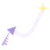{ .ability-icon } *Active*

A thread of light from the horn pulls the target to the user, it works on allies and on enemies.

| Stat | Value |
|---|---|
| Cooldown | 12 s |
| Range | 25 blocks (line) |

## Moonlight Burst { #moonlight-burst }

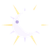{ .ability-icon } *Active*

The unicorn rears up and releases a burst of light, enemies around are pushed away, allies lose their harmful effects and are healed and the light of the horn is refilled

| Stat | Value |
|---|---|
| Damage type | Indirect |
| Element | Light |
| Haki | Special |
| Cooldown | 60 s |
| Damage | 40 |
| Range | 12 blocks (area) |

## Alicorn { #alicorn }

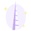{ .ability-icon } *Passive*

The light of the horn removes every harmful effect on the user except stuns and heals the user while transformed. Both use light, which comes back over time and with every horn hit.

## Unicorn Rideable { #unicorn-rideable }

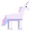{ .ability-icon } *Passive*

Allows other players to ride on the unicorn's back.

## Unicorn Flight { #unicorn-flight }

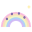{ .ability-icon } *Passive*

Allows the user to fly while transformed, leaving a rainbow behind them

Requires Uma Uma Walk Point or Uma Uma Heavy Point to be active.
