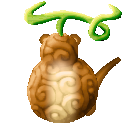

# InoFruits

{ .mod-icon }

**InoFruits** adds **brand-new Devil Fruits** to [Mine Mine no Mi](https://www.curseforge.com/minecraft/mc-mods/mine-mine-no-mi-mod): fruits the base mod does not have, each with its own abilities.

| | |
|---|---|
| Version documented | **4.0.0** (beta) |
| Mod id | `inofruits` |
| Download | [CurseForge](https://www.curseforge.com/minecraft/mc-mods/inofruits) · [4.0.0](https://www.curseforge.com/minecraft/mc-mods/inofruits/files/9376690) |
| Changelog | [Every release](changelog.md) |

## What it adds

**36 Devil Fruits**: 4 Logia, 18 Paramecia and 14 Zoan (three of them Mythical, among them the [Hydra](fruits/hebi-hebi-no-mi-model-hydra.md) and the [Griffon](fruits/tori-tori-no-mi-model-griffon.md)), with their abilities, morphs, projectiles and status effects.

The fruits behave like the base mod's own:

- they **drop from the base mod's Devil Fruit boxes**, each in the box matching its tier, and are drawn as often as a base mod fruit;
- the base mod's **one-fruit-per-world rule** applies to them unchanged;
- they appear in the base mod's **Devil Fruits** creative tab.

## Requirements

| Mod | Version |
|---|---|
| Minecraft | 1.20.1 |
| Forge | 47.4.18 or later |
| [Mine Mine no Mi](https://www.curseforge.com/minecraft/mc-mods/mine-mine-no-mi-mod) | 0.11.6 or newer (built against `1.20.1-0.11.6`) |
| [AkumaLib](../../akumalib/index.md) | **6.1.0 or later** |

!!! warning "Update AkumaLib first"
    With an older AkumaLib the game refuses to start and says which version it needs. AkumaLib 6 does not play with 5.2.0 or older: update the server and every client together.

## Your size

Since 4.0.0 every technique follows the size of its user, through [AkumaLib](../../akumalib/size/index.md). The figures on these pages are for a body of size 1. This is a beta: the size rules were checked by automated tests, not by playing, and the numbers may change.

- **Reach, areas and damage grow** with your body: at four times a man's height, about twice the reach and twice the damage. A blow of arm's reach grows a little more.
- **Pushes, leaps and dashes carry further**, and your steps climb higher.
- **What you summon or leave behind grows too**: Bai Bai's clones, the bubbles of the Gamu Gamu no Mi, the Hydra's shed skin.
- **The laws of the Oki Oki no Mi and the senses of the Kane Kane no Mi reach further.**
- **Kugi Yoroi and the bear's fur answer a blow from wherever a giant can strike you.**
- **What is sent back stays what it was**: blows returned by Toge, Kugi Yoroi and the Kaze Kaze no Mi do not grow with the size of the one returning them.

### Forms that count as big bodies

These change even at normal size, and their numbers are first drafts.

- **[Isa Isa](fruits/isa-isa-no-mi-model-whale.md) Guard Point, [Hydra](fruits/hebi-hebi-no-mi-model-hydra.md) Guard Point and [Griffon](fruits/tori-tori-no-mi-model-griffon.md) Fly Point**: your walk, jump, fall and melee reach follow the form's size. Their techniques keep a man's numbers, and a bigger player's grow from their own size alone.
- **The golem of the [Tsuchi Tsuchi no Mi](fruits/tsuchi-tsuchi-no-mi.md)**: here the techniques also grow, on top of what the golem already gave them.

## Getting started

1. Install Forge for Minecraft 1.20.1, then put **Mine Mine no Mi**, **AkumaLib** and **InoFruits** in your `mods` folder.
2. Find a fruit in a Devil Fruit box. Wooden, iron and golden boxes each hold the fruits of their tier, listed in [Fruits](fruits/index.md).
3. Eat it. Its abilities appear in the base mod's ability menu, grouped under the fruit.

!!! note "Upgrading from before 3.0.0"
    The ferret fruit was renamed **Ita Ita no Mi, Model: Ferret** in 3.0.0. Older saves are remapped automatically: the fruit, its abilities and its forms carry over.

## Explore the wiki

| Page | What you'll find |
|---|---|
| **[Fruits](fruits/index.md)** | the 36 fruits, one page each, with every ability's description and values |
| **[All abilities](all-abilities.md)** | every ability in one table you can sort and filter: cooldown, charge, hold, damage, range |
| **[Status effects](effects.md)** | the effects the fruits inflict or grant, and what applies each one |
| **[Configuration](configuration.md)** | the settings of `inofruits-common.toml` |
