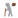
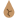
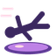

# Status effects

The **65 status effects** Missing Missing no Mi adds, and what applies them.

| Effect | Kind | Applied by |
|---|---|---|
| { .effect-icon } **Absorbed**{ #effect-absorbed } | Neutral | — |
| { .effect-icon } **Aged**{ #effect-aged } | Harmful | [Aging Touch](fruits/juku-juku-no-mi.md#aging-touch), [Draining Bite](fruits/batto-batto-no-mi-model-vampire.md#draining-bite) |
| { .effect-icon } **Antibodies**{ #effect-antibodies } | Beneficial | — |
| { .effect-icon } **Art**{ #effect-art } | Harmful | [Broken-Fu Art](fruits/ato-ato-no-mi.md#broken-fu-art), [Dying Art](fruits/ato-ato-no-mi.md#dying-art), [Panorama Art](fruits/ato-ato-no-mi.md#panorama-art) |
| { .effect-icon } **Buried**{ #effect-buried } | Harmful | [Shishi Odoshi: Chimaki](fruits/fuwa-fuwa-no-mi.md#chimaki), [Devouring Plant](fruits/mosa-mosa-no-mi.md#devouring-plant), [Paper Mummy](fruits/pasa-pasa-no-mi.md#paper-mummy) |
| { .effect-icon } **Buried in Clay**{ #effect-buried-in-clay } | Harmful | [Bury](fruits/gunyo-gunyo-no-mi.md#gunyo-bury) |
| { .effect-icon } **Butter Cuffs**{ #effect-butter-cuffs } | Harmful | — |
| { .effect-icon } **Butter Wrap**{ #effect-butter-wrap } | Harmful | — |
| { .effect-icon } **Cased in Metal**{ #effect-cased-in-metal } | Harmful | [Metal Casing](fruits/gutsu-gutsu-no-mi.md#metal-casing) |
| { .effect-icon } **Collared**{ #effect-collared } | Harmful | [Collar](fruits/peto-peto-no-mi.md#collar) |
| { .effect-icon } **Coughing Fit**{ #effect-coughing-fit } | Harmful | — |
| { .effect-icon } **Cream Burn**{ #effect-cream-burn } | Harmful | [Cream Ball](fruits/kuri-kuri-no-mi.md#cream-ball), [Cream Grab](fruits/kuri-kuri-no-mi.md#cream-grab), [Cream Monster](fruits/kuri-kuri-no-mi.md#cream-monster), [Cream Shell](fruits/kuri-kuri-no-mi.md#cream-shell), [Cream Wave](fruits/kuri-kuri-no-mi.md#cream-wave) |
| { .effect-icon } **Cubed**{ #effect-cubed } | Harmful | [Living Cube](fruits/kyubu-kyubu-no-mi.md#living-cube) |
| { .effect-icon } **Devoted**{ #effect-devoted } | Neutral | [Kibi Dan-boshi](fruits/kibi-kibi-no-mi.md#kibi-dan-boshi) |
| { .effect-icon } **Dried Out**{ #effect-dried-out } | Harmful | [Juice Drain](fruits/shibo-shibo-no-mi.md#shibo-juice-drain) |
| { .effect-icon } **Drunkenness**{ #effect-drunkenness } | Harmful | [Sake Shibuki](fruits/gabu-gabu-no-mi.md#gabu-sake-shibuki), [Sakedeppo](fruits/gabu-gabu-no-mi.md#gabu-sakedeppo), [Shuki](fruits/gabu-gabu-no-mi.md#gabu-shuki) |
| { .effect-icon } **Exhausted**{ #effect-exhausted } | Harmful | [Knight Form](fruits/uta-uta-no-mi.md#knight-form), [Swallowing Pocket](fruits/poke-poke-no-mi.md#poke-swallow), [Tot Musica](fruits/uta-uta-no-mi.md#tot-musica), [Song](fruits/uta-uta-no-mi.md#uta-song) |
| { .effect-icon } **Feminization Disease**{ #effect-feminization-disease } | Harmful | — |
| { .effect-icon } **Fever**{ #effect-fever } | Harmful | — |
| { .effect-icon } **Flashback**{ #effect-flashback } | Harmful | [Memories Fil Flashback](fruits/memo-memo-no-mi.md#memo-flashback) |
| { .effect-icon } **Floured**{ #effect-floured } | Harmful | [Logia Invulnerability Ame](fruits/ame-ame-no-mi.md#logia-invulnerability-ame) |
| { .effect-icon } **Forgotten Quarrel**{ #effect-forgotten-quarrel } | Neutral | [Cut](fruits/memo-memo-no-mi.md#memo-cut) |
| { .effect-icon } **Frozen Stiff**{ #effect-frozen-stiff } | Harmful | — |
| { .effect-icon } **Genie Master**{ #effect-genie-master } | Neutral | [Genie](fruits/hoya-hoya-no-mi.md#hoya-genie) |
| { .effect-icon } **Giro Sight**{ #effect-giro-sight } | Beneficial | [Peeping Mind](fruits/giro-giro-no-mi.md#peeping-mind) |
| { .effect-icon } **Gold Dust**{ #effect-gold-dust } | Neutral | [Gold Dust](fruits/goru-goru-no-mi.md#gold-dust) |
| { .effect-icon } **Golden Statue**{ #effect-golden-statue } | Harmful | [Golden Statue](fruits/goru-goru-no-mi.md#golden-statue) |
| { .effect-icon } **Hangover**{ #effect-hangover } | Harmful | [Sake Shibuki](fruits/gabu-gabu-no-mi.md#gabu-sake-shibuki), [Sakedeppo](fruits/gabu-gabu-no-mi.md#gabu-sakedeppo), [Shuki](fruits/gabu-gabu-no-mi.md#gabu-shuki) |
| { .effect-icon } **In His Darkness**{ #effect-in-his-darkness } | Beneficial | [Darkness](fruits/batto-batto-no-mi-model-vampire.md#vampire-darkness) |
| **In the Swamp**{ #effect-in-the-swamp } | Neutral | [Hikizuri Komi](fruits/numa-numa-no-mi.md#hikizuri-komi), [Numa Sensui](fruits/numa-numa-no-mi.md#numa-sensui), [Sokonashi Numa](fruits/numa-numa-no-mi.md#sokonashi-numa) |
| { .effect-icon } **Island Spirit**{ #effect-island-spirit } | Beneficial | [Merge](fruits/shima-shima-no-mi.md#shima-merge) |
| **Juicy Giant**{ #effect-juicy-giant } | Beneficial | [Juicy Giant](fruits/shibo-shibo-no-mi.md#shibo-juicy-giant) |
| { .effect-icon } **Jumped Ahead**{ #effect-jumped-ahead } | Neutral | — |
| { .effect-icon } **Just Woken**{ #effect-just-woken } | Beneficial | [Knight Form](fruits/uta-uta-no-mi.md#knight-form), [Swallowing Pocket](fruits/poke-poke-no-mi.md#poke-swallow), [Tot Musica](fruits/uta-uta-no-mi.md#tot-musica), [Song](fruits/uta-uta-no-mi.md#uta-song) |
| **Kaen Daiko**{ #effect-kaen-daiko } | Beneficial | [Kaen Daiko](fruits/uo-uo-no-mi-model-seiryu.md#seiryu-kaen-daiko) |
| { .effect-icon } **Kneeling**{ #effect-kneeling } | Harmful | [Kneel!](fruits/muchi-muchi-no-mi.md#muchi-kneel) |
| { .effect-icon } **Launched**{ #effect-launched } | Beneficial | [Guru Guru Toshaho](fruits/guru-guru-no-mi.md#guru-guru-toshaho) |
| { .effect-icon } **Lowered**{ #effect-lowered } | Harmful | [Order](fruits/peto-peto-no-mi.md#order) |
| { .effect-icon } **Merged**{ #effect-merged } | Beneficial | [Gattai](fruits/gocha-gocha-no-mi.md#gocha-gattai) |
| { .effect-icon } **Murder of Crows**{ #effect-murder-of-crows } | Neutral | [Karasu Hiko](fruits/susu-susu-no-mi.md#karasu-hiko) |
| { .effect-icon } **Pinned**{ #effect-pinned } | Harmful | — |
| { .effect-icon } **Puppet**{ #effect-puppet } | Neutral | [Knight Form](fruits/uta-uta-no-mi.md#knight-form), [Swallowing Pocket](fruits/poke-poke-no-mi.md#poke-swallow), [Tot Musica](fruits/uta-uta-no-mi.md#tot-musica), [Song](fruits/uta-uta-no-mi.md#uta-song) |
| { .effect-icon } **Rolling Low**{ #effect-rolling-low } | Beneficial | [Wheels](fruits/koro-koro-no-mi.md#wheels) |
| { .effect-icon } **Scattered**{ #effect-scattered } | Beneficial | [Sefer Yetzirah](fruits/pasa-pasa-no-mi.md#sefer-yetzirah) |
| { .effect-icon } **Sent Ahead**{ #effect-sent-ahead } | Neutral | — |
| { .effect-icon } **Shut in a Book**{ #effect-shut-in-a-book } | Harmful | [Imprison](fruits/buku-buku-no-mi.md#buku-imprison) |
| { .effect-icon } **Slipping**{ #effect-slipping } | Harmful | — |
| { .effect-icon } **Softened**{ #effect-softened } | Harmful | [Arma Bandera](fruits/hira-hira-no-mi.md#arma-bandera) |
| **Spared by the Clay**{ #effect-spared-by-the-clay } | Beneficial | — |
| **Spared by the Cream**{ #effect-spared-by-the-cream } | Beneficial | — |
| { .effect-icon } **Spared by the Syrup**{ #effect-spared-by-the-syrup } | Beneficial | — |
| { .effect-icon } **Spores**{ #effect-spores } | Harmful | [Cross Shade](fruits/noko-noko-no-mi.md#cross-shade), [Run Hypha](fruits/noko-noko-no-mi.md#run-hypha), [Shade Dance](fruits/noko-noko-no-mi.md#shade-dance), [Spin Drill](fruits/noko-noko-no-mi.md#spin-drill) |
| { .effect-icon } **Stuck in Mochi**{ #effect-stuck-in-mochi } | Harmful | [Amadare Mochi](fruits/mochi-mochi-no-mi.md#mochi-amadare), [Kagami Mochi](fruits/mochi-mochi-no-mi.md#mochi-kagami), [Kashiwa Mochi](fruits/mochi-mochi-no-mi.md#mochi-kashiwa), [Mochi Lump](fruits/mochi-mochi-no-mi.md#mochi-lump), [Nagare Mochi](fruits/mochi-mochi-no-mi.md#mochi-nagare), [Stretching Arm](fruits/mochi-mochi-no-mi.md#mochi-stretching-arm), [Mochi Wall](fruits/mochi-mochi-no-mi.md#mochi-wall) |
| { .effect-icon } **Swarm of Bats**{ #effect-swarm-of-bats } | Beneficial | [Swarm of Bats](fruits/batto-batto-no-mi-model-vampire.md#bat-swarm) |
| { .effect-icon } **Taken Along**{ #effect-taken-along } | Neutral | [Take Along](fruits/nuke-nuke-no-mi.md#take-along) |
| { .effect-icon } **Toy**{ #effect-toy } | Harmful | [Omocha](fruits/hobi-hobi-no-mi.md#omocha) |
| { .effect-icon } **Untouched**{ #effect-untouched } | Beneficial | [Untouched](fruits/nuke-nuke-no-mi.md#untouched) |
| { .effect-icon } **Vanished**{ #effect-vanished } | Beneficial | [Vanish](fruits/inu-inu-no-mi-model-kyubi-no-kitsune.md#kyubi-vanish) |
| { .effect-icon } **Warded**{ #effect-warded } | Beneficial | [Warding Page](fruits/pasa-pasa-no-mi.md#warding-page) |
| { .effect-icon } **Wasting**{ #effect-wasting } | Harmful | — |
| { .effect-icon } **Wide Awake**{ #effect-wide-awake } | Beneficial | [Knight Form](fruits/uta-uta-no-mi.md#knight-form), [Swallowing Pocket](fruits/poke-poke-no-mi.md#poke-swallow), [Tot Musica](fruits/uta-uta-no-mi.md#tot-musica), [Song](fruits/uta-uta-no-mi.md#uta-song) |
| { .effect-icon } **World of Books**{ #effect-world-of-books } | Harmful | [Hon no Sekai](fruits/buku-buku-no-mi.md#buku-sekai) |
| { .effect-icon } **Wound in Paper**{ #effect-wound } | Harmful | [Scroll Wrap](fruits/maki-maki-no-mi.md#scroll-wrap) |
| { .effect-icon } **Yolk**{ #effect-yolk } | Harmful | [Three Lives](fruits/tama-tama-no-mi.md#tama-lives) |
| { .effect-icon } **Younger**{ #effect-younger } | Harmful | [Modo Modo](fruits/modo-modo-no-mi.md#modo-modo), [Modo Modo Shot](fruits/modo-modo-no-mi.md#modo-modo-shot) |
