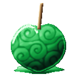
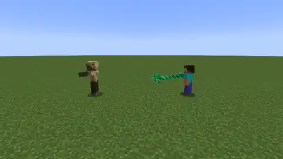
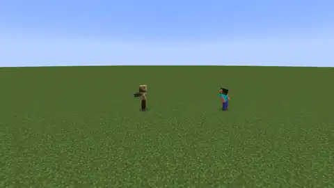
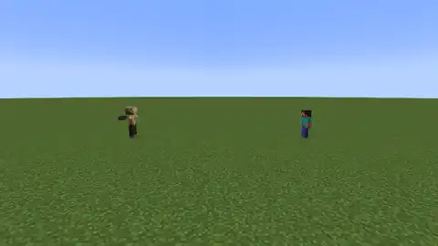
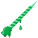
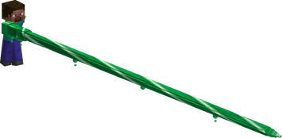
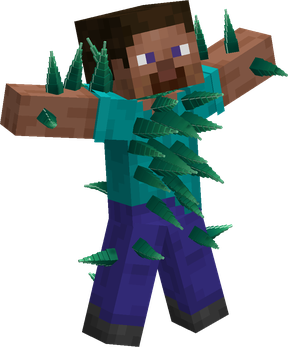
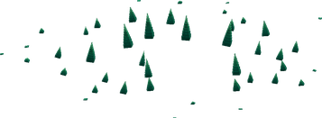

# Ame Ame no Mi

{ .mod-icon }

| | |
|---|---|
| **Type** | Logia |
| **Theme** | Candy syrup |
| **Box** | { .box-icon } Golden |
| **Chance per opening** | golden **2.26%**, iron **0.113%**, wooden **0.006%** ([how it works](index.md#box-odds)) |
| **Abilities** | 5: 4 active, 1 passive |
| **Effects applied** | { .effect-mini }[Floured](../effects.md#effect-floured) |

In 3D: drag to turn, scroll or pinch to zoom.

<!-- animations -->
??? example "Animations"

    Taken in game, at size 1, third person.

    

    <figure markdown="span">
      { loading=lazy }
      <figcaption>Syrup Grab (ALT)</figcaption>
    </figure>
    <figure markdown="span">
      { loading=lazy }
      <figcaption>Spiked Charge (ALT)</figcaption>
    </figure>
    <figure markdown="span">
      { loading=lazy }
      <figcaption>Slingshot</figcaption>
    </figure>
    

<!-- /animations -->

Found in the base mod's **golden Devil Fruit box**. Eat it and its abilities appear in the ability menu, grouped under the fruit.

!!! note "About the values"
    The values are those of the ability's tooltip in game, with the base mod's default settings. Damage is shown on the base mod's scale, as in the ability screen.

## Logia Invulnerability Ame { #logia-invulnerability-ame }

{ .ability-icon } *Passive*

Applies { .effect-mini }[Floured](../effects.md#effect-floured)

Allows the user to avoid attacks by instinctively transforming parts of their body into their specific element

Whoever hits the user's syrup body in close combat without Haki is stuck in place for a moment. The user's punches hit harder on an enemy stuck in the syrup

A hit with wheat or bread in hand, or one of them thrown at the user, covers the user in flour. For a while every hit lands on the syrup body, and it holds nobody

| Stat | Value |
|---|---|
| Striker Stuck | 2 s |
| Floured | 10 s |
| Punch Damage on a Stuck Enemy | +4 |

## Syrup Spear { #syrup-spear }

{ .ability-icon } *Active*

{ .form-picture }

The user's arm stretches far ahead into a spear of hardened syrup. It pierces every enemy in a line and leaves them stuck for a moment

{ .effect-mini }With the **Alt key** it is **Syrup Grab**: the user's arm stretches far ahead and catches the first enemy in its way. The enemy is brought back stuck against the user's syrup body

| Stat | Syrup Spear | Syrup Grab |
|---|---|---|
| Damage type | Slash | Slash |
| Haki | Hardening | Hardening |
| Cooldown | 6 s | 8 s |
| Damage | 18 | 8 |
| Range | 12 blocks (line) | 12 blocks (line) |
| Stuck | 1.5 s | 3 s |

## Spike Burst { #spike-burst }

{ .ability-icon } *Active*

{ .form-picture }

Spikes of hardened syrup shoot out of the user's whole body. Every enemy around is hit and thrown back

{ .effect-mini }With the **Alt key** it is **Spiked Charge**: covered in spikes of hardened syrup, the user dashes forward. Every enemy on the way is hit and thrown aside

| Stat | Spike Burst | Spiked Charge |
|---|---|---|
| Damage type | Slash | Slash |
| Haki | Hardening | Hardening |
| Cooldown | 10 s | 9 s |
| Damage | 20 | 18 |
| Range | 4 blocks (area) | |

## Slingshot { #slingshot }

{ .ability-icon } *Active*

While the key is held, the user's syrup body stretches back like a slingshot. When it is let go, the body snaps forward and throws the user where they look. The longer it is held, the farther the leap and the harder the blow

The first enemy in the way is struck and stuck in the syrup

| Stat | Value |
|---|---|
| Damage type | Blunt |
| Haki | Hardening |
| Cooldown | 8–12 s |
| Charge | 2 s |
| Leap Length | 10–30 blocks |
| Damage | 6–20 |
| Stuck | 1.5 s |

## Syrup Pool { #syrup-pool }

{ .ability-icon } *Active*

{ .form-picture }

The user spreads a pool of syrup on the ground where the user is looking. Whoever steps in it is stuck

Using it again hardens the pool into spikes that hit every enemy standing in it

| Stat | Value |
|---|---|
| Damage type | Indirect |
| Haki | Special |
| Cooldown | 12 s |
| Hold | 8 s |
| Damage | 14 |
| Range | 4 blocks (area) |
