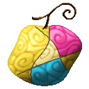
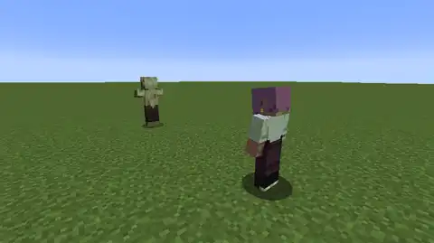
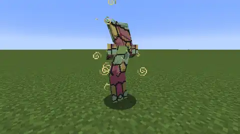
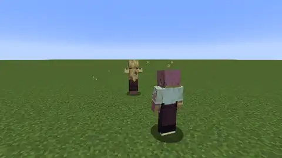
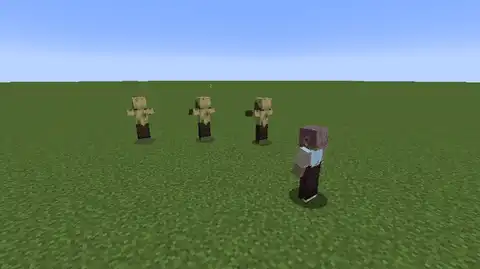
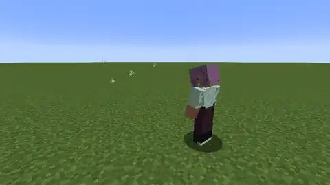
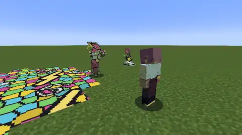
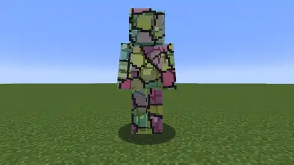
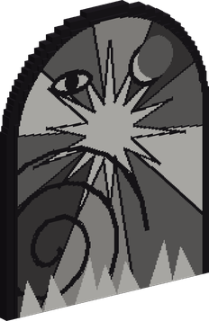
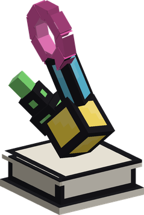

# Ato Ato no Mi

{ .mod-icon }

| | |
|---|---|
| **Type** | Paramecia |
| **Theme** | Art |
| **Box** | { .box-icon } Wooden |
| **Chance per opening** | wooden **1.65%** ([how it works](index.md#box-odds)) |
| **Abilities** | 8: 8 active, 0 passive |
| **Transformations** | [Heaven's Do Art](#heavens-do-art) |
| **Effects applied** | { .effect-mini }[Art](../effects.md#effect-art) |

In 3D: drag to turn, scroll or pinch to zoom.

<!-- animations -->
??? example "Animations"

    Taken in game, at size 1, third person.

    

    <figure markdown="span">
      { loading=lazy }
      <figcaption>Broken-Fu Art</figcaption>
    </figure>
    <figure markdown="span">
      { loading=lazy }
      <figcaption>Back from art, in a puff of smoke</figcaption>
    </figure>
    <figure markdown="span">
      { loading=lazy }
      <figcaption>Dying Art</figcaption>
    </figure>
    <figure markdown="span">
      { loading=lazy }
      <figcaption>Panorama Art</figcaption>
    </figure>
    <figure markdown="span">
      { loading=lazy }
      <figcaption>Mosaic Art</figcaption>
    </figure>
    <figure markdown="span">
      { loading=lazy }
      <figcaption>Fukugen</figcaption>
    </figure>
    <figure markdown="span">
      { loading=lazy }
      <figcaption>Heaven's Do Art</figcaption>
    </figure>
    

<!-- /animations -->

Found in the base mod's **wooden Devil Fruit box**. Eat it and its abilities appear in the ability menu, grouped under the fruit.

!!! note "About the values"
    The values are those of the ability's tooltip in game, with the base mod's default settings. Damage is shown on the base mod's scale, as in the ability screen.

## Broken-Fu Art { #broken-fu-art }

{ .ability-icon } *Active*

Applies { .effect-mini }[Art](../effects.md#effect-art)

Throws a cloud that turns the enemy it touches into abstract art, slowing it and making its weapons and its fists useless.

| Stat | Value |
|---|---|
| Cooldown | 45 s |
| Charge | under 1 s |
| Duration | 30 s |

## Dying Art { #dying-art }

{ .ability-icon } *Active*

{ .form-picture }

Applies { .effect-mini }[Art](../effects.md#effect-art)

Flattens the enemy the user is looking at into a mural, where it can't move and slowly dies.

| Stat | Value |
|---|---|
| Haki | Special |
| Cooldown | 20 s |
| Charge | under 1 s |
| Damage | 9 |
| Duration | 6 s |

## Fukugen { #fukugen }

{ .ability-icon } *Active*

Restores everything the user turned into art. Everything is also restored if the user is knocked out. Water washes the art off a body.

| Stat | Value |
|---|---|
| Cooldown | 2 s |
| Charge | under 1 s |

## Heaven's Do Art { #heavens-do-art }

{ .ability-icon } *Active · Transformation*

The user enters a world of their art, becoming giant and absorbing most of the damage they take. Using it again ends it.

| Stat | Value |
|---|---|
| Damage Taken | -60 % |
| Size | x2 |

## Panorama Art { #panorama-art }

{ .ability-icon } *Active*

Applies { .effect-mini }[Art](../effects.md#effect-art)

The user releases a wide cloud in front of them that turns all enemies it touches into abstract art, slowing them and making their weapons and fists useless.

| Stat | Value |
|---|---|
| Cooldown | 25 s |
| Charge | under 1 s |
| Duration | 10 s |
| Range | 9 blocks (cone) |

## Still Life Art { #still-life-art }

{ .ability-icon } *Active*

For a few seconds, all enemy projectiles that get close to the user are turned into small harmless pieces of art that fall to the ground. Using it again ends it.

| Stat | Value |
|---|---|
| Cooldown | 20 s |
| Hold | 5 s |
| Range | 4 blocks (area) |

## Mosaic Art { #mosaic-art }

{ .ability-icon } *Active*

Turns the ground where the user is looking into abstract art for a while. All enemies standing on it are heavily slowed.

| Stat | Value |
|---|---|
| Cooldown | 25 s |
| Charge | under 1 s |
| Duration | 8 s |
| Range | 4 blocks (area) |

## Readymade Art { #readymade-art }

{ .ability-icon } *Active*

{ .form-picture }

Makes an art sculpture out of the block the user is looking at, which attracts all nearby hostile creatures for a while or until it is destroyed.

Only one sculpture can be active.

| Stat | Value |
|---|---|
| Cooldown | 30 s |
| Charge | under 1 s |
| Duration | 10 s |
