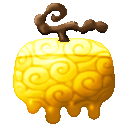
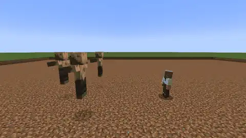
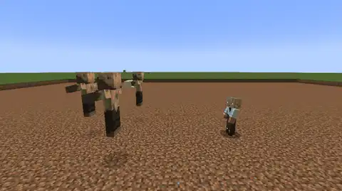
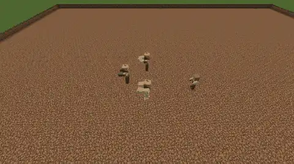
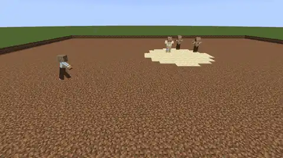
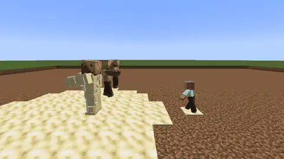
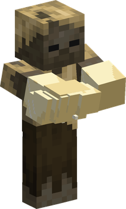
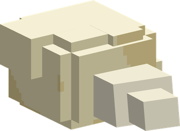

# Bata Bata no Mi

{ .mod-icon }

| | |
|---|---|
| **Type** | Paramecia |
| **Theme** | Butter |
| **Box** | { .box-icon } Wooden |
| **Chance per opening** | wooden **1.65%** ([how it works](index.md#box-odds)) |
| **Abilities** | 6: 6 active, 0 passive |
| **Effects applied** | { .effect-mini }[Butter Cuffs](../effects.md#effect-butter-cuffs), { .effect-mini }[Butter Wrap](../effects.md#effect-butter-wrap) |

In 3D: drag to turn, scroll or pinch to zoom.

<!-- animations -->
??? example "Animations"

    Taken in game, at size 1.

    

    <figure markdown="span">
      { loading=lazy }
      <figcaption>Butter lump</figcaption>
    </figure>
    <figure markdown="span">
      { loading=lazy }
      <figcaption>Butter Cuffs</figcaption>
    </figure>
    <figure markdown="span">
      { loading=lazy }
      <figcaption>Butter Wrap</figcaption>
    </figure>
    <figure markdown="span">
      { loading=lazy }
      <figcaption>Sticky Sheet</figcaption>
    </figure>
    <figure markdown="span">
      { loading=lazy }
      <figcaption>Butter slide</figcaption>
    </figure>
    <figure markdown="span">
      { loading=lazy }
      <figcaption>Burning butter</figcaption>
    </figure>
    

<!-- /animations -->

Found in the base mod's **wooden Devil Fruit box**. Eat it and its abilities appear in the ability menu, grouped under the fruit.

!!! note "About the values"
    The values are those of the ability's tooltip in game, with the base mod's default settings. Damage is shown on the base mod's scale, as in the ability screen.

## Butter Lump { #bata-lump }

{ .ability-icon } *Active*

{ .form-picture }

The user throws a lump of butter where they look. It hits the first enemy in its way and slows it for a moment

| Stat | Value |
|---|---|
| Damage type | Blunt, Projectile |
| Haki | Special |
| Cooldown | 4 s |
| Range | 54 blocks (line) |
| Damage | 5 |

## Butter Cuffs { #bata-cuffs }

{ .ability-icon } *Active*

{ .form-picture }

Applies { .effect-mini }[Butter Cuffs](../effects.md#effect-butter-cuffs), { .effect-mini }[Butter Wrap](../effects.md#effect-butter-wrap)

The user throws a ball of butter where they look. It wraps the hands of the first enemy it hits, who can't hit or use what it holds

The butter lasts a shorter time on a player. Hits from someone else break it sooner and fire melts it

| Stat | Value |
|---|---|
| Cooldown | 12 s |
| Range | 12 blocks (line) |
| Hold | 8 s |

## Butter Wrap { #bata-wrap }

{ .ability-icon } *Active*

{ .form-picture }

Applies { .effect-mini }[Butter Cuffs](../effects.md#effect-butter-cuffs), { .effect-mini }[Butter Wrap](../effects.md#effect-butter-wrap)

The user throws a ball of butter where they look. It wraps the whole body of the first enemy it hits, who can't move or hit

The butter lasts a shorter time on a player. Hits from someone else break it sooner and fire melts it

| Stat | Value |
|---|---|
| Cooldown | 18 s |
| Range | 12 blocks (line) |
| Hold | 6 s |

## Sticky Sheet { #bata-sheet }

{ .ability-icon } *Active*

The user spreads soft butter on the ground where they look. Everyone who walks in it gets stuck and can't jump, friend and enemy, but not the user

Using it again takes the butter back

| Stat | Value |
|---|---|
| Cooldown | 18 s |
| Hold | 10 s |
| Range | 10 blocks (line) |
| Range | 5 blocks (area) |
| Charge | 0 s |

## Butter Slide { #bata-slide }

{ .ability-icon } *Active*

The user slides fast on their own butter and leaves a sticky trail behind. Everyone who follows on it gets stuck

Using it again stops the slide and takes the trail back

| Stat | Value |
|---|---|
| Cooldown | 15 s |
| Hold | 10 s |
| Charge | 0 s |

## Burning Butter { #bata-burning }

{ .ability-icon } *Active*

Applies { .effect-mini }[Butter Cuffs](../effects.md#effect-butter-cuffs), { .effect-mini }[Butter Wrap](../effects.md#effect-butter-wrap)

The user heats all their butter at once. Everyone held in the user's butter is burnt, and every enemy standing in it a little less. Then the butter melts away

| Stat | Value |
|---|---|
| Damage type | Indirect |
| Element | Fire |
| Haki | Special |
| Cooldown | 20 s |
| Damage | 12 |
| Damage | 8 |
| Range | 24 blocks (area) |
