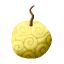

# Bata Bata no Mi

{ .mod-icon }

| | |
|---|---|
| **Type** | Paramecia |
| **Theme** | Butter |
| **Box** | { .box-icon } Wooden |
| **Chance per opening** | wooden **1.93%** ([how it works](index.md#box-odds)) |
| **Abilities** | 6: 6 active, 0 passive |

Found in the base mod's **wooden Devil Fruit box**. Eat it and its abilities appear in the ability menu, grouped under the fruit.

!!! note "About the values"
    The values are those of the ability's tooltip in game, with the base mod's default settings. Damage is shown on the base mod's scale, as in the ability screen.

## Butter Lump { #bata-lump }

{ .ability-icon } *Active*

The user throws a lump of butter where they look. It hits the first enemy in its way and slows it for a moment

| Stat | Value |
|---|---|
| Damage type | Blunt, Projectile |
| Haki | Special |
| Cooldown | 4 s |
| Damage | 5 |

## Butter Cuffs { #bata-cuffs }

{ .ability-icon } *Active*

A lump of butter flies to the enemy the user looks at and wraps its hands. It can't hit and can't use what it holds

The butter lasts less on a player. Hits from someone else break it sooner and fire melts it

| Stat | Value |
|---|---|
| Cooldown | 12 s |
| Range | 12 blocks (line) |

## Butter Wrap { #bata-wrap }

{ .ability-icon } *Active*

A lump of butter flies to the enemy the user looks at and wraps its whole body. It can't move and can't hit

The butter lasts less on a player. Hits from someone else break it sooner and fire melts it

| Stat | Value |
|---|---|
| Cooldown | 18 s |
| Range | 12 blocks (line) |

## Slippery Sheet { #bata-sheet }

{ .ability-icon } *Active*

The user spreads melted butter on the ground where they look. Everyone who walks on it slides, friend and enemy, but not the user

Using it again takes the butter back

| Stat | Value |
|---|---|
| Cooldown | 18 s |
| Hold | 10 s |
| Range | 5 blocks (area) |

## Butter Slide { #bata-slide }

{ .ability-icon } *Active*

The user slides fast on their own butter and leaves a slippery trail behind. Everyone who follows on it slides

Using it again stops the slide and takes the trail back

| Stat | Value |
|---|---|
| Cooldown | 15 s |
| Hold | 10 s |

## Burning Butter { #bata-burning }

{ .ability-icon } *Active*

The user heats all their butter at once. Everyone held in the user's butter and every enemy standing on it is burnt. Then the butter melts away

| Stat | Value |
|---|---|
| Damage type | Indirect |
| Element | Fire |
| Haki | Special |
| Cooldown | 20 s |
| Damage | 12 |
| Range | 24 blocks (area) |
