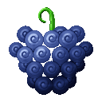
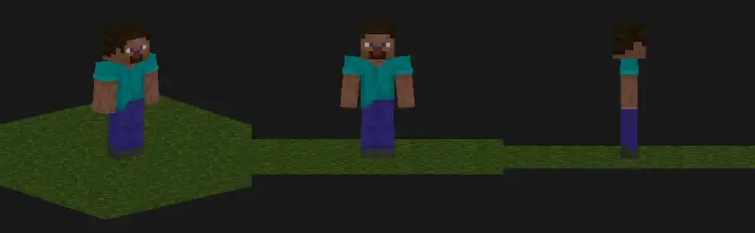
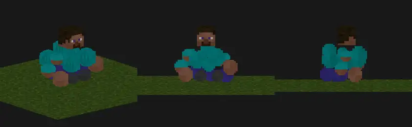
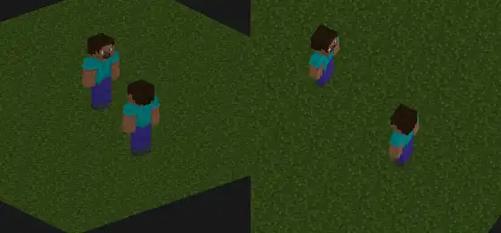
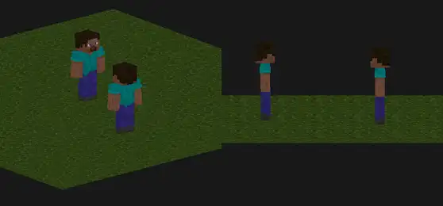
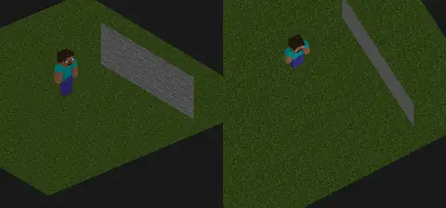
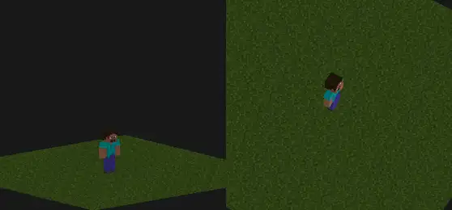

# Beri Beri no Mi

{ .mod-icon }

| | |
|---|---|
| **Type** | Paramecia |
| **Theme** | Berry |
| **Box** | { .box-icon } Wooden |
| **Chance per opening** | wooden **1.81%** ([how it works](index.md#box-odds)) |
| **Abilities** | 5: 5 active, 0 passive |
| **Transformations** | [Grape](#beri-grape) |

<!-- animations -->
??? example "Animations"

    

    <figure markdown="span">
      { loading=lazy }
      <figcaption>Grape</figcaption>
    </figure>
    <figure markdown="span">
      { loading=lazy }
      <figcaption>Grape: moving</figcaption>
    </figure>
    <figure markdown="span">
      { loading=lazy }
      <figcaption>Swarm</figcaption>
    </figure>
    <figure markdown="span">
      { loading=lazy }
      <figcaption>Cannonball</figcaption>
    </figure>
    <figure markdown="span">
      { loading=lazy }
      <figcaption>Bounce</figcaption>
    </figure>
    <figure markdown="span">
      { loading=lazy }
      <figcaption>Berry Rain</figcaption>
    </figure>
    

<!-- /animations -->

Found in the base mod's **wooden Devil Fruit box**. Eat it and its abilities appear in the ability menu, grouped under the fruit.

!!! note "About the values"
    The values are those of the ability's tooltip in game, with the base mod's default settings. Damage is shown on the base mod's scale, as in the ability screen.

## Grape { #beri-grape }

{ .ability-icon } *Active · Transformation*

The user splits their body into lots of berry balls, the balls move aside from every hit by hand or with a weapon, even blades and Armament Haki, but each dodge makes the split end sooner

They rise up to 5 blocks over the ground while jump is held, crouching takes them down, and they fall slowly. With the alternate mode the balls stay bunched or scatter, scattered the arrows and shots miss too but the user can't attack

All the parts of the body must be back to split, while split the other abilities take their balls out of the bunch and they come back to it

Bunched

[Scattered](../effects.md#effect-scattered)

Can't attack, shots go through

| Stat | Value |
|---|---|
| Time Lost per Dodge | 1 s |
| Duration | 20 s |
| Movement Speed | -30 % |
| Fist Damage | 3 |
| Movement Speed | -50 % |

## Swarm { #beri-swarm }

{ .ability-icon } *Active*

The user sends berry balls of their body around the enemy they look at, the balls circle it and charge it from every side one after the other

The balls are both arms and both legs, they fly back to the user after and must all be back to use it again

| Stat | Value |
|---|---|
| Damage type | Blunt |
| Haki | Hardening |
| Cooldown | 14 s |
| Range | 12 blocks (line) |
| Damage | 3 |
| Hits | 6 |
| Total Damage | 18 |

## Cannonball { #beri-cannonball }

{ .ability-icon } *Active*

The user throws one arm as a berry ball like a cannonball, it flies back to them after, nobody can catch it

The alternate mode throws the other arm, one charge for each arm, a charge comes back with its arm

| Stat | Value |
|---|---|
| Damage type | Blunt |
| Haki | Hardening |
| Stacks | 2 |
| Range | 20 blocks (line) |
| Damage | 10 |

## Bounce { #beri-bounce }

{ .ability-icon } *Active*

The user throws berry balls of their body in front of them, they bounce off the ground and the walls and hit everything they touch

The balls are both legs, they fly back to the user after and must be back to use it again

| Stat | Value |
|---|---|
| Damage type | Blunt |
| Haki | Hardening |
| Cooldown | 16 s |
| Damage | 4 |
| Balls | 5 |
| Bounces | 4 |
| Max Damage per Target | 8 |
| Duration | 3 s |

## Berry Rain { #beri-berry-rain }

{ .ability-icon } *Active*

The user rises up as berry balls and falls down on the place they look at as a hail of cannonballs, then takes shape again in the middle of it

Nothing can touch the user while they are in the air

The hail is the whole body but the head, it flies back to the user after they land and must all be back to use it again

| Stat | Value |
|---|---|
| Damage type | Blunt |
| Haki | Hardening |
| Cooldown | 40 s |
| Range | 20 blocks (line) |
| Damage | 5 |
| Balls | 12 |
| Radius | 6  blocks |
| Max Damage per Target | 15 |
| Max Damage at the Centre | 30 |
