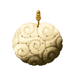
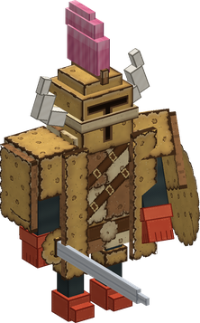
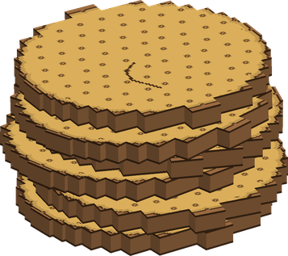
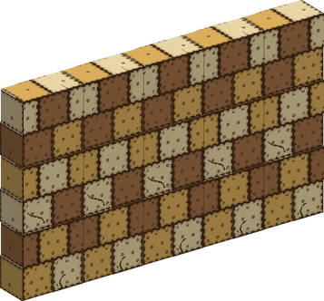
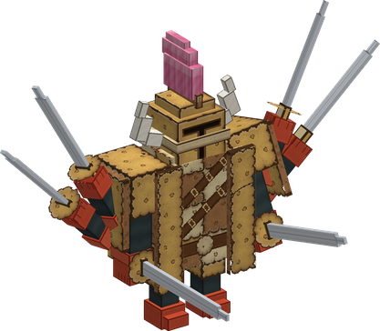
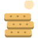

# Bisu Bisu no Mi

{ .mod-icon }

| | |
|---|---|
| **Type** | Paramecia |
| **Theme** | Biscuit |
| **Box** | { .box-icon } Iron |
| **Chance per opening** | iron **1.46%**, wooden **0.073%** ([how it works](index.md#box-odds)) |
| **Abilities** | 8: 8 active, 0 passive |

In 3D: drag to turn, scroll or pinch to zoom.

Found in the base mod's **iron Devil Fruit box**. Eat it and its abilities appear in the ability menu, grouped under the fruit.

!!! note "About the values"
    The values are those of the ability's tooltip in game, with the base mod's default settings. Damage is shown on the base mod's scale, as in the ability screen.

## Biscuit Hei { #bisu-hei }

{ .ability-icon } *Active*

{ .form-picture }

The user makes 3 biscuit soldiers that follow them and attack their enemies. A broken soldier comes back after 10 seconds as long as the ability is active

In water or rain the biscuit gets soft. A soft soldier takes double damage and anyone can eat it

| Stat | Value |
|---|---|
| Cooldown | 30 s |
| Hold | ∞ s |

## Hard Biscuit { #bisu-hard-biscuit }

{ .ability-icon } *Active*

{ .form-picture }

A pile of hardened biscuit shields falls on the enemy the user looks at. It hurts the enemy and pins them to the ground for a moment

| Stat | Value |
|---|---|
| Damage type | Blunt, Indirect |
| Haki | Special |
| Cooldown | 15 s |
| Damage | 14 |
| Range | 16 blocks (line) |

## Biscuit Wall { #bisu-wall }

{ .ability-icon } *Active*

{ .form-picture }

A wall of hard biscuit rises in front of the user and stops enemies and projectiles for a while. In water or rain it lasts half as long. Using the ability again brings the wall down

| Stat | Value |
|---|---|
| Cooldown | 20 s |
| Hold | 10 s |

## Biscuit Armour { #bisu-armour }

{ .ability-icon } *Active*

{ .form-picture }

The user wears a giant biscuit soldier that takes the damage for them. When the armour breaks the user comes out unharmed

Using it again adds a pair of arms with swords, up to 6 arms, and each pair makes the user hit harder. Using it with 6 arms leaves the armour

In water or rain the armour gets soft and breaks twice as fast

| Stat | Value |
|---|---|
| Cooldown | 20–60 s |
| Armour Toughness | 80 |
| Damage per Extra Pair of Arms | +4 |

## Double Roll Pretzel { #bisu-pretzel }

{ .ability-icon } *Active*

Inside the biscuit armour the user dashes forward with two spinning swords, hitting every enemy on the way and throwing them aside

| Stat | Value |
|---|---|
| Damage type | Physical |
| Haki | Hardening |
| Cooldown | 12 s |
| Damage | 18 |

## Crush Biscuit { #bisu-crush-biscuit }

{ .ability-icon } *Active*

The user crushes biscuits into fine crumbs and shapes a copy of the sword Pretzel in their hand, for 60 seconds at most

The sword crumbles if it leaves the hand of the user, in water or under the rain

| Stat | Value |
|---|---|
| Damage type | Slash |
| Haki | Imbuing |
| Cooldown | 12 s |
| Hold | 60 s |

## Crumb Burst { #bisu-crumb-burst }

{ .ability-icon } *Active*

The user crushes biscuits and throws the hardened crumbs in a fan in front of them, hitting every enemy close ahead

| Stat | Value |
|---|---|
| Damage type | Blunt, Indirect |
| Haki | Special |
| Cooldown | 12 s |
| Damage | 12 |
| Range | 6 blocks (cone) |

## Biscuit Rations { #bisu-biscuit-rations }

{ .ability-icon } *Active*

The user makes 4 hard biscuits. They are too hard to eat until they are soaked, by using them on water

| Stat | Value |
|---|---|
| Cooldown | 30 s |
