# Buki Buki no Mi

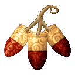{ .mod-icon }

| | |
|---|---|
| **Type** | Paramecia |
| **Theme** | Weapons |
| **Box** | { .box-icon } Iron |
| **Chance per opening** | iron **1.37%**, wooden **0.069%** ([how it works](index.md#box-odds)) |
| **Abilities** | 8: 8 active, 0 passive |

In 3D: drag to turn, scroll or pinch to zoom.

<!-- animations -->
??? example "Animations"

    Taken in game, at size 1.

    

    <figure markdown="span">
      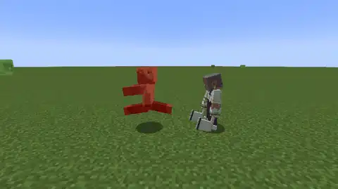{ loading=lazy }
      <figcaption>Espada Girl</figcaption>
    </figure>
    <figure markdown="span">
      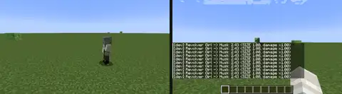{ loading=lazy }
      <figcaption>Revolver</figcaption>
    </figure>
    <figure markdown="span">
      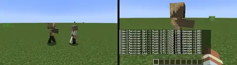{ loading=lazy }
      <figcaption>Revolver leg</figcaption>
    </figure>
    <figure markdown="span">
      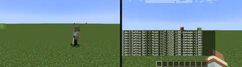{ loading=lazy }
      <figcaption>Gatling</figcaption>
    </figure>
    <figure markdown="span">
      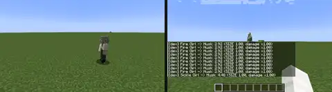{ loading=lazy }
      <figcaption>Sickle Girl</figcaption>
    </figure>
    <figure markdown="span">
      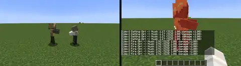{ loading=lazy }
      <figcaption>Flamethrower</figcaption>
    </figure>
    <figure markdown="span">
      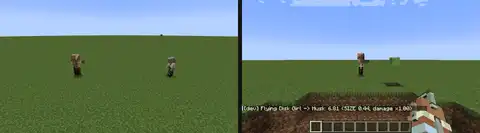{ loading=lazy }
      <figcaption>Missile</figcaption>
    </figure>
    <figure markdown="span">
      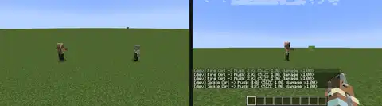{ loading=lazy }
      <figcaption>Flying Disk Girl</figcaption>
    </figure>
    

<!-- /animations -->

Found in the base mod's **iron Devil Fruit box**. Eat it and its abilities appear in the ability menu, grouped under the fruit.

!!! note "About the values"
    The values are those of the ability's tooltip in game, with the base mod's default settings. Damage is shown on the base mod's scale, as in the ability screen.

## Espada Girl { #espada-girl }

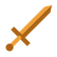{ .ability-icon } *Active · Punch*

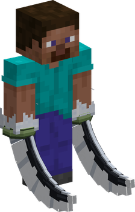{ .form-picture }

Turns the user's arms into weapons, sword blades by default. Their punches cut, and their hands count as a sword. The mode key picks another weapon before use.

| Stat | Value |
|---|---|
| Damage type | Slash, Fist, Physical |
| Haki | Hardening |
| Charge | 0 s |

## Revolver Girl { #revolver-girl }

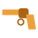{ .ability-icon } *Active*

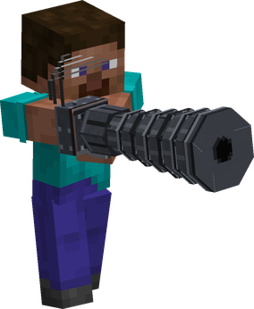{ .form-picture }

Turns the user's arm into a revolver that fires a burst of bullets where the user looks.

| Stat | Value |
|---|---|
| Damage type | Projectile, Bullet |
| Haki | Imbuing |
| Cooldown | 10 s |
| Hold | 2 s |
| Damage | 25 |
| Range | 87.5 blocks (line) |

## Revolver Leg { #revolver-leg }

{ .ability-icon } *Active*

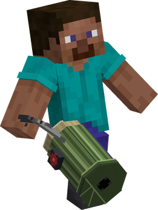{ .form-picture }

The user kicks with a leg turned into a gun. It fires as the kick lands and pushes back the enemies in front.

| Stat | Value |
|---|---|
| Damage type | Bullet |
| Haki | Imbuing |
| Cooldown | 7 s |
| Charge | 0 s |
| Damage | 10 |
| Range | 3.5 blocks (cone) |

## Gatling Girl { #gatling-girl }

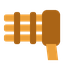{ .ability-icon } *Active*

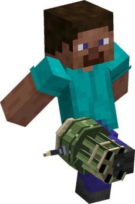{ .form-picture }

Turns the user's leg into a Gatling gun that fires a long burst of bullets where the user looks. The user is slowed while firing.

| Stat | Value |
|---|---|
| Damage type | Projectile, Bullet |
| Haki | Imbuing |
| Cooldown | 25 s |
| Hold | 4 s |
| Damage | 48 |
| Range | 80 blocks (line) |

**Stats while active**

| Stat | Value |
|---|---|
| Speed | x0.5 |

## Sickle Girl { #sickle-girl }

{ .ability-icon } *Active*

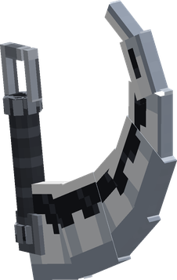{ .form-picture }

Throws a sickle on a chain from the user's arm. It cuts the first enemy it hits, and the chain pulls that enemy back.

| Stat | Value |
|---|---|
| Damage type | Projectile |
| Haki | Imbuing |
| Cooldown | 9 s |
| Damage | 5 |
| Range | 35.2 blocks (line) |

## Fire Girl { #fire-girl }

{ .ability-icon } *Active*

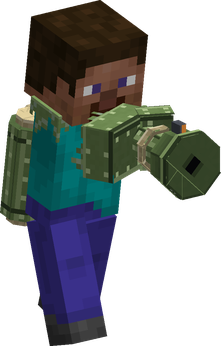{ .form-picture }

Turns the user's upper body into a flamethrower that pours a cone of fire in front of them and sets the enemies on fire.

| Stat | Value |
|---|---|
| Element | Fire |
| Haki | Special |
| Cooldown | 16 s |
| Hold | 3 s |
| Damage | 18 |
| Range | 7 blocks (cone) |

## Missile Girl { #missile-girl }

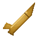{ .ability-icon } *Active*

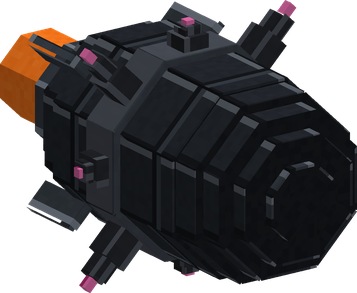{ .form-picture }

Turns the user into a missile that flies where they look and explodes on the first thing it hits. Use the ability again to explode at once. The blast does not hurt the user.

| Stat | Value |
|---|---|
| Element | Explosion |
| Haki | Imbuing |
| Cooldown | 30 s |
| Hold | 5 s |
| Damage | 20 |
| Range | 110 blocks (line) |

## Flying Disk Girl { #flying-disk-girl }

{ .ability-icon } *Active*

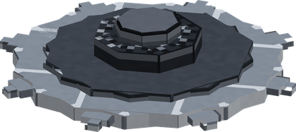{ .form-picture }

Turns the user into a spinning cutting disk that dashes forward, cutting and pushing away every enemy in its path.

| Stat | Value |
|---|---|
| Damage type | Physical |
| Haki | Hardening |
| Cooldown | 12 s |
| Hold | 2 s |
| Damage | 7 |
| Range | 27 blocks (line) |
