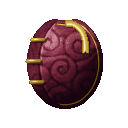
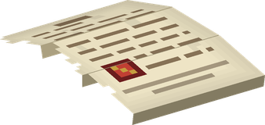

# Buku Buku no Mi

{ .mod-icon }

| | |
|---|---|
| **Type** | Paramecia |
| **Theme** | Book |
| **Box** | { .box-icon } Iron |
| **Chance per opening** | iron **1.48%**, wooden **0.074%** ([how it works](index.md#box-odds)) |
| **Abilities** | 8: 7 active, 1 passive (1 hidden, not in the ability menu) |
| **Effects applied** | { .effect-mini }[Shut in a Book](../effects.md#effect-shut-in-a-book), { .effect-mini }[World of Books](../effects.md#effect-world-of-books) |

In 3D: drag to turn, scroll or pinch to zoom.

Found in the base mod's **iron Devil Fruit box**. Eat it and its abilities appear in the ability menu, grouped under the fruit.

!!! note "About the values"
    The values are those of the ability's tooltip in game, with the base mod's default settings. Damage is shown on the base mod's scale, as in the ability screen.

## Cutting Page { #buku-page }

{ .ability-icon } *Active*

{ .form-picture }

The user throws a torn page as sharp as a blade where they look. It cuts the first enemy in its way and makes it bleed

| Stat | Value |
|---|---|
| Damage type | Projectile |
| Haki | Special |
| Cooldown | 6 s |
| Damage | 9 |

## Book Barrage { #buku-barrage }

{ .ability-icon } *Active*

{ .form-picture }

The user throws a volley of heavy books where they are looking

| Stat | Value |
|---|---|
| Damage type | Blunt, Projectile |
| Haki | Special |
| Damage | 3 |

## Book Wall { #buku-wall }

{ .ability-icon } *Active*

Great books stand in a row in front of the user and stop enemies and projectiles for a while. Fire burns them. Using the ability again brings the wall down

| Stat | Value |
|---|---|
| Cooldown | 20 s |
| Hold | 8 s |

## Swallowing Book { #buku-swallow }

{ .ability-icon } *Active*

An open book in front of the user swallows the projectiles that come from the front

Using it again throws them all back where the user looks. If the book closes by itself they are lost

| Stat | Value |
|---|---|
| Cooldown | 12 s |
| Hold | 5 s |

## Flying Book { #buku-flying-book }

{ .ability-icon } *Active*

{ .form-picture }

A book floats under the feet of the user and carries them. The user can fly until they have no more stamina

| Stat | Value |
|---|---|
| Cooldown | 5 s |
| Hold | ∞ s |

## Hon no Sekai { #buku-sekai }

{ .ability-icon } *Active*

Applies { .effect-mini }[World of Books](../effects.md#effect-world-of-books)

A book opens over the enemy the user looks at. As long as the user keeps it open the enemy sees only pages. A creature forgets its target and stands still

The book closes when the user is hit or uses the ability again

| Stat | Value |
|---|---|
| Cooldown | 20 s |
| Hold | 10 s |
| Range | 16 blocks (line) |

## Imprison { #buku-imprison }

{ .ability-icon } *Active*

Applies { .effect-mini }[Shut in a Book](../effects.md#effect-shut-in-a-book)

The user shuts the creature they look at inside a book from their bag. The creature must be under half its health and bosses can't be taken. Using the book on the ground lets the creature out and burning the book does too

A player is shut in for 4 seconds and nothing touches them. Hitting the book or burning it lets them out sooner

| Stat | Value |
|---|---|
| Cooldown | 20 s |
| Range | 6 blocks (line) |

## Book Flight { #buku-flight }

{ .ability-icon } *Passive*

!!! info "Hidden ability"
    It does not appear in the ability menu.

While standing on the Flying Book the user can fly, until they have no more stamina
