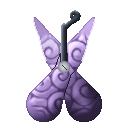
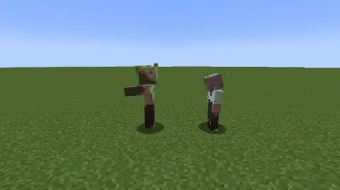
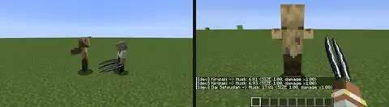
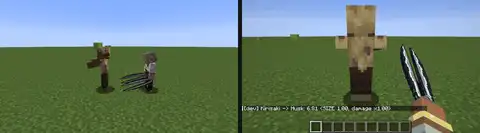
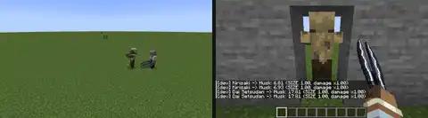
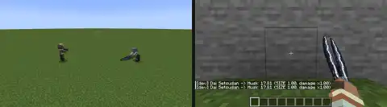
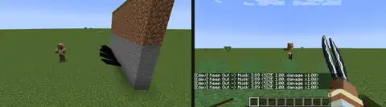
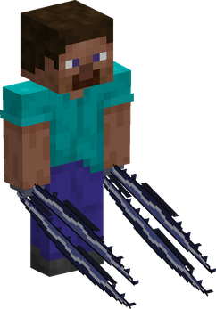

# Choki Choki no Mi

{ .mod-icon }

| | |
|---|---|
| **Type** | Paramecia |
| **Theme** | Scissors |
| **Box** | { .box-icon } Wooden |
| **Chance per opening** | wooden **1.65%** ([how it works](index.md#box-odds)) |
| **Abilities** | 8: 7 active, 1 passive |

In 3D: drag to turn, scroll or pinch to zoom.

<!-- animations -->
??? example "Animations"

    Taken in game, at size 1.

    

    <figure markdown="span">
      { loading=lazy }
      <figcaption>Hasami</figcaption>
    </figure>
    <figure markdown="span">
      { loading=lazy }
      <figcaption>Dai Setsudan</figcaption>
    </figure>
    <figure markdown="span">
      { loading=lazy }
      <figcaption>Kirisaki</figcaption>
    </figure>
    <figure markdown="span">
      { loading=lazy }
      <figcaption>Kirikabe</figcaption>
    </figure>
    <figure markdown="span">
      { loading=lazy }
      <figcaption>Kami Hashi</figcaption>
    </figure>
    <figure markdown="span">
      { loading=lazy }
      <figcaption>Keep Out</figcaption>
    </figure>
    

<!-- /animations -->

Found in the base mod's **wooden Devil Fruit box**. Eat it and its abilities appear in the ability menu, grouped under the fruit.

!!! note "About the values"
    The values are those of the ability's tooltip in game, with the base mod's default settings. Damage is shown on the base mod's scale, as in the ability screen.

## Hasami { #hasami }

{ .ability-icon } *Active · Punch*

{ .form-picture }

Turns the user's hands into giant scissors. Punches cut the enemy, blocks are cut like paper, and the hands count as a sword.

| Stat | Value |
|---|---|
| Damage type | Slash, Fist, Physical |
| Haki | Hardening |
| Cooldown | 1 s |
| Damage | 6 |

## O Kanabashi { #o-kanabashi }

{ .ability-icon } *Active*

While the scissors are active, the user dashes forward and cuts all enemies and blocks near them.

| Stat | Value |
|---|---|
| Damage type | Slash, Physical |
| Haki | Hardening |
| Cooldown | 8 s |
| Damage | 8 |

## Keep Out { #keep-out }

{ .ability-icon } *Active*

While the scissors are active, the user cuts up to 4 pieces of the ground and throws them one by one where they are looking. Harder blocks deal more damage.

| Stat | Value |
|---|---|
| Damage type | Blunt, Projectile |
| Haki | Imbuing |
| Cooldown | 12 s |
| Charge | 0 s |
| Damage | 3–8 |
| Range | 24 blocks (line) |

## Kirikabe { #kirikabe }

{ .ability-icon } *Active*

While the scissors are active, the user cuts the ground under them and raises it as a wall 9 blocks wide and 6 blocks tall. It goes back down after 10 seconds.

| Stat | Value |
|---|---|
| Cooldown | 15 s |
| Charge | 1 s |
| Hold | 10 s |

## Kamikiri { #kamikiri }

{ .ability-icon } *Passive*

While the scissors are active, right clicking a block with an empty hand cuts it instantly. An iron door or trapdoor is picked open instead.

## Dai Setsudan { #dai-setsudan }

{ .ability-icon } *Active*

While the scissors are active, the user closes both blades on the enemy in front of them and deals heavy damage.

| Stat | Value |
|---|---|
| Damage type | Slash, Physical |
| Haki | Hardening |
| Cooldown | 10 s |
| Charge | 0 s |
| Damage | 18 |
| Range | 3.5 blocks (line) |

## Kirisaki { #kirisaki }

{ .ability-icon } *Active*

While the scissors are active, the user cuts open the protections of the enemy in front of them. It loses a big part of its armor for a few seconds.

| Stat | Value |
|---|---|
| Damage type | Slash, Physical |
| Haki | Hardening |
| Cooldown | 12 s |
| Charge | 0 s |
| Damage | 7 |
| Range | 4 blocks (line) |
| Hold | 6 s |
| Target's Armor | x0.4 |

## Kami Hashi { #kami-hashi }

{ .ability-icon } *Active*

While the scissors are active, the user cuts a strip of the ground and unrolls it like paper towards where they are looking. It makes a bridge or a ramp that goes back down after 10 seconds.

| Stat | Value |
|---|---|
| Cooldown | 15 s |
| Charge | 1 s |
| Hold | 10 s |
| Range | 24 blocks (line) |
