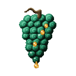
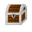
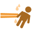

# Gabu Gabu no Mi

{ .mod-icon }

| | |
|---|---|
| **Type** | Paramecia |
| **Theme** | Liquor |
| **Box** | { .box-icon } Wooden |
| **Chance per opening** | wooden **1.88%** ([how it works](index.md#box-odds)) |
| **Abilities** | 6: 5 active, 1 passive |
| **Effects applied** | { .effect-mini }[Drunkenness](../effects.md#effect-drunkenness), { .effect-mini }[Hangover](../effects.md#effect-hangover) |

Found in the base mod's **wooden Devil Fruit box**. Eat it and its abilities appear in the ability menu, grouped under the fruit.

!!! note "About the values"
    The values are those of the ability's tooltip in game, with the base mod's default settings. Damage is shown on the base mod's scale, as in the ability screen.

## Suiken { #gabu-suiken }

{ .ability-icon } *Passive*

The user fists are soaked in liquor, a bare hand blow make the enemy a little drunk

Drunk enemies walk crooked, very drunk they miss some blows and shots and when too drunk they fall asleep until hit. A hangover follow

| Stat | Value |
|---|---|
| Drunkenness | +5 |

## Shugo Roppu { #gabu-shugo-roppu }

{ .ability-icon } *Active*

After a great gulp the user breathes a stream of burning liquor in front of them that burns every enemy it swallows

| Stat | Value |
|---|---|
| Damage type | Indirect |
| Element | Fire |
| Haki | Special |
| Cooldown | 15 s |
| Hold | 2 s |
| Damage | 28 |
| Range | 8 blocks (line) |

## Sake Shibuki { #gabu-sake-shibuki }

{ .ability-icon } *Active*

Applies { .effect-mini }[Drunkenness](../effects.md#effect-drunkenness), { .effect-mini }[Hangover](../effects.md#effect-hangover)

The user spits liquor over the enemies in front of them, they get drunk

| Stat | Value |
|---|---|
| Cooldown | 8 s |
| Range | 6 blocks (line) |
| Drunkenness | +35 |

## Shuki { #gabu-shuki }

{ .ability-icon } *Active*

Applies { .effect-mini }[Drunkenness](../effects.md#effect-drunkenness), { .effect-mini }[Hangover](../effects.md#effect-hangover)

The user breathes a cloud of liquor fumes where they look. Enemies in it get more drunk the longer they stay

| Stat | Value |
|---|---|
| Cooldown | 20 s |
| Range | 3 blocks (area) |
| Cloud | 6 s |
| Drunkenness a Second | +8 |

## Sakedeppo { #gabu-sakedeppo }

{ .ability-icon } *Active*

Applies { .effect-mini }[Drunkenness](../effects.md#effect-drunkenness), { .effect-mini }[Hangover](../effects.md#effect-hangover)

The user shoots a jet of liquor at the enemy they look at, it push them back and make them very drunk

| Stat | Value |
|---|---|
| Damage type | Indirect |
| Haki | Special |
| Cooldown | 12 s |
| Range | 24 blocks (line) |
| Damage | 6 |
| Drunkenness | +50 |

## Tokkuri { #gabu-tokkuri }

{ .ability-icon } *Active*

The user fills the empty glass bottles of their inventory with liquor. A bottle is thrown to make enemies drunk, or drunk while crouching to heal

| Stat | Value |
|---|---|
| Cooldown | 30 s |
| Bottles | 4 |
