# Gasha Gasha no Mi

{ .mod-icon }

| | |
|---|---|
| **Type** | Paramecia |
| **Theme** | Assembly |
| **Box** | { .box-icon } Golden |
| **Chance per opening** | golden **2.32%**, iron **0.116%**, wooden **0.006%** ([how it works](index.md#box-odds)) |
| **Abilities** | 11: 10 active, 1 passive |
| **Transformations** | [Unión Armado](#union-armado), [Blindado](#blindado) |

In 3D: drag to turn, scroll or pinch to zoom.

<!-- animations -->
??? example "Animations"

    

    <figure markdown="span">
      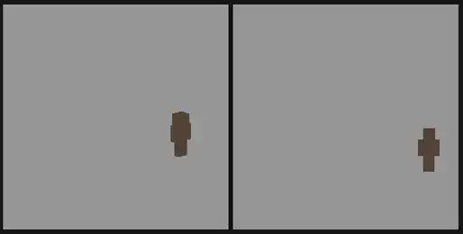{ loading=lazy }
      <figcaption>Union Armado</figcaption>
    </figure>
    <figure markdown="span">
      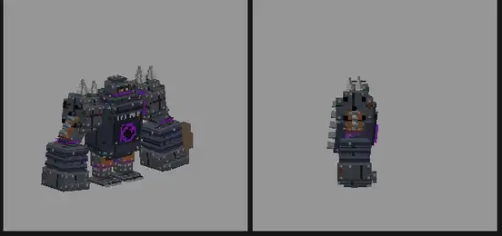{ loading=lazy }
      <figcaption>Ultimate Faust</figcaption>
    </figure>
    <figure markdown="span">
      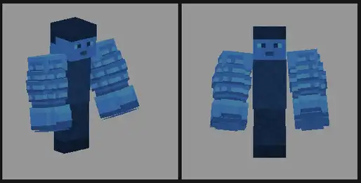{ loading=lazy }
      <figcaption>Det Sterkeste Strike</figcaption>
    </figure>
    <figure markdown="span">
      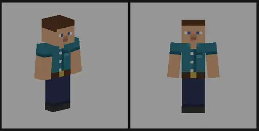{ loading=lazy }
      <figcaption>Torreta</figcaption>
    </figure>
    <figure markdown="span">
      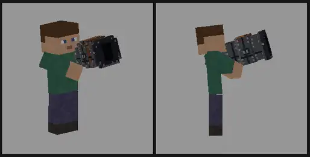{ loading=lazy }
      <figcaption>Cañón Armado</figcaption>
    </figure>
    <figure markdown="span">
      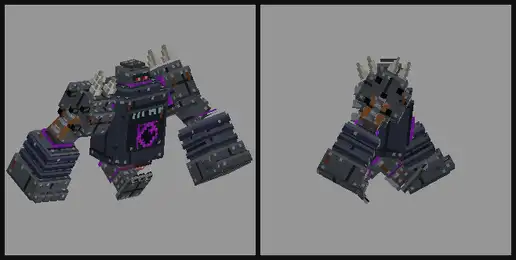{ loading=lazy }
      <figcaption>Mech</figcaption>
    </figure>
    

<!-- /animations -->

Found in the base mod's **golden Devil Fruit box**. Eat it and its abilities appear in the ability menu, grouped under the fruit.

!!! note "About the values"
    The values are those of the ability's tooltip in game, with the base mod's default settings. Damage is shown on the base mod's scale, as in the ability screen.

## Desmontar { #desmontar }

{ .ability-icon } *Active*

Breaks the crafted block or the dropped item the user is looking at into half the ingredients of its recipe, rounded down. A damaged item gives less ingredients

A thing that can be made in more than one way does not come apart

| Stat | Value |
|---|---|
| Cooldown | 2 s |

## Taller { #taller }

{ .ability-icon } *Active*

Opens a crafting table anywhere.

If used while crouching, repairs the item in the user's hand using its material from the inventory, no anvil or experience needed

| Stat | Value |
|---|---|
| Cooldown | 1 s |

## Muralla { #muralla }

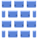{ .ability-icon } *Active*

The user creates a big wall where they are looking at, made from the ground blocks, which sends flying the enemies near it. The wall stops enemies and projectiles and disappears after 10 seconds. Using the ability again brings the wall down

| Stat | Value |
|---|---|
| Cooldown | 12 s |
| Hold | 10 s |

## Cañón Armado { #canon-armado }

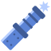{ .ability-icon } *Active*

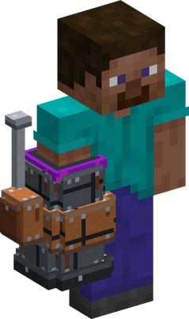{ .form-picture }

Transforms the user's arm into a cannon. While active, holding right click with an empty hand shoots the first ammo found in the inventory, TNT, gunpowder, bullets, cannon balls or arrows

Use the ability again to remove the cannon.

Making the cannon takes metal blocks near the user, or 2 iron ingots from the inventory

| Stat | Value |
|---|---|
| Damage type | Blunt, Projectile |
| Cooldown | 2 s |

## Torreta { #torreta }

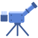{ .ability-icon } *Active*

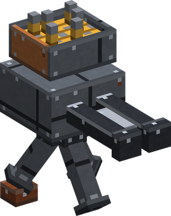{ .form-picture }

Creates a turret where the user is looking at and loads it with up to 32 bullets from the inventory. The turret shoots the closest enemy every second, for 1 minute or until it has no more bullets or is destroyed

The unused bullets are given back to the user. Only one turret can be active.

Building the turret takes metal blocks near the user, or 4 iron ingots and 2 gunpowder from the inventory

| Stat | Value |
|---|---|
| Cooldown | 30 s |

## Soldado { #soldado }

{ .ability-icon } *Active*

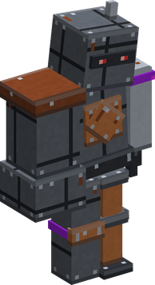{ .form-picture }

Creates a soldier made of scrap in front of the user, that follows them and attacks their enemies for 90 seconds. A broken soldier comes back after 10 seconds as long as the ability is active

Only one soldier can be active

Building the soldier takes metal blocks near the user, or 6 iron ingots and 2 copper ingots from the inventory, each time it comes back too

| Stat | Value |
|---|---|
| Cooldown | 60 s |
| Hold | 90 s |

## Unión Armado { #union-armado }

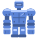{ .ability-icon } *Active · Transformation*

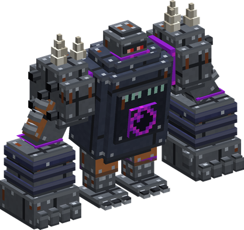{ .form-picture }

The user creates a giant mech around them, increasing the damage and the range of their punches and their armor, but making them slower

The size can be changed before using it, the colossus looks like the ground it was made on, lasts less and has a longer cooldown.

Building the mech takes metal blocks near the user, or 8 iron ingots and 2 copper ingots from the inventory

Unión Armado

| Stat | Value |
|---|---|
| Cooldown | 6–30 s |
| Hold | 60 s |
| Size | x3 |
| Fist Damage | +10 |
| Armor | +8 |
| Unión Armado | Coloso |
| Cooldown | 18–90 s |
| Hold | 30 s |
| Size | x8 |
| Fist Damage | +22 |
| Armor | +14 |

## Ultimate Faust { #ultimate-faust }

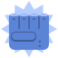{ .ability-icon } *Active*

While in the colossus form, the user pulls back their fist and then smashes it where they are looking, damaging all enemies around the impact and sending them flying

Deals more damage while Busoshoku Haki is active.

Needs Armament Haki mastery

| Stat | Value |
|---|---|
| Damage type | Physical |
| Haki | Hardening |
| Cooldown | 40 s |
| Haki Cost | 400 |
| Charge | 2 s |
| Range | 6 blocks (area) |
| Damage | 80 |

## Blindado { #blindado }

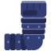{ .ability-icon } *Active · Transformation*

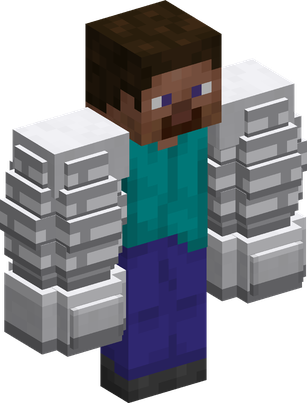{ .form-picture }

The user's arms gets bigger with scrap and Busoshoku Haki, increasing their punch damage, armor and speed

Growing the arms takes metal blocks near the user, or 3 iron ingots from the inventory

Needs Armament Haki mastery

| Stat | Value |
|---|---|
| Haki Cost | 20 per second |

## Det Sterkeste Strike { #det-sterkeste-strike }

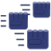{ .ability-icon } *Active*

The user launches 8 fast punches in 2 seconds hitting all enemies in front of them, the last punch sends them flying.

Requires Blindado to be active.

Needs Armament Haki mastery

| Stat | Value |
|---|---|
| Damage type | Physical |
| Haki | Hardening |
| Cooldown | 20 s |
| Haki Cost | 200 |
| Range | 4 blocks (line) |
| Damage | 10 |

## Scrap Parts { #gasha-parts }

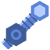{ .ability-icon } *Passive*

Shows the iron ingots, copper ingots and gunpowder the user carries, in green when there are enough metal blocks around them to build for free

Soldado: 6 iron, 2 copper. Torreta: 4 iron, 2 gunpowder. Cañón Armado: 2 iron. Blindado: 3 iron. Unión Armado, the mech or the colossus: 8 iron, 2 copper. Muralla is free
