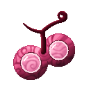
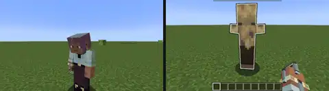
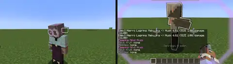
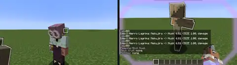
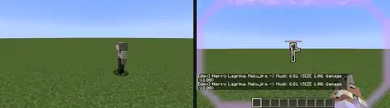
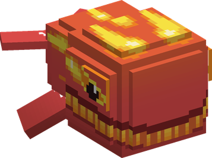

# Giro Giro no Mi

{ .mod-icon }

| | |
|---|---|
| **Type** | Paramecia |
| **Theme** | Glare |
| **Box** | { .box-icon } Wooden |
| **Chance per opening** | wooden **1.65%** ([how it works](index.md#box-odds)) |
| **Abilities** | 5: 4 active, 1 passive |
| **Effects applied** | { .effect-mini }[Giro Sight](../effects.md#effect-giro-sight) |

In 3D: drag to turn, scroll or pinch to zoom.

<!-- animations -->
??? example "Animations"

    Taken in game, at size 1.

    

    <figure markdown="span">
      { loading=lazy }
      <figcaption>Giro Vision</figcaption>
    </figure>
    <figure markdown="span">
      { loading=lazy }
      <figcaption>Senrigan</figcaption>
    </figure>
    <figure markdown="span">
      { loading=lazy }
      <figcaption>Peeping Mind</figcaption>
    </figure>
    <figure markdown="span">
      { loading=lazy }
      <figcaption>Mekujira</figcaption>
    </figure>
    

<!-- /animations -->

Found in the base mod's **wooden Devil Fruit box**. Eat it and its abilities appear in the ability menu, grouped under the fruit.

!!! note "About the values"
    The values are those of the ability's tooltip in game, with the base mod's default settings. Damage is shown on the base mod's scale, as in the ability screen.

## Giro Giro Vision { #giro-vision }

{ .ability-icon } *Active*

The user can see all nearby creatures through walls together with their health. Using it for too long makes the user hungry.

| Stat | Value |
|---|---|
| Cooldown | 2 s |
| Range | 40 blocks (area) |

## Peeping Mind { #peeping-mind }

{ .ability-icon } *Active*

Applies { .effect-mini }[Giro Sight](../effects.md#effect-giro-sight)

The user reads the mind of an enemy, showing its devil fruit, abilities and cooldowns and keeping it visible through walls. If used on an ally, shares the user's vision with them instead. A stronger enemy can shock the user.

| Stat | Value |
|---|---|
| Cooldown | 10 s |
| Range | 3 blocks (line) |
| Hold | 30 s |

## Senrigan { #senrigan }

{ .ability-icon } *Active*

The user sends their sight out very far. Every player and every boss within 4,000 blocks is marked on the screen for a while, with its direction and distance.

| Stat | Value |
|---|---|
| Cooldown | 60 s |
| Range | 4,000 blocks (area) |
| Hold | 15 s |

## Hierro Lagrima: Mekujira { #mekujira }

{ .ability-icon } *Active*

{ .form-picture }

A tear from each of the user's eyes turns into a whale that charges at the enemy the user is looking at.

| Stat | Value |
|---|---|
| Element | Water |
| Haki | Special |
| Cooldown | 10 s |
| Range | 24 blocks (line) |
| Damage | 7–14 |

## Insight { #giro-insight }

{ .ability-icon } *Passive*

The user can see through everything. Invisible creatures nearby are visible to them.

| Stat | Value |
|---|---|
| Range | 32 blocks (area) |
