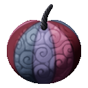

# Gocha Gocha no Mi

{ .mod-icon }

| | |
|---|---|
| **Type** | Paramecia |
| **Theme** | Merging |
| **Box** | { .box-icon } Wooden |
| **Chance per opening** | wooden **1.93%** ([how it works](index.md#box-odds)) |
| **Abilities** | 2: 2 active, 0 passive |
| **Effects applied** | { .effect-mini }[Merged](../effects.md#effect-merged) |

Found in the base mod's **wooden Devil Fruit box**. Eat it and its abilities appear in the ability menu, grouped under the fruit.

!!! note "About the values"
    The values are those of the ability's tooltip in game, with the base mod's default settings. Damage is shown on the base mod's scale, as in the ability screen.

## Gattai { #gocha-gattai }

{ .ability-icon } *Active*

Applies { .effect-mini }[Merged](../effects.md#effect-merged)

The user merges with their own creatures nearby and stays open for a moment. A player who right clicks the user merges too. Up to 4 members, each one makes the giant bigger and stronger and adds their health to it

A merged player sees from the giant and uses their own abilities from it, they get down to leave. Using it again ends the merge and everyone comes out with the same share of health as the giant

When the giant falls nobody dies, everyone comes out with one heart

| Stat | Value |
|---|---|
| Cooldown | 30–120 s |
| Members | 4 |
| Damage per Member | +3 |
| Armor per Member | +2 |

## Great Weapon { #gocha-great-weapon }

{ .ability-icon } *Active*

The giant sweeps everything in front with the weapons of all its members as one huge weapon. Each weapon held by a member and the blow of each merged creature adds to the damage. Only the merged giant can use it

| Stat | Value |
|---|---|
| Damage type | Physical |
| Haki | Imbuing |
| Cooldown | 8 s |
| Damage | 10 |
| Range | 5 blocks (area) |
| Most Damage from Merged Weapons | +30 |
