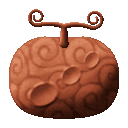
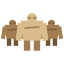
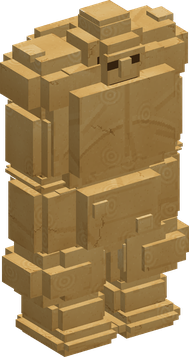
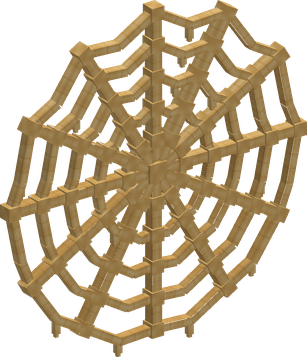
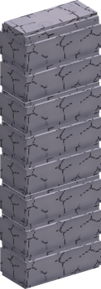
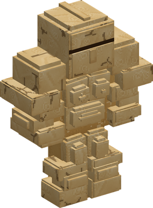
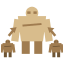

# Gunyo Gunyo no Mi

{ .mod-icon }

| | |
|---|---|
| **Type** | Paramecia |
| **Theme** | Clay |
| **Box** | { .box-icon } Iron |
| **Chance per opening** | iron **1.48%**, wooden **0.074%** ([how it works](index.md#box-odds)) |
| **Abilities** | 9: 9 active, 0 passive |
| **Transformations** | [Clay Armour](#gunyo-clay-armour) |
| **Effects applied** | { .effect-mini }[Buried in Clay](../effects.md#effect-buried-in-clay) |

In 3D: drag to turn, scroll or pinch to zoom.

Found in the base mod's **iron Devil Fruit box**. Eat it and its abilities appear in the ability menu, grouped under the fruit.

!!! note "About the values"
    The values are those of the ability's tooltip in game, with the base mod's default settings. Damage is shown on the base mod's scale, as in the ability screen.

## Golems { #gunyo-golems }

{ .ability-icon } *Active*

{ .form-picture }

The user makes 3 clay golems that follow them and attack their enemies, slow and heavy, their blows throw far. Used again they melt away

A broken golem melts and forms again after 10 seconds, after 20 if the blow had Haki or it stood in water

| Stat | Value |
|---|---|
| Cooldown | 30 s |
| Damage | 10 |

## Nyudo Gunyo { #gunyo-nyudo }

{ .ability-icon } *Active*

A wave of soft clay covers the ground where the user aims. Nobody takes fall damage on it and the feet of enemies sink in, they are very slow and can't jump

Used again the clay goes away

| Stat | Value |
|---|---|
| Cooldown | 20 s |
| Hold | 20 s |
| Range | 7 blocks (area) |

## Gunyo no Su { #gunyo-no-su }

{ .ability-icon } *Active*

{ .form-picture }

A huge web of clay stands where the user aims, the longer they hold the bigger it is. It stops every projectile and holds the enemies that touch it

| Stat | Value |
|---|---|
| Cooldown | 20 s |
| Charge | 3 s |
| Hold | 20 s |

## Clay Weapon { #gunyo-clay-weapon }

{ .ability-icon } *Active*

The user hardens clay into a spiked morning star in their hand. Used again it is put away

The morning star crumbles if it leaves the user's hands

| Stat | Value |
|---|---|
| Cooldown | 2 s |
| Damage | 9 |

## Clay Wall { #gunyo-clay-wall }

{ .ability-icon } *Active*

{ .form-picture }

A wall of clay rises where the user aims, soft then hard. It stops enemies and projectiles

| Stat | Value |
|---|---|
| Cooldown | 15 s |
| Hold | 15 s |

## Bury { #gunyo-bury }

{ .ability-icon } *Active*

Applies { .effect-mini }[Buried in Clay](../effects.md#effect-buried-in-clay)

Soft clay climbs the enemy the user looks at and holds its whole body. It can't move and can't hit

| Stat | Value |
|---|---|
| Cooldown | 12 s |
| Range | 16 blocks (line) |

## Clay Armour { #gunyo-clay-armour }

{ .ability-icon } *Active · Transformation*

{ .form-picture }

The user hardens clay into a heavy armour all over their body until they take it off, they take less damage and hit harder but walk a bit slower

## Clay Bridge { #gunyo-clay-bridge }

{ .ability-icon } *Active*

The user lays a path of hard clay from their feet to where they aim, flat or as stairs if it is higher. It only fills the empty space

The clay crumbles after a while

| Stat | Value |
|---|---|
| Cooldown | 25 s |
| Duration | 20 s |
| Range | 16 blocks (line) |

## Giant Golem { #gunyo-giant-golem }

{ .ability-icon } *Active*

{ .form-picture }

The user's golems merge into one giant golem twice their size, slow and very strong. Used again it splits back into three

The golems must be out. A broken giant melts and the three form again after 20 seconds

| Stat | Value |
|---|---|
| Cooldown | 30 s |
| Golem Health | 240 |
| Golem Damage | 22 |
