# Gunyo Gunyo no Mi

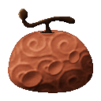{ .mod-icon }

| | |
|---|---|
| **Type** | Paramecia |
| **Theme** | Clay |
| **Box** | { .box-icon } Iron |
| **Chance per opening** | iron **1.33%**, wooden **0.067%** ([how it works](index.md#box-odds)) |
| **Abilities** | 8: 8 active, 0 passive |
| **Transformations** | [Clay Armour](#gunyo-clay-armour) |
| **Effects applied** | 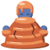{ .effect-mini }[Buried in Clay](../effects.md#effect-buried-in-clay) |

In 3D: drag to turn, scroll or pinch to zoom.

<!-- animations -->
??? example "Animations"

    Taken in game, at size 1, third person.

    

    <figure markdown="span">
      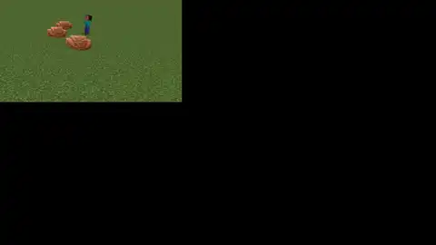{ loading=lazy }
      <figcaption>Golems</figcaption>
    </figure>
    <figure markdown="span">
      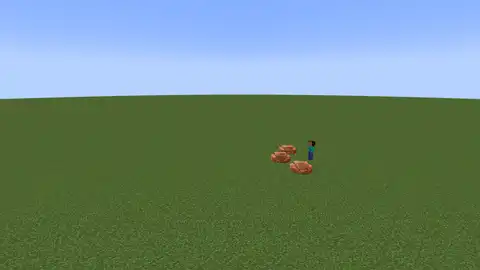{ loading=lazy }
      <figcaption>Golems: Giant Golem (ALT)</figcaption>
    </figure>
    <figure markdown="span">
      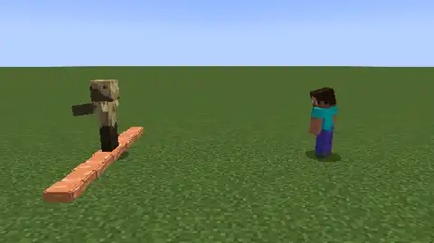{ loading=lazy }
      <figcaption>Clay Wall</figcaption>
    </figure>
    <figure markdown="span">
      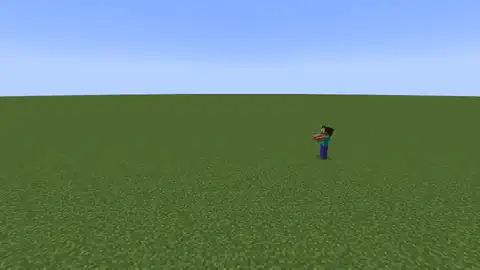{ loading=lazy }
      <figcaption>Clay Bridge, laid upwards</figcaption>
    </figure>
    

<!-- /animations -->

Found in the base mod's **iron Devil Fruit box**. Eat it and its abilities appear in the ability menu, grouped under the fruit.

!!! note "About the values"
    The values are those of the ability's tooltip in game, with the base mod's default settings. Damage is shown on the base mod's scale, as in the ability screen.

## Golems { #gunyo-golems }

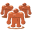{ .ability-icon } *Active*

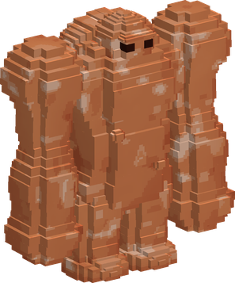{ .form-picture }

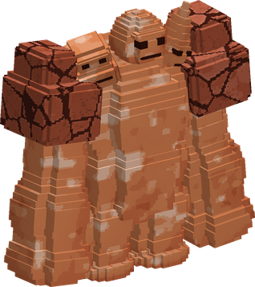{ .form-picture }

Golems, the user makes three clay golems that follow them and attack their enemies, slow and heavy, their blows throw far. A broken golem melts and forms again later, later still if the blow had Haki or it stood in water or rain. Used again they melt away.

With the **Alt key** it is **Giant Golem**: Giant Golem, the golems merge into one giant golem twice their size, slow and very strong. With none out it rises at once from the clay. Switching back splits it into three. A broken giant melts and the three form again later.

| Stat | Golems | Giant Golem |
|---|---|---|
| Cooldown | 30 s | 30 s |
| Golem Health | 80 | 240 |
| Damage | 10 | — |
| Forms Again After | 10 s | 20 s |
| After Haki, Water or Rain | 20 s | — |
| Golem Damage | — | 22 |

## Nyudo Gunyo { #gunyo-nyudo }

{ .ability-icon } *Active*

A wave of soft clay covers the ground where the user aims. Nobody takes fall damage on it and the feet of enemies sink in, they are very slow and can't jump.

Used again the clay goes away.

| Stat | Value |
|---|---|
| Cooldown | 20 s |
| Hold | 20 s |
| Range | 7 blocks (area) |

## Gunyo no Su { #gunyo-no-su }

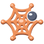{ .ability-icon } *Active*

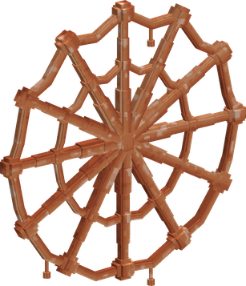{ .form-picture }

A web of clay stands before the user where they aim, the longer they charge it the bigger it is. Pressed again it stands. It stops every projectile and holds the enemies that touch it, until the user uses it again or goes too far from it.

| Stat | Value |
|---|---|
| Cooldown | 20 s |
| Charge | 1 s |
| Hold | ∞ s |
| Range | 6 blocks (line) |
| Web Width | 3–9 blocks |
| Holds | 3 s |

## Clay Weapon { #gunyo-clay-weapon }

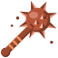{ .ability-icon } *Active*

The user hardens clay into a spiked morning star in their hand. Used again it is put away.

The morning star crumbles if it leaves the user's hands.

| Stat | Value |
|---|---|
| Cooldown | 2 s |
| Damage | 9 |

## Clay Wall { #gunyo-clay-wall }

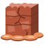{ .ability-icon } *Active*

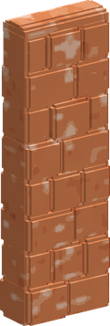{ .form-picture }

A wall of clay rises where the user aims, soft then hard. It stops enemies and projectiles. Using the ability again brings the wall down.

| Stat | Value |
|---|---|
| Cooldown | 15 s |
| Hold | 15 s |

## Bury { #gunyo-bury }

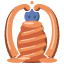{ .ability-icon } *Active*

Applies { .effect-mini }[Buried in Clay](../effects.md#effect-buried-in-clay)

Soft clay climbs the enemy the user looks at and holds its whole body. It can't move and can't hit.

| Stat | Value |
|---|---|
| Cooldown | 12 s |
| Range | 16 blocks (line) |
| Holds | 3 s |

## Clay Armour { #gunyo-clay-armour }

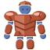{ .ability-icon } *Active · Transformation*

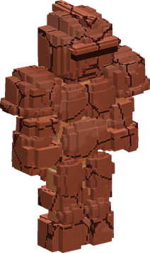{ .form-picture }

The user hardens clay into a heavy armour all over their body until they take it off.

## Clay Bridge { #gunyo-clay-bridge }

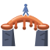{ .ability-icon } *Active*

The user lays a path of hard clay from their feet the way they look, flat or as stairs going up or down. It only fills the empty space.

Using the ability again brings the path down.

| Stat | Value |
|---|---|
| Cooldown | 25 s |
| Hold | ∞ s |
| Range | 16 blocks (line) |
