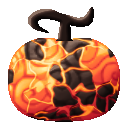
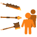
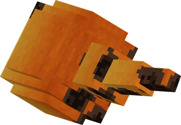
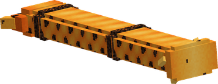
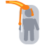
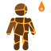

# Gutsu Gutsu no Mi

{ .mod-icon }

| | |
|---|---|
| **Type** | Paramecia |
| **Theme** | Furnace |
| **Box** | { .box-icon } Iron |
| **Chance per opening** | iron **1.37%**, wooden **0.069%** ([how it works](index.md#box-odds)) |
| **Abilities** | 9: 8 active, 1 passive |
| **Transformations** | [Metal Coat](#metal-coat), [Overfed](#overfed) |
| **Effects applied** | { .effect-mini }[Cased in Metal](../effects.md#effect-cased-in-metal) |

In 3D: drag to turn, scroll or pinch to zoom.

Found in the base mod's **iron Devil Fruit box**. Eat it and its abilities appear in the ability menu, grouped under the fruit.

!!! note "About the values"
    The values are those of the ability's tooltip in game, with the base mod's default settings. Damage is shown on the base mod's scale, as in the ability screen.

## Furnace { #furnace }

{ .ability-icon } *Passive*

The user's body is a furnace, the metal they eat is stored inside them, up to 64 ingots, and every ability of the fruit spends it. The best metal eaten decides what their metal is made of

The user is immune to fire and lava

## Smelt { #smelt }

{ .ability-icon } *Active*

The user eats up to 8 pieces of metal from their inventory, the one in their hand first. It can be ore, raw metal, ingots, nuggets or blocks of iron, gold, copper or black metal. It fills their furnace

| Stat | Value |
|---|---|
| Cooldown | 1 s |

## Forge { #forge }

{ .ability-icon } *Active*

The user pulls a glowing weapon out of their body, it can be a blade, a maul, a spear or a gun that fires molten metal. The weapon is chosen before it is forged

Forged weapons are made of the best metal in the furnace, set what they strike on fire, and melt after 90 seconds or when dropped. Arm the Crew hands out the weapon chosen here

The weapon is a **Forged Blade**, a **Forged Maul**, a **Forged Spear** or a **Forged Gun**, in the metal the furnace holds (iron, gold or copper). What it strikes burns. It takes no wear and no enchantment, melts after 90 seconds, and at once if it is dropped. The gun fires 6 balls of molten metal, then it is spent.

| Stat | Value |
|---|---|
| Cooldown | 10 s |
| Metal Spent | 3 |

## Arm the Crew { #arm-the-crew }

{ .ability-icon } *Active*

The user forges a weapon for each ally around them who has no forged weapon yet, as long as the furnace has metal for it. It is the weapon chosen in Forge, but a creature that can't shoot gets a blade instead of a gun. These weapons melt as the user's own do

| Stat | Value |
|---|---|
| Cooldown | 30 s |
| Metal Spent | 2 |
| Range | 10 blocks (area) |

## Molten Shot { #molten-shot }

{ .ability-icon } *Active*

{ .form-picture }

The user spits a ball of molten metal. It damages what it hits and sets it on fire

With the **Alt key** it is **Molten Sphere**: the user spits a big, slow sphere of molten metal. It bursts where it lands, and every enemy around takes damage and catches fire

| Stat | Molten Shot | Molten Sphere |
|---|---|---|
| Damage type | Projectile | Projectile |
| Haki | Special | Special |
| Cooldown | 3.5 s | 12 s |
| Charge | 0.1 s | 0.3 s |
| Damage | 14 | 26 |
| Range |  | 3 blocks (area) |
| Metal Spent | 1 | 4 |

## Molten Stream { #molten-stream }

{ .ability-icon } *Active*

{ .form-picture }

The user pours a wide stream of molten metal where they are looking, enemies in it are burned and set on fire. It spends metal for as long as it flows

Use the ability again to stop it

While Overfed, the stream is a torrent, half again as wide and as strong

| Stat | Value |
|---|---|
| Damage type | Indirect |
| Haki | Special |
| Cooldown | 12 s |
| Hold | 5 s |
| Damage | 57 |
| Range | 10 blocks (line) |
| Metal Spent | 9.5 |

## Metal Casing { #metal-casing }

{ .ability-icon } *Active*

Applies { .effect-mini }[Cased in Metal](../effects.md#effect-cased-in-metal)

The user pours molten metal over the enemy they are looking at. It burns them and sets around them, and they can't move or attack. The casing lasts less on players and bosses, and breaks if it takes enough damage

With the **Alt key** it is **Heat Metal**: the metal armour of the enemy the user is looking at heats up. Each piece of iron, chain, gold or netherite burns them every second, and the steam blinds them for a moment

| Stat | Metal Casing | Heat Metal |
|---|---|---|
| Cooldown | 25 s | 15 s |
| Charge | 0.25 s |  |
| Damage | 8 | 20 |
| Hold | 3–8 s | 5 s |
| Range | 12 blocks (line) | 12 blocks (line) |
| Casing Health | 25 |  |
| Metal Spent | 4 | 2 |

## Metal Coat { #metal-coat }

{ .ability-icon } *Active · Transformation*

The user covers their whole body with the metal of their furnace, becoming much tougher and harder to push, but heavier and slower

| Stat | Value |
|---|---|
| Metal Spent | 6 |

## Overfed { #overfed }

{ .ability-icon } *Active · Transformation*

With at least 32 ingots in the furnace the user's body swells, they are bigger, much stronger and harder to push. They are so hot that enemies close to them are burned, ice and snow melt and what can burn catches fire. The fuller the furnace, the hotter and the further

The furnace burns its metal for as long as the form lasts, and the form ends when it is empty. Molten Stream becomes a torrent

| Stat | Value |
|---|---|
| Haki | Special |
| Metal Needed | 32 |
| Metal Burned per Second | 0.5 |
| Heat Damage per Second | 2–4 |
| Heat Range | 3.5–5 blocks (area) |
