# Hebi Hebi no Mi, Model: Anaconda

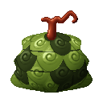{ .mod-icon }

| | |
|---|---|
| **Type** | Zoan |
| **Box** | { .box-icon } Iron |
| **Chance per opening** | iron **1.48%**, wooden **0.074%** ([how it works](index.md#box-odds)) |
| **Abilities** | 7: 7 active, 0 passive |
| **Transformations** | [Anaconda Heavy Point](#anaconda-heavy-point), [Anaconda Walk Point](#anaconda-walk-point) |
| **Effects applied** | 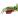{ .effect-mini }[Anaconda Digesting](../effects.md#effect-anaconda-digesting), 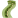{ .effect-mini }[Anaconda Dodge](../effects.md#effect-anaconda-dodge), 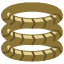{ .effect-mini }[Coiled](../effects.md#effect-coiled) |

<!-- animations -->
??? example "Animations"

    

    <figure markdown="span">
      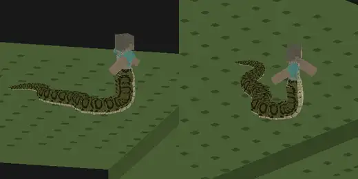{ loading=lazy }
      <figcaption>Hybrid: crawl</figcaption>
    </figure>
    <figure markdown="span">
      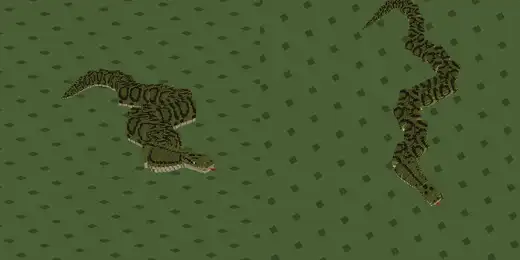{ loading=lazy }
      <figcaption>Anaconda: crawl</figcaption>
    </figure>
    <figure markdown="span">
      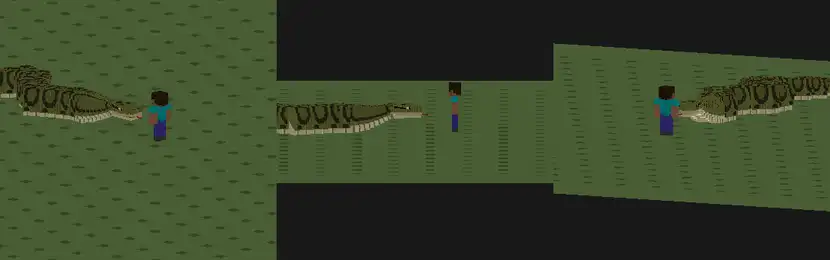{ loading=lazy }
      <figcaption>Heavy Slam</figcaption>
    </figure>
    <figure markdown="span">
      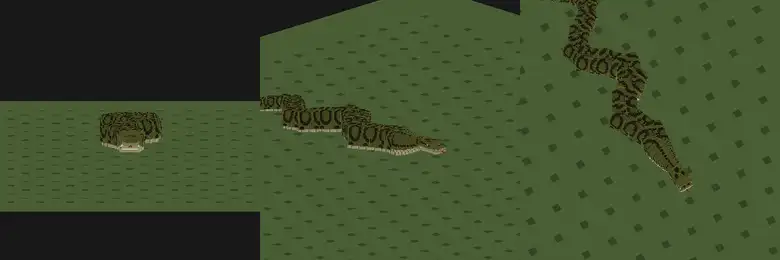{ loading=lazy }
      <figcaption>Snake Dance</figcaption>
    </figure>
    <figure markdown="span">
      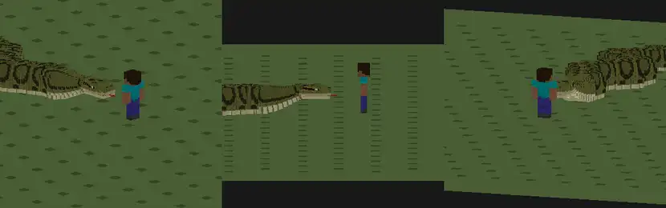{ loading=lazy }
      <figcaption>Shimetsuke</figcaption>
    </figure>
    <figure markdown="span">
      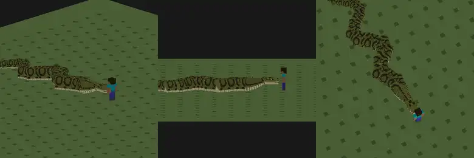{ loading=lazy }
      <figcaption>Kamiyose</figcaption>
    </figure>
    <figure markdown="span">
      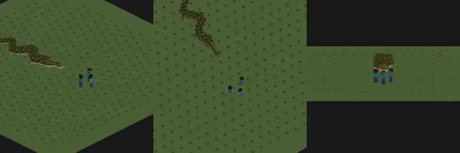{ loading=lazy }
      <figcaption>Daija Shime</figcaption>
    </figure>
    

<!-- /animations -->

Found in the base mod's **iron Devil Fruit box**. Eat it and its abilities appear in the ability menu, grouped under the fruit.

!!! note "About the values"
    The values are those of the ability's tooltip in game, with the base mod's default settings. Damage is shown on the base mod's scale, as in the ability screen.

## Anaconda Heavy Point { #anaconda-heavy-point }

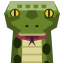{ .ability-icon } *Active · Transformation*

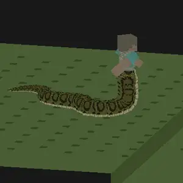{ .form-picture }

Transforms the user into a half-snake, their upper body on a long and heavy anaconda tail that gives their blows reach.

## Anaconda Walk Point { #anaconda-walk-point }

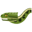{ .ability-icon } *Active · Transformation*

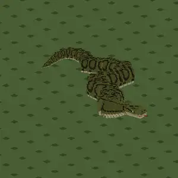{ .form-picture }

Transforms the user into a huge anaconda, fourteen blocks long and very heavy.

## Heavy Slam { #heavy-slam }

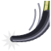{ .ability-icon } *Active*

Applies { .effect-mini }[Coiled](../effects.md#effect-coiled)

The user hardens their tail with Armament Haki, wraps it round the enemy in front of them, lifts it and slams it head first into the ground. Needs Armament Haki hardening unlocked

Needs Armament Haki mastery

| Stat | Value |
|---|---|
| Damage type | Physical |
| Haki | Hardening |
| Cooldown | 14 s |
| Haki Cost | 80 |
| Damage | 24 |
| Reach | 5–6.3  blocks |
| Stunned | 1 s |

## Snake Dance { #snake-dance }

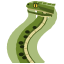{ .ability-icon } *Active*

Applies { .effect-mini }[Anaconda Dodge](../effects.md#effect-anaconda-dodge)

The user reads the blows with Observation Haki and sways their body like a dance, so every blow and projectile misses them for a while. Explosions still hit. Needs Observation Haki unlocked

Needs Observation Haki mastery

| Stat | Value |
|---|---|
| Cooldown | 18 s |
| Haki Cost | 100 |
| Dodging | 4 s |

## Shimetsuke { #shimetsuke }

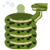{ .ability-icon } *Active*

Applies { .effect-mini }[Coiled](../effects.md#effect-coiled)

The user winds their long body round the enemy in front of them and slowly chokes it. Every time it moves or strikes the coils tighten and it runs out of breath. Only a strong blow on the user makes them let go. Use the ability again to let it go

| Stat | Value |
|---|---|
| Damage type | Physical |
| Haki | Hardening |
| Cooldown | 24 s |
| Held | 8 s |
| Damage | 20 |
| Damage per Struggle | 2 |
| Blow to Break Free | 8 |
| Reach | 4–5.4  blocks |

## Kamiyose { #kamiyose }

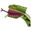{ .ability-icon } *Active*

Applies { .effect-mini }[Anaconda Digesting](../effects.md#effect-anaconda-digesting)

The user uses their jaws, press the Alt key to switch between the two

With Kamiyose the user bites the enemy in front of them and pulls it against their body. A hold put on it right after lasts longer

With Marunomi the anaconda swallows a small creature whole, heals and digests it slowly, then its loot comes out. Not players, bosses, tamed or named creatures

| Stat | Value |
|---|---|
| Damage type | Physical |
| Haki | Hardening |
| Cooldown | 8–30 s |
| Damage | 9 |
| Reach | 3–3.6  blocks |
| Held | 1 s |
| Healed | 8 |
| Digesting | 15 s |

## Daija Shime { #daija-shime }

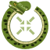{ .ability-icon } *Active*

Applies { .effect-mini }[Coiled](../effects.md#effect-coiled)

The user coils their body into a huge ring around them, then tightens it more and more. The enemies inside cant get out and get crushed together in the middle

| Stat | Value |
|---|---|
| Damage type | Physical |
| Haki | Hardening |
| Cooldown | 40 s |
| Damage | 30 |
| Range | 4–7 blocks (area) |
| Hold | 4 s |
